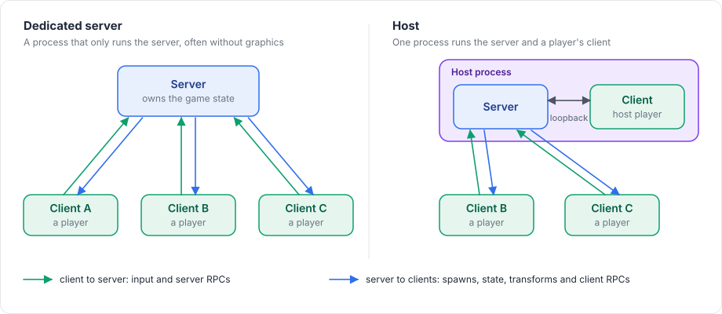

# Fomoxa for Unity

Fomoxa for Unity (`com.fomoxa.networking`) is a server-authoritative networking package for Unity games. It is built on the Fomoxa protocol and its C# runtime, Fomoxa.Net. A game declares the data it sends as plain C# classes, the package generates their codecs, and components such as `NetworkManager`, `NetworkObject` and `NetworkBehaviour` handle connections, spawning, RPCs, state, transforms and client-side prediction.

<figure><figcaption>
A game runs either a dedicated server or a host. Clients send input and requests; the server sends back what happens.
</figcaption></figure>

| | |
|---|---|
| Package | `com.fomoxa.networking` 0.2.0 |
| Unity | 6000.5 or later |
| License | Apache-2.0 |
| Bundled code generator | `fomoxac` v0.2.2, Windows x64 and Linux x64 |

## Where to start

| If you want to | Read |
|---|---|
| Know what the package does and does not do | [Introduction](getting-started/introduction.md) |
| Add the package to a project | [Installation](getting-started/installation.md) |
| Build a small multiplayer game step by step | [Tutorial](getting-started/tutorial/README.md) |
| Understand how the package works underneath | [Learn the basics](concepts/architecture.md) |
| Add one feature, with working code | The guides under Connections, Network objects, Messaging, Synchronization, Prediction and Physics |
| Take an existing game online | The [Red Runner example](examples/redrunner/README.md), which ports a single-player platformer in nine steps |
| Look up one type or member | The [reference](reference/api.md) |
| Fix something that does not work | [Troubleshooting](getting-started/troubleshooting.md) |
| Upgrade from 0.1.0 | [Release notes](release-notes.md) |
| Run many servers behind one address | [Cluster](deploy/cluster.md) |

## What the package covers

The package connects peers over UDP, TCP or WebSocket, and one server can listen on several transports at once. UDP can be encrypted, WebGL clients can send the same encrypted datagrams over WebSocket, and native clients can use TLS on TCP and WebSocket. A server can authenticate a peer before it starts, kick it with a reason, or transfer it to another server. Host mode joins the host player's client to the server through an in-process connection instead of a socket.

Network objects are spawned from prefabs or placed in scenes. Each one can have an owner, and a visibility that differs per peer. Clients call the server and the server calls clients through RPCs declared with attributes. Each behaviour can keep a state that is sent with delta encoding, `NetworkTransform` sends transforms with interpolation and teleport, and `NetworkAnimator` sends the Animator's parameters. Network scenes can be loaded for everyone or for selected peers.

The package also offers client-side prediction with input, reconciliation and replay, including rollback of Unity 3D and 2D physics. WebGL clients connect through the browser's WebSocket.

The [introduction](getting-started/introduction.md#what-is-not-included) lists what the package does not do.

## Beyond Unity's physics and Unity servers

Two optional parts build on the package once a game works in Unity. [Rapier physics](rapier/overview.md) is a separate package that replaces Unity's physics with Rapier, so that rollback replays the server's physics exactly. The [console server](console-server/overview.md) runs a game's server as a .NET program without Unity. The rest of this documentation does not depend on either of them, and the second part of the [Red Runner example](examples/redrunner/rapier-and-console/README.md) uses both.
