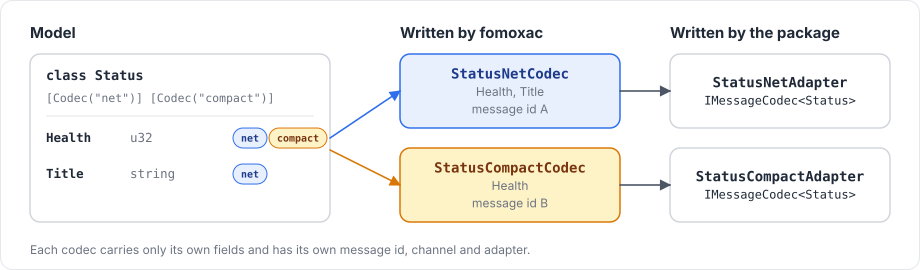

# Custom codecs and Unity types

## Several codecs for one model

A model can declare several codecs, each carrying a subset of its properties. Since each codec has its own message id and adapter, the same class can be sent in a full form and in a compact form:

```csharp
[Network]
[Codec("net")]
[Codec("compact")]
public class Status
{
    [Network("u32")]
    [Codec("net")]
    [Codec("compact")]
    public uint Health { get; set; }

    [Network("string")]
    [Codec("net")]
    public string Title { get; set; }
}
```

<figure><figcaption><p>The two codecs of Status and their adapters.</p></figcaption></figure>

`StatusCompactAdapter` encodes only `Health`, and decoding with it leaves `Title` unchanged. Each codec can also have its own channel, declared with `[NetworkChannel("compact", Channel.ReliableOrdered)]`. [Models and codecs](../messaging/models.md) describes the attributes.

## Unity types

Model properties can use `Vector2`, `Vector3`, `Vector4`, `Vector2Int`, `Vector3Int`, `Quaternion`, `Color`, `Color32` and `Rect` directly. For each of these types that a model uses, the package writes a small codec named `<Type><Codec>Codec` into `<Generated Folder>/UnityCodecs/`, which writes the type's fields one after another:

| Type | Fields |
|---|---|
| `Vector2` | `x`, `y` as `f32` |
| `Vector3` | `x`, `y`, `z` as `f32` |
| `Vector4`, `Quaternion` | `x`, `y`, `z`, `w` as `f32` |
| `Vector2Int` | `x`, `y` as `i32` |
| `Vector3Int` | `x`, `y`, `z` as `i32` |
| `Color` | `r`, `g`, `b`, `a` as `f32` |
| `Color32` | `r`, `g`, `b`, `a` as `u8` |
| `Rect` | `x`, `y`, `width`, `height` as `f32` |

Arrays of these types, such as `Array<Vector3>`, do not compile. Use separate properties instead, or wrap the type as the property of a model and send an `Array<Model>`.

## Adding your own value types

A struct whose settable fields or properties are of scalar types can be used the same way, once it is registered with `FomoxaUnityTypes.Register` in the Editor. Register it from an Editor script that runs when the Editor loads, so that the registration happens before generation:

```csharp
using Fomoxa.Unity.Editor;
using UnityEditor;

[InitializeOnLoad]
internal static class GameWireTypes
{
    static GameWireTypes()
    {
        FomoxaUnityTypes.Register(
            "GridCell",
            "MyGame.GridCell",
            new FomoxaUnityField("X", "i16"),
            new FomoxaUnityField("Y", "i16"));
    }
}
```

```csharp
namespace MyGame
{
    public struct GridCell
    {
        public short X;
        public short Y;
    }
}
```

A model can then declare `[Network("GridCell")]` on a `GridCell` property. The first argument of `Register` is the name used in `[Network("...")]` and the second the full C# type name, and each field pairs a member name with a wire type among `bool`, `i8` to `u64`, `f32` and `f64`. Registering a name again replaces its earlier layout, and this applies to the built-in types too.

Put the script in an `Editor` folder, and keep the type in an assembly that the generated code can reference.

## Hand-written codecs

`IMessageCodec<T>` is a public interface, but every message id must be part of the generated schema, because the dispatcher rejects handlers for ids outside it and the handshake compares schemas. Write models instead and let the package generate their adapters.

[Models and codecs](../messaging/models.md) covers models in general, and [editor integration](editor-integration.md) describes the generation step that writes these codecs.
