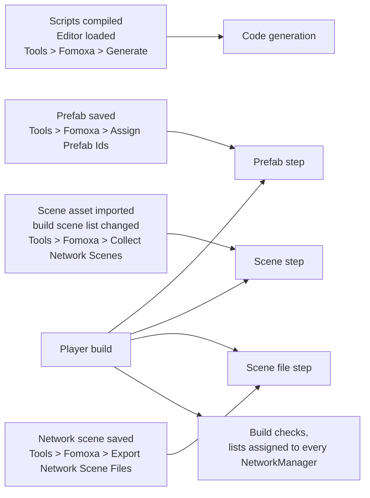

# Editor integration

The package's Editor assembly generates code, assigns prefab, scene and scene object ids, writes a scene file for each network scene, and checks the project before a build. This page lists what runs when and which files each step writes.

## Settings

Each project has one `FomoxaSettings` asset, created with Assets > Create > Fomoxa > Settings:

| Field | Default | Meaning |
|---|---|---|
| Models Folder | `Assets/Models` | Where your model classes are |
| Generated Folder | `Assets/Generated` | Where generated code and assets go |

The generated namespace is named after the last folder of Generated Folder.

## Menu

| Menu item | Runs |
|---|---|
| Tools > Fomoxa > Generate | Code generation |
| Tools > Fomoxa > Assign Prefab Ids | The prefab step |
| Tools > Fomoxa > Collect Network Scenes | The scene step |
| Tools > Fomoxa > Export Network Scene Files | The scene file step for every network scene |
| Assets > Create > Fomoxa > Settings | Creates the settings asset |
| Assets > Create > Fomoxa > Distance Rule | Creates a [`DistanceRule`](../objects/observers.md#distancerule) asset |

## Code generation

Generation runs after every script compilation, when the Editor loads, and from the menu, but never while Play Mode is starting or running. It goes through these steps:

1. Copy the package's system models into `FomoxaSystemModels/` at the project root.
2. Write an empty model for every parameterless RPC into `<Generated Folder>/RpcModels/`.
3. Write `fomoxa.toml` from the settings.
4. Run the bundled `fomoxac generate` in the project root. It reads the Models Folder, `FomoxaSystemModels` and `RpcModels`, and writes the codecs, `NetSchema.cs`, `Handshake.cs` and `Runtime.cs` into the Generated Folder, and its schema files into `.fomoxa/`.
5. Write codecs for the Unity types the models use into `<Generated Folder>/UnityCodecs/`, and `.fomoxa/schema.inspect.json`, a copy of the schema with those types described for inspection tools.
6. Write an adapter for every codec, `<Model><Codec>Adapter.cs`.
7. Write `FomoxaAdapters.cs`, which registers the schema, every system adapter, every declared channel and every RPC id, and `FomoxaUnityRegistration.cs`, which calls it when the player starts.
8. Run the prefab and scene steps if their outputs do not exist yet.

Every file the package writes starts with a marker comment. The package refuses to overwrite a file without the marker, and deletes files with the marker that are no longer needed.

Errors and warnings appear in the Console with the prefix `[Fomoxa]`, and [troubleshooting](../getting-started/troubleshooting.md#code-generation-fails) explains each of them.

## RPC source generator

`Runtime/Core/Generators/Fomoxa.Networking.Generators.dll` is a Roslyn source generator that Unity runs for every assembly referencing `Fomoxa.Networking`. It writes the registration of `[ServerRpc]` and `[ClientRpc]` methods into each `partial` behaviour and reports the errors `FOMOXA001` to `FOMOXA010`, which are listed in [RPCs](../messaging/rpc.md#compile-errors).

## Prefab step

The prefab step runs when a prefab is imported or saved in the Editor, from the menu, and before every player build, but not on imports in batch mode.

For every prefab under `Assets` that has a `NetworkObject`, the step assigns the prefab id from the asset GUID unless Explicit Prefab Id is on, and clears any scene object id on the prefab asset. It checks that the `NetworkObject` is on the root, that there is no nested `NetworkObject`, that there are at most 256 `NetworkBehaviour` components, and that the id is neither 0 nor used by another prefab.

The step writes `<Generated Folder>/FomoxaPrefabList.asset` and `<Generated Folder>/FomoxaPrefabs.cs`. Its errors are logged, and during a build they fail the build.

## Scene step

The scene step runs when a scene asset is imported, when the Build Profiles scene list changes, from the menu, and before every player build.

It computes the scene id of every scene under `Assets` from its GUID and checks that no id is 0 or repeated. It then writes `<Generated Folder>/FomoxaSceneList.asset` with the scenes of the build list and their scene files, and `<Generated Folder>/FomoxaScenes.cs` with a constant for every scene.

To fix a scene id of 0 or a repeated id, recreate one of the scene assets, which gives it a new GUID.

## Scene files

A scene file, `<Generated Folder>/<scene id>.fomoxascene`, describes a network scene in a form that does not need Unity: its scene objects with their poses, behaviours and bodies, its static colliders, and the 3D and 2D layer collision matrices. It is encoded with the codec of the package's `SceneFile` system model, so it is only readable together with the schema it was generated with.

The scene file step writes the file of a network scene when you save that scene, and for every network scene from the menu. Before a player build it writes the files that are missing, older than their scene or no longer readable, and it deletes the files of scenes that are no longer network scenes. Unity imports each file as a `TextAsset`, and the scene list references it, so builds include it. `RigidbodyPhysics` does not read scene files.

A scene whose objects or colliders cannot be described, for example because a scene object has no scene object id yet, logs an error and keeps its previous file.

## Scene object ids

When a scene is saved, every `NetworkObject` in it that lacks a unique scene object id gets one, made by combining the scene id with an id local to the scene.

In Play Mode, a scene object without a valid id gets a temporary one, and the package warns `scene objects without a unique scene object id got one for this Play Mode session only; save the scene so every build uses the same ids`. In a build, a missing or repeated id fails the build.

## Build checks

Before a player build, the package runs the prefab, scene and scene file steps and fails the build on their errors. It checks that the generated model of every parameterless RPC is present and current and that `FomoxaAdapters.cs` registers it, and fails with `run Tools > Fomoxa > Generate and commit the generated files` otherwise.

It then assigns the generated prefab list and scene list to every `NetworkManager` in the built scenes, the prefab list only where the manager's Collect Prefabs is on, and checks the scene object ids of every built scene. The same assignment runs for each scene when you enter Play Mode, but after the managers' `Awake`, so it has no effect in that session; [NetworkManager](../connections/network-manager.md#prefab-and-scene-lists) explains why the lists also belong in the scene.

## Files to commit

| Path | Commit |
|---|---|
| `FomoxaSettings` asset | Yes |
| `fomoxa.toml` | Yes |
| `FomoxaSystemModels/` | Yes |
| `.fomoxa/` | Yes |
| Generated Folder, with `RpcModels/`, `UnityCodecs/` and the scene files | Yes |

Committing these files lets a fresh clone or a build machine compile without running the generator first.

## Platforms

The `fomoxac` binary is bundled for the Windows x64 and Linux x64 Editors. On other Editor platforms generation fails, but a project whose generated files are committed still compiles and builds.

[Installation](../getting-started/installation.md) walks through the first generation, [models and codecs](../messaging/models.md) describes what is generated from your models, and [spawning](../objects/spawning.md) and [network scenes](../objects/scenes.md) explain how the ids are used at run time.
