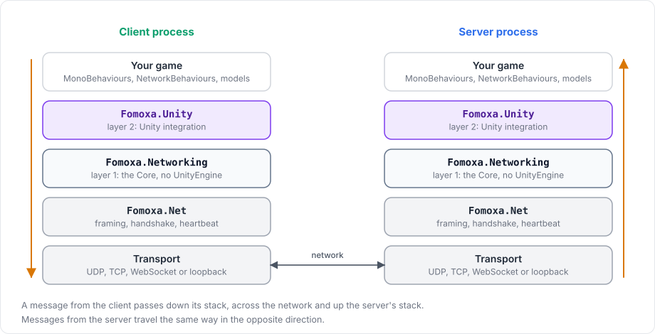

# How the package is built

The package is built in layers, and each layer uses only the layers below it. Layer 1, the Core, knows nothing about Unity. Layer 2 connects the Core to Unity's GameObjects, scenes, player loop and physics. Knowing which layer does what helps you find the right type, and explains why most networking rules behave the same whether Unity, a test or a console server drives them.

<figure><figcaption>
Both ends of a connection have the same layers. A host has both stacks in one process.
</figcaption></figure>

## Assemblies

| Assembly | Folder | References UnityEngine | Contents |
|---|---|---|---|
| `Fomoxa.Net` | `Runtime/Plugins/Fomoxa.Net.dll` | No | The Fomoxa protocol runtime: frames, handshake, heartbeat, `Schema`, TCP and UDP transports |
| `Fomoxa.Attributes` | `Runtime/Plugins/Fomoxa.Attributes.dll` | No | `[Network]` and `[Codec]`, in namespace `Fomoxa` |
| `Fomoxa.Networking` | `Runtime/Core` | No | Layer 1, plus the RPC source generator in `Runtime/Core/Generators` |
| `Fomoxa.Unity` | `Runtime/Unity` | Yes | Layer 2 |
| `Fomoxa.Unity.Editor` | `Editor` | Yes, Editor only | Code generation, prefab and scene id steps, scene files, build checks |

Your game code references `Fomoxa.Unity` for the components and `Fomoxa.Networking` for types such as `NetworkState`, `ConnectionState` and the RPC attributes.

## Layer 1: Fomoxa.Networking

Layer 1 holds everything that can work without Unity. Its assembly definition sets `noEngineReferences`, so the compiler rejects any use of `UnityEngine` inside it, and vectors and quaternions in its API are `System.Numerics` types.

| Area | Namespace | What it does |
|---|---|---|
| Managers | `Fomoxa.Networking` | `ServerManager`, `ClientManager` and `TimeManager`, the order of work in one tick, `FomoxaRegistry`, the RPC and channel attributes, and the registration types `NetworkRpcs`, `NetworkState` and `NetworkInput` |
| Messaging | `Fomoxa.Networking.Messaging` | Message ids, `IMessageCodec<T>`, message bundles, the reliable-ordered channel, the dispatcher that routes a message id to a handler, delta encoding, the package's system models |
| Sessions | `Fomoxa.Networking.Sessions` | Client and server sessions: connection states, send queues and their limits, flushing, reconnection, connection events |
| Objects | `Fomoxa.Networking.Objects` | The object table, spawn, despawn and owner messages, observer sets, network scenes per peer |
| Timing | `Fomoxa.Networking.Timing` | The client's estimate of the server tick and of the prediction tick, ping and pong |
| Prediction | `Fomoxa.Networking.Prediction` | The server's input buffers per object and peer, and the client's prediction, reconciliation and replay |
| Simulation | `Fomoxa.Networking.Simulation` | The physics interfaces `IPhysicsSimulation`, `IPhysicsWorld` and `IPhysicsWorld2D`, `PhysicsBody`, `PhysicsHistory` and contact tracking |
| Transports | `Fomoxa.Networking.Transports` | `ITransportFactory`, non-blocking connectors, the WebSocket protocol, loopback, combined listeners |

The networking decisions are made in layer 1: spawning, ownership, routing RPCs and state, deciding who observes what, and deciding when to send a transform. A `NetworkBehaviour` forwards its callbacks and registrations to a layer 1 behaviour, so the rules are the same whatever drives them.

Layer 1 writes its warnings and errors through a `NetworkLog` that layer 2 gives it, and layer 2 sends them to the Unity Console.

## Layer 2: Fomoxa.Unity

Layer 2 connects layer 1 to Unity. `NetworkManager` reads its Inspector fields, builds layer 1 from them and runs it from Unity's player loop. `TransportManager`, `NetworkObject` and `NetworkBehaviour` belong to this layer, and so do the `NetworkTransform` and `NetworkAnimator` components.

The prefab and scene registries, scene loading and the observer rule assets are in layer 2 as well. So are the `RigidbodyPhysics` component with the `Rigidbody` and `Rigidbody2D` worlds, the contact event components, and the transport components, including the browser WebSocket for WebGL.

## Generated code

Your code works together with code that the package generates in your project. The package's own messages, such as spawn and transform messages, are models too: the package copies them into the project's `FomoxaSystemModels` folder and generates them together with yours. Every message the game sends therefore belongs to one schema, which the client and the server compare during the handshake.

<figure><figcaption>
How models become codecs and reach a NetworkManager.
</figcaption></figure>

[Installation](../getting-started/installation.md#how-code-generation-works) walks through one generation, and [editor integration](../advanced/editor-integration.md) lists every generated file.

## Why the split

Layer 1 does not depend on Unity, so it can be compiled and tested outside Unity, and the [console server](../console-server/overview.md) runs it without Unity at all. Physics follows the same split: game code uses the interfaces and `PhysicsBody` from layer 1, and the Unity worlds implement them in layer 2, as [physics architecture](../physics/architecture.md) explains.

The next pages build on this one. [Server, clients and messages](networking-model.md) describes what travels between the layers, and [ticks and timing](tick.md) describes when.
