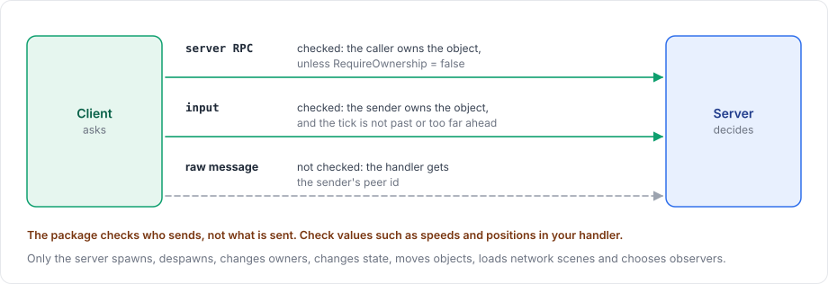

# Authority

The package is server-authoritative. The server holds the real game state and is the only side that can change what other players see. A client can only ask for a change, and the server decides whether it happens. A cheating client can therefore send bad requests, but it cannot change the world directly.

<figure><figcaption>
The three ways a client can reach the server, and what the package checks on each.
</figcaption></figure>

## What only the server does

Only the server spawns and despawns network objects and changes their owners. Calling `ServerManager.Spawn` on a process that is not running a server throws `the server is not started`.

State models and [collections](../synchronization/collections.md) change on the server and flow to clients, never the other way. Changing a spawned collection on a client throws. The same holds for movement: `NetworkTransform` sends the server's transform to clients and does not send a client's transform changes, and only the server's `NetworkAnimator` parameters reach other players.

The server also loads and unloads network scenes, and decides which clients observe which objects.

## What a client can send

| Path | Checked by the package | Guide |
|---|---|---|
| Server RPC | The caller must own the object, unless the RPC sets `RequireOwnership = false`. Calls from other peers are dropped with a warning. | [RPCs](../messaging/rpc.md) |
| Input for a predicted object | The sender must own the object. Input from other peers is dropped with a warning. Input for ticks that are already past, or too far ahead, is dropped and counted. | [Input](../prediction/input.md) |
| Raw message | Not checked. The handler receives the sender's peer id and must validate the content. | [Raw messages](../messaging/messages.md) |

The package checks who may send, but not whether the content is reasonable, such as a speed or a position. Validate arguments in the RPC or input handler on the server.

## Ownership is not authority

An owner is the peer that an object belongs to, as a player character belongs to its player. Ownership lets that client call the object's server RPCs, and if the object has an input model, the owner also predicts it. The server still runs the object, and corrects the owner's prediction when it differs from the server's own result. [Ownership](../objects/ownership.md) describes how owners are assigned and changed.

## Prediction stays server-authoritative

With prediction, the owner applies its own input at once instead of waiting for the server. The server applies the same input when it arrives and sends its result back. If the two results differ, the client restores the server's result and replays its newer input on top of it. Whatever the client predicted, the server's result is the one that stays. [Prediction](prediction.md) explains the loop in more detail.

For how the server's decisions reach clients, see [server, clients and messages](networking-model.md) and [replication](replication.md).
