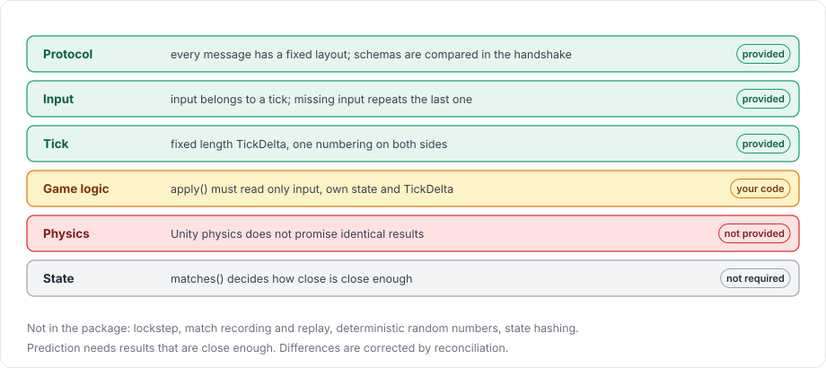

# Deterministic simulation

A simulation is deterministic when the same starting state and the same input always produce the same result. Networked games rely on determinism to different degrees depending on the feature. The package provides some levels of it and not others, and this page sorts out which is which.

<figure><figcaption>
Which levels of determinism the package provides.
</figcaption></figure>

A lockstep game needs every level to hold bit for bit on every platform. Client-side prediction, which is what this package implements, only needs them to hold closely enough that corrections are rare.

## What the package provides

| Property | Status in the package |
|---|---|
| Deterministic protocol | Every message has a fixed layout given by the generated schema, and the client and the server compare schemas during the handshake. |
| Deterministic input | Input is tied to a tick. The server applies the input of tick N at its tick N. When the input for a tick is missing, it repeats the last input and marks it with `InputContext.Repeated`. |
| Deterministic tick | Ticks have a fixed length, `TimeManager.TickDelta`, and the client and the server number them on the same scale. Replays use the same tick length. |
| Deterministic game logic | Your responsibility. The package calls `apply` with the same input on both sides, but cannot check what `apply` reads. |
| Deterministic physics | Not provided. The package steps Unity's physics engines, which do not promise identical results across machines. |
| Deterministic state | Not required. The reconcile `matches` function decides how close the client's state must be to the server's. |

## Prediction does not need bit-exact results

The client compares its predicted state with the server's state for the same tick. When they differ, it restores the server's state and replays its newer input, so a small difference costs one correction and the game stays in sync. By default the comparison is exact on the encoded bytes; for floating-point values, pass a `matches` function with tolerances, as shown in [reconciliation](../prediction/reconciliation.md).

To keep corrections rare, `apply` should read only the input it receives, the behaviour's own state (which the reconcile model captures and restores) and `TimeManager.TickDelta`. Reading other objects, `Time.deltaTime`, unseeded random numbers, or data that only one side has makes the two sides differ, and reconciliation then corrects the difference every time it happens. `NetworkBehaviour.ReconcileCount` counts the corrections of a behaviour, which helps you track down such a dependency.

## Physics is approximate

With physics simulation on, the client saves the state of each physics world every tick and loads it again to roll back. A saved state contains the position, rotation, velocity, angular velocity and sleep state of each dynamic body, but not the physics engine's contact data, so a replay that starts from a loaded state can differ from the original run. [Rollback with physics](../prediction/rollback.md) goes into the details. The optional [Rapier physics](../rapier/overview.md) backend saves whole worlds, contacts included, so its replays give the same ticks as the first run.

## Not implemented

Some features need a level of determinism that the package does not provide, and the package does not include them. There is no lockstep simulation, no deterministic random number generator, and no state hashing to detect divergence. A match cannot be recorded and replayed later either. Wherever this documentation says replay, it means applying input again during reconciliation.

For more on the pieces this page relies on, see [prediction](prediction.md), [ticks and timing](tick.md) and the [physics overview](../physics/overview.md).
