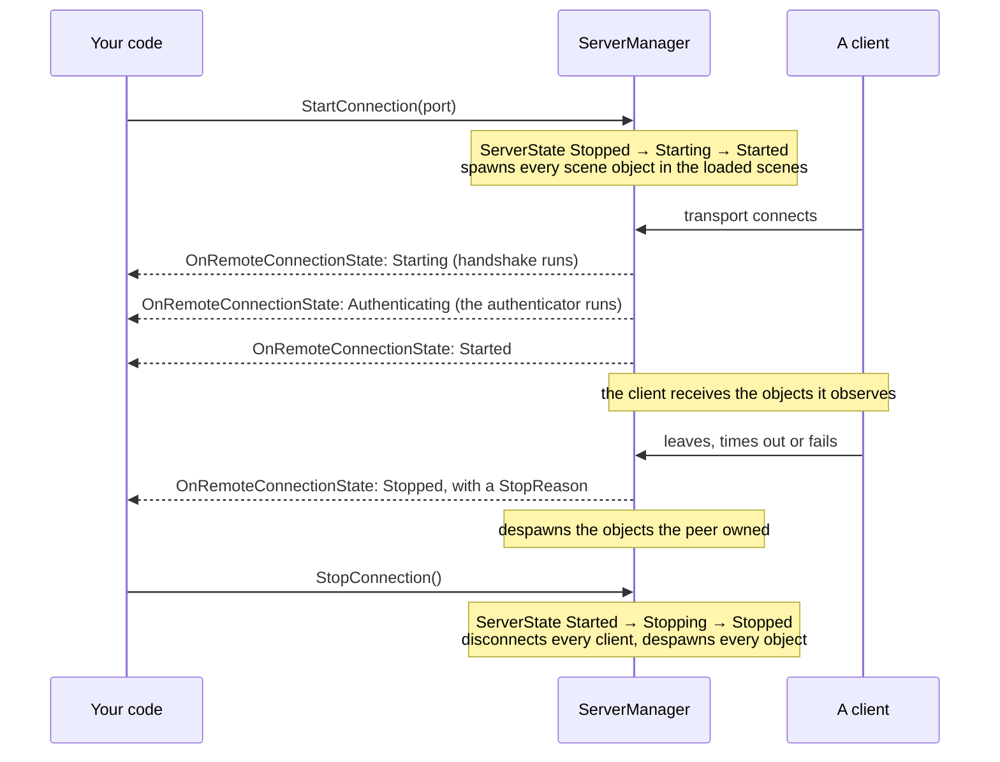
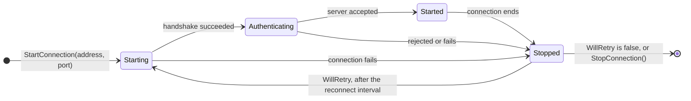
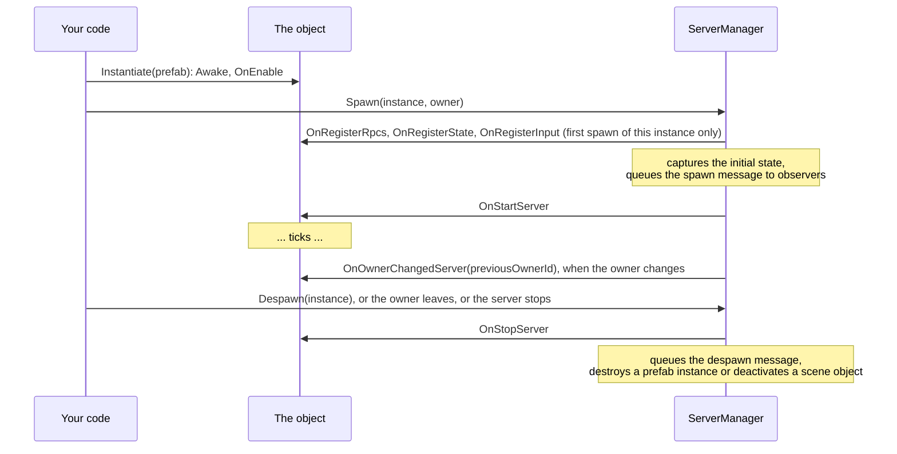
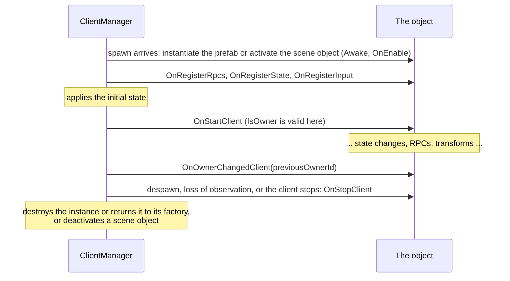

# Lifecycle

This page gives the order of events for the `NetworkManager`, for connections and for network objects. Use it to decide where a piece of your code belongs: in `Awake`, in `OnStartServer`, in a connection event or in `OnStopClient`.

## NetworkManager

| Unity message | What the manager does |
|---|---|
| `Awake` | Reads the registered schema and codecs, registers the prefabs of Collected Prefabs and Prefabs, registers the scenes of Collected Scenes, creates the transport factory and the `ServerManager`, `ClientManager`, `TimeManager` and `TransportManager`. Throws if the generated registration has not run. |
| `OnEnable` | Adds its entries to the player loop. |
| `OnDisable` | Removes them. No ticks run, nothing is received or sent. |
| `OnDestroy` | Stops the client and the server, and releases the physics simulation. |

The manager also stops both connections when the application quits.

Because the managers are created in `Awake`, other components can rely on them from `Start` on. In their own `Awake` the managers may not exist yet.

## Server

## Client

`OnClientConnectionState` reports each change. When the client reaches `Started`, the scene objects in its loaded scenes are deactivated until the server spawns them. Objects then spawn, change and despawn. When the connection stops, every object is despawned on the client before `OnClientConnectionState` reports `Stopped`, and `ConnectionStateArgs.WillRetry` tells whether the client starts again after the reconnect interval. A [transfer](../connections/transfer.md) to another server raises `OnTransferring` first, while the objects still exist, and the client then starts again at once at the new address.

## Network objects

### On the server

The spawn message contains the state captured before `OnStartServer`, so set the initial state before calling `Spawn`. A change made in `OnStartServer` reaches clients only with the next tick's state update.

Destroying a spawned `GameObject` on the server despawns it.

### On a client

`NetworkBehaviour.NetworkObject` is set when the object spawns, so in `Awake` of a freshly instantiated prefab it is still null.

If a client destroys a spawned `GameObject` without a despawn from the server, the object is removed from the client's objects and a warning is logged.

### In host mode

In host mode the server and the host's client share one instance. That instance gets `OnStartServer` when the server spawns it and `OnStartClient` when the host's client receives it. On despawn, `OnStopClient` runs before `OnStopServer`. [Host mode](../connections/host-mode.md) covers the consequences for your code.

The callbacks themselves are described in [NetworkBehaviour](../objects/network-behaviour.md) and listed in [events and callbacks](../reference/callbacks.md). [Server, clients and messages](networking-model.md) explains the connection states in more depth.
