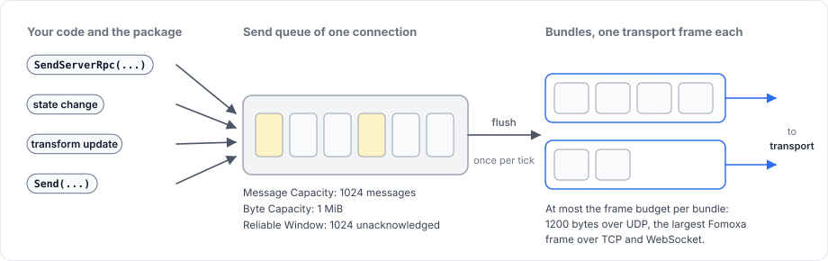
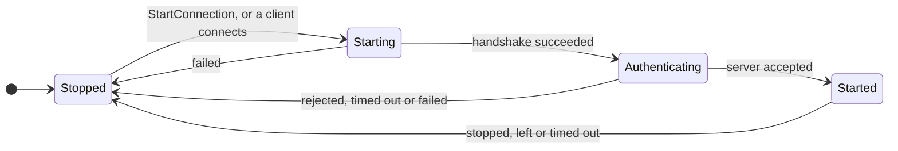
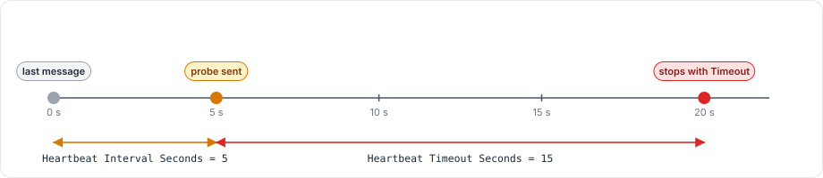

# Server, clients and messages

This page describes who talks to whom, what a message is, and how messages are queued, packed and kept alive on a connection.

## Server and peers

A game has one server and any number of clients. The server owns the game state and decides what happens. Clients send requests and input and show what the server sends back. A host is a server and a client running in one process.

The server gives every connected client a peer id, a `ulong` that is never 0, because peer id 0 means "no peer". An object with owner 0 therefore belongs to the server. A client has only one remote side, the server, so events that carry a peer id report 0 on a client.

## Messages are models

Everything the package sends is a model: a C# class marked with `[Network]` and `[Codec]` whose codec `fomoxac` generates. This holds for the package's own messages, such as spawn, despawn, state and transform messages, and for your RPC arguments, state and input.

Each pair of a model and a codec has a message id, and the generated `NetSchema` lists every message id together with a fingerprint of its layout. During the handshake, Fomoxa.Net compares the client's schema with the server's. If they disagree, it refuses the connection with `HandshakeFailure.SchemaConflict`, so the client and the server must be built from the same models. [Models and codecs](../messaging/models.md) covers how to declare them.

## Three kinds of message

| Kind | Addressed to | Examples | Guide |
|---|---|---|---|
| System message | The package on the other side | Spawn, despawn, owner change, clock ping, acknowledgements | Not used directly |
| Object message | One `NetworkBehaviour` of one `NetworkObject` | RPCs, state, transform updates, input | [RPCs](../messaging/rpc.md), [State](../synchronization/state.md) |
| Plain message | A handler registered for its message id | Game messages sent with `ClientManager.Send` | [Raw messages](../messaging/messages.md) |

An object message carries a 5-byte header in front of the model: the 4-byte object id and the 1-byte behaviour index of the target component.

## Channels

Each message id has a channel.

- `Unreliable`, the default, lets a message be lost or arrive out of order relative to other messages.
- `ReliableOrdered` delivers a message exactly once, in the order it was sent relative to every other reliable message of the same connection. Each reliable message carries a 2-byte sequence number, the receiver acknowledges it, and the sender sends it again until the acknowledgement arrives.

A model declares its channel with `[NetworkChannel]`, as described in [channels and reliability](../messaging/channels.md).

## Send queue and bundles

A send does not write to the network at once. It adds the message to the connection's send queue and returns a `SendResult`. The `NetworkManager` flushes the queues later: once per tick in the Tick timing mode, or once at the end of each frame in the Variable timing mode.

<figure><figcaption>
Messages wait in a queue per connection and leave in bundles.
</figcaption></figure>

A flush packs the queued messages into bundles. Each bundle is one transport frame and holds as many messages as fit in the transport's frame budget: 1200 bytes for UDP, and the largest Fomoxa frame for TCP and WebSocket. Several small messages therefore travel in a single datagram, and a reliable message larger than the budget is split across several bundles (see [message size](../messaging/channels.md#message-size)).

The queue of each connection has limits, which you set on the `NetworkManager`:

| Field | Default | Meaning |
|---|---|---|
| Message Capacity | 1024 | Messages waiting in one queue |
| Byte Capacity | 1 MiB | Bytes waiting in one queue |
| Reliable Window | 1024 | Reliable messages sent and not yet acknowledged |

A send that would exceed one of the first two limits is not queued, and returns `SendResult.Full` or `SendResult.BytesFull`. The package's own object messages, such as spawns, are exempt from those two limits. Reliable messages beyond the window wait in the queue until acknowledgements arrive.

## Connections

A connection goes through four states, which `ConnectionState` reports:

`Starting` covers the transport connection and the Fomoxa handshake. In `Authenticating`, the server's [authenticator](../connections/authentication.md) decides whether to let the client in, and only the authenticator's messages flow; without an authenticator the server lets the client in at once. `Started` means messages flow. The server itself has a separate state, `ServerState`, which goes from `Stopped` through `Starting`, `Started` and `Stopping` back to `Stopped`.

### Silent connections

Fomoxa.Net watches every connection for silence. When nothing has arrived for **Heartbeat Interval Seconds**, it sends a probe. When the probe gets no answer within **Heartbeat Timeout Seconds**, the connection stops with `StopReason.Timeout`.

<figure><figcaption>
With the defaults, a peer that vanishes is removed about 20 seconds after its last message.
</figcaption></figure>

A client that disappears without closing, such as a crashed process, is therefore removed about 20 seconds after its last message. A client that stops normally sends a leave message first, and the server removes it at once.

## Related pages

[How the package is built](architecture.md) shows the layers these messages pass through, [ticks and timing](tick.md) explains when they are received and sent, [lifecycle](lifecycle.md) gives the order of connection events, and [errors and stop reasons](../reference/errors.md) lists every way a connection can stop.
