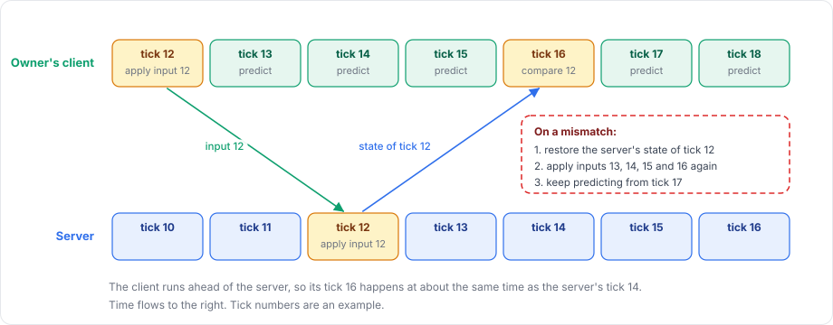

# Prediction

Without prediction, a client sees the result of its own input one round trip later, because the input has to travel to the server, be applied there and travel back. With a round trip of 100 ms, that is three ticks at 30 ticks per second.

Client-side prediction removes that delay for the objects a client owns. The client applies its input at once, and corrects itself when the server's result turns out different.

## The loop

<figure><figcaption>
One input on its way to the server and back. The client keeps predicting while it waits.
</figcaption></figure>

1. The owner's client gathers input for its prediction tick.
2. The client applies the input at once and records the result for that tick.
3. The server applies the same input when its own tick reaches that number.
4. The server sends its result for that tick to the owner.
5. The client compares the server's result with its record of the same tick.
6. On a mismatch, the client restores the server's result and applies its recorded input again for every later tick.

## Terms that are often confused

| Term | Where it runs | What it is |
|---|---|---|
| Server simulation | Server | The server applies each client's input at the tick it belongs to. Its result is the authoritative state. |
| Client prediction | Owner's client | The client applies its own input before the server confirms it. |
| Authoritative state | Server, sent to the owner | The server's result for one tick, captured with the reconcile model. |
| Reconciliation | Owner's client | Comparing the authoritative state with the prediction for the same tick, and correcting a mismatch by rolling back and replaying. |
| Interpolation | Every client, for objects it does not predict | Showing remote objects between two received positions, a few ticks in the past. It does not guess the future and does not use input. |

Prediction and interpolation apply to different objects. A client predicts the objects that it owns and that have an input model, and interpolates all other objects through `NetworkTransform`. An object that stops being predicted, for example after an owner change, goes back to interpolation.

## Requirements

Prediction needs the `NetworkManager` to use the Tick timing mode, and the object needs a `NetworkBehaviour` that registers an input model with `NetworkInput.Use`. To predict, the behaviour also needs a reconcile model; without one, the client only sends input.

The `apply` callback must compute the same result on the server and on the client from the same input and the same starting state. In practice it reads only the input, the behaviour's own state and `TimeManager.TickDelta`. The results do not have to be bit-exact: a `matches` function decides what counts as close enough, and small differences are corrected, as [deterministic simulation](deterministic-simulation.md) explains.

## Guides

The [prediction overview](../prediction/overview.md) builds a complete predicted character. [Input](../prediction/input.md) covers gathering, sending and applying input, [reconciliation](../prediction/reconciliation.md) covers capturing, restoring, comparing and replaying, and [rollback with physics](../prediction/rollback.md) shows how Unity physics worlds are rolled back.
