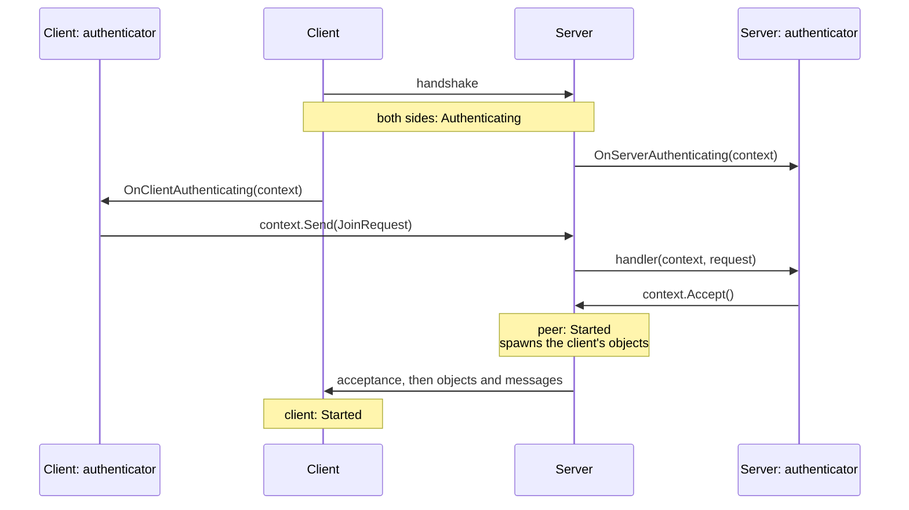

# Authentication

An authenticator decides whether a client may join. After the Fomoxa handshake, the server holds each new connection until your authenticator accepts or rejects it. Use it to check a password or a ticket from your login service before the client receives any objects or game messages.

Without an authenticator, the server lets every client in as soon as the handshake succeeds.

## How it works

A connection goes through `Authenticating` between `Starting` and `Started`, on the server and on the client:



While a connection is `Authenticating`, only the models that the authenticator registered cross it, in either direction, along with the package's own acknowledgement and fragment messages and the server's close notice. Messages that your game code sends before `Started`, on either side, wait in the send queue and go out once the connection has started. Sends from the authenticator have a separate queue with the same Message Capacity and Byte Capacity.

When the server accepts, the peer becomes `Started`. The server sends what the authenticator still has queued, then the acceptance and the client's objects, then the messages your code queued for the peer. The client becomes `Started` when the acceptance arrives.

## Declare a model

The authenticator's messages are ordinary [models](../messaging/models.md). Make them `ReliableOrdered`, because an unreliable message that gets lost leaves the client waiting until the authentication times out.

```csharp
[Network]
[Codec("net")]
[NetworkChannel("net", Channel.ReliableOrdered)]
public class JoinRequest
{
    [Network("string")]
    [Codec("net")]
    public string RoomCode { get; set; }
}
```

A model registered on the authenticator is handled only by the authenticator. Its message id cannot also have a handler on a `Dispatcher`; registering both throws `HandlerRegistrationException`. Once the connection has started, the model is treated as a message without a handler.

## Write an authenticator

In Unity, derive a component from `NetworkAuthenticator` and override the methods you need. This one lets in clients that know the room code:

```csharp
using Fomoxa.Networking;
using Fomoxa.Unity;
using Generated;
using MyGame.Network.Models;
using UnityEngine;

public sealed class RoomCodeAuthenticator : NetworkAuthenticator
{
    [SerializeField] private string roomCode;

    public string EnteredCode { get; set; }

    private static JoinRequestNetAdapter Codec => JoinRequestNetAdapter.Instance;

    public override void RegisterServer(ServerAuthentication server) =>
        server.On(Codec, OnJoinRequest);

    public override void OnClientAuthenticating(ClientAuthenticationContext context) =>
        context.Send(Codec, new JoinRequest { RoomCode = EnteredCode });

    private void OnJoinRequest(ServerAuthenticationContext context, JoinRequest request)
    {
        if (request.RoomCode == roomCode)
        {
            context.Accept();
        }
        else
        {
            context.Reject();
        }
    }
}
```

| Method | Side | Called |
|---|---|---|
| `RegisterServer(ServerAuthentication server)` | Server | Once, when the authenticator is assigned. Register the models the client sends with `server.On(codec, handler)`. |
| `OnServerAuthenticating(ServerAuthenticationContext context)` | Server | When a peer becomes `Authenticating` |
| `RegisterClient(ClientAuthentication client)` | Client | Once, when the authenticator is assigned. Register the models the server sends with `client.On(codec, handler)`. |
| `OnClientAuthenticating(ClientAuthenticationContext context)` | Client | When the client becomes `Authenticating` |

Each connection's authentication has its own context. The server passes the peer's context to `OnServerAuthenticating` and to every handler for a message from that peer, so the handler knows which peer sent it.

| Member | Context | Purpose |
|---|---|---|
| `PeerId` | Server | The peer being authenticated |
| `Send(codec, value)` | Both | Sends a model to the other side; returns a `SendResult` |
| `Accept()` | Server | Lets the peer in; returns true |
| `Reject()` | Server | Closes the peer's connection with a reason; returns true |
| `CancellationToken` | Both | Cancelled when this authentication ends, for any reason |

## Add it to the NetworkManager

Add the component to a GameObject and assign it to the **Authenticator** field of the `NetworkManager`. The same component serves the server and the client, so server and client builds can share one scene setup. In [host mode](host-mode.md) the host's own client goes through the authenticator too.

The manager assigns the authenticator in `Awake`. To assign one from code, set `ServerManager.Authenticator` and `ClientManager.Authenticator` while that side is stopped; setting it while running throws `InvalidOperationException`. Setting null removes it. An exception from `RegisterServer` or `RegisterClient` comes out of the assignment, and the manager is left without an authenticator.

## Reject and time out

`Reject()` closes the connection the way [`Kick`](server.md#peers) does. The peer stops with `StopReason.AuthenticationFailed`. The client stops with `ServerClosed` and a `CloseReason` of `AuthenticationFailed`, and it does not reconnect. To tell the player more, for example that the room is full, send your own authenticator model first; it arrives before the close.

The server gives each connection **Authentication Timeout Seconds** (30 by default) to be accepted. When the time runs out, the server closes the connection the same way, with `AuthenticationTimeout` as both the stop reason and the close reason. 0 turns the limit off.

## Asynchronous checks

If the check takes time, such as a request to your login service, accept or reject when the answer comes and pass `context.CancellationToken` to the request. The package cancels the token when the authentication ends: after an accept, a reject or a timeout, when the connection drops, or when the server or the client stops.

You do not have to rely on the token for safety. A context whose authentication has ended stays harmless: `Send` returns `NotConnected`, and `Accept` and `Reject` return false. Only a mistake throws: calling `Send`, `Accept` or `Reject` on a context that was already accepted throws `InvalidOperationException`. Like every package member, these calls belong on Unity's [main thread](../reference/network-manager.md#threading).

## Messages outside the authentication

The package never breaks these rules by itself, so a break usually means that the client and the server were built from different versions of your authenticator.

- When a client sends anything other than the authenticator's models while it is `Authenticating`, the server closes its connection at once, without a close notice, and the peer stops with `UnauthenticatedMessage`. A leave message counts too.
- When the server sends a client anything other than the authenticator's models or the acceptance, the client stops with `UnauthenticatedMessage` and does not reconnect.

A client that stops while `Authenticating` closes its connection without a leave message, so the server sees the peer stop with `PeerClosed` over TCP and WebSocket, or with `Timeout` over UDP.

## Errors

An exception thrown from `OnServerAuthenticating`, `OnClientAuthenticating` or one of the authenticator's handlers counts as a [handler exception](server.md#errors-in-handlers). `OnHandlerException` carries message id 0 when the exception came from `OnServerAuthenticating` or `OnClientAuthenticating`, and the model's message id when it came from a handler. On the server, the peer is closed with `HandlerException`; on the client, the client stops with `HandlerException`.

An exception thrown by a callback you registered on the `CancellationToken` is reported the same way. When it happens while the connection is being accepted, the connection then stops with `HandlerException`. When the connection is already ending for another reason, the package only raises `OnHandlerException`, and the connection stops with its original reason.

## Without Unity

A [console server](../console-server/overview.md) has no `NetworkAuthenticator` component. Implement `IServerAuthenticator` from `Fomoxa.Networking` and assign it to `ServerManager.Authenticator` before starting the server. `IClientAuthenticator` is the client counterpart; `NetworkAuthenticator` implements both.
