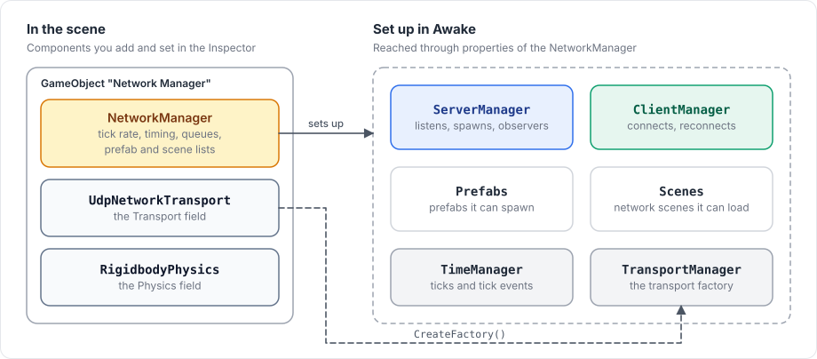
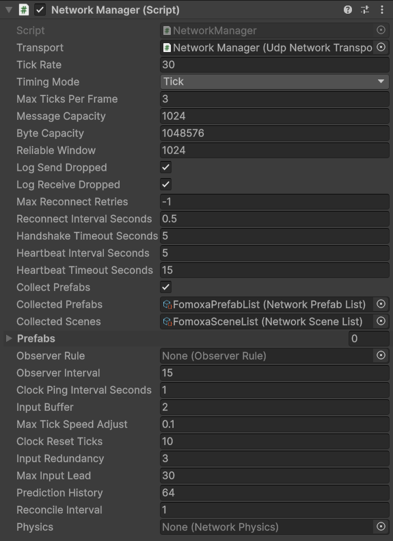

# NetworkManager

`NetworkManager` is the component that runs networking for a scene. It holds the configuration, runs ticks inside Unity's player loop, and owns the server, the client and the clock of that scene.

<figure><figcaption><p>The components you add, and the objects the manager sets up from them.</p></figcaption></figure>

The package has no static access to a manager. Keep a reference to it, for example in a serialized field, and reach the server and the client through that reference.

## Add a NetworkManager

1. Create an empty GameObject and name it `Network Manager`.
2. Add a transport component, such as `UdpNetworkTransport`.
3. Add `NetworkManager` and drag the transport into its **Transport** field.
4. Drag the generated `FomoxaPrefabList.asset` into **Collected Prefabs** and `FomoxaSceneList.asset` into **Collected Scenes**. [Prefab and scene lists](#prefab-and-scene-lists) explains why.

Then start it from code:

```csharp
manager.ServerManager.StartConnection(7777);
manager.ClientManager.StartConnection("127.0.0.1", 7777);
```

Calling both methods on the same manager makes it a [host](host-mode.md).

## What the manager owns

| Property | Type | Purpose |
|---|---|---|
| `ServerManager` | [`ServerManager`](server.md) | Starts and stops the server, spawns objects, observers, network scenes |
| `ClientManager` | [`ClientManager`](client.md) | Connects to a server, reconnects, the client's spawned objects |
| `TimeManager` | [`TimeManager`](../reference/time-manager.md) | Tick rate, tick numbers, tick events |
| `TransportManager` | `TransportManager` | The transport component and the factory created from it |
| `Prefabs` | `PrefabRegistry` | Prefabs the manager can spawn; see [spawning](../objects/spawning.md) |
| `Scenes` | `SceneRegistry` | Network scenes the manager can load; see [network scenes](../objects/scenes.md) |
| `Registry` | `FomoxaRegistry` | Schema, codecs, channels and RPC ids. Defaults to `FomoxaRegistry.Default`, which the generated code fills |

`ServerManager`, `ClientManager`, `TimeManager` and `TransportManager` are created in `Awake` and are null before that, so use them from `Start` or later.

## When it runs

While it is enabled, the manager adds two steps to Unity's player loop: one at the very start of `EarlyUpdate` and one at the very end of `PostLateUpdate`.

With the default timing mode, Tick, all the ticks due in a frame run in the first step, before any `Update` method of yours. Receiving, game logic in tick callbacks and sending all happen there. With Variable, the first step receives and the last step sends, so changes your `Update` code makes in the same frame go out at the end of it. [Ticks and timing](../concepts/tick.md#ticks-and-frames) shows both cases.

Disabling the component removes both steps, so nothing is received, ticked or sent until you enable it again.

## Inspector

<figure><figcaption><p>The NetworkManager of the tutorial. Every value except the three references is the default.</p></figcaption></figure>

The manager reads these fields once, in `Awake`. Changing them in Play Mode has no effect.

### Transport and timing

| Field | Default | Meaning |
|---|---|---|
| Transport | none | The transport component. Without one, the manager adds a `UdpNetworkTransport` to its GameObject. |
| Tick Rate | 30 | Ticks per second. A client follows the server's rate while connected. |
| Timing Mode | Tick | `Tick` receives and sends per tick and allows prediction. `Variable` receives at the start and sends at the end of each frame. |
| Max Ticks Per Frame | 3 | Ticks a single frame may run. Ticks beyond it are dropped, not run later. |

### Send queue

| Field | Default | Meaning |
|---|---|---|
| Message Capacity | 1024 | Messages one connection's queue holds before a send returns `Full` |
| Byte Capacity | 1048576 | Bytes one connection's queue holds before a send returns `BytesFull` |
| Reliable Window | 1024 | Reliable messages in flight without acknowledgement, per connection |
| Close Timeout Seconds | 1 | Time the server spends sending a kicked peer's queue before it closes the connection anyway |
| Log Send Dropped | on | Logs a warning when a queued message could not be sent |
| Log Receive Dropped | on | Logs a warning when a received bundle could not be read |

### Connection

| Field | Default | Meaning |
|---|---|---|
| Max Reconnect Retries | -1 | Times a client tries again after losing or failing a connection. -1 retries forever. |
| Reconnect Interval Seconds | 0.5 | Wait before each retry |
| Handshake Timeout Seconds | 5 | Time the handshake may take before the connection fails |
| Heartbeat Interval Seconds | 5 | Silence after which a connection sends a probe |
| Heartbeat Timeout Seconds | 15 | Time a probe may stay unanswered before the connection stops with `Timeout` |

### Authentication

| Field | Default | Meaning |
|---|---|---|
| Authentication Timeout Seconds | 30 | Time the server waits for a client to be accepted before it closes the connection with `AuthenticationTimeout`. 0 waits without limit. |
| Authenticator | none | A [`NetworkAuthenticator`](authentication.md) component. Without one, the server lets every client in after the handshake. |

### Prefabs and scenes

| Field | Default | Meaning |
|---|---|---|
| Collect Prefabs | on | Registers the prefabs of Collected Prefabs. While it is off, the list is also left out of builds. |
| Collected Prefabs | none | The generated `FomoxaPrefabList.asset` |
| Collected Scenes | none | The generated `FomoxaSceneList.asset` |
| Prefabs | empty | Additional prefabs to register |

### Observers

| Field | Default | Meaning |
|---|---|---|
| Observer Rule | none | An [`ObserverRule`](../objects/observers.md) asset. Without one, every client observes every object. |
| Observer Interval | 15 | Ticks over which the server spreads one full recalculation of the observer sets |

### Prediction

| Field | Default | Meaning |
|---|---|---|
| Clock Ping Interval Seconds | 1 | Time between clock pings of a remote client |
| Input Buffer | 2 | Ticks of margin the client keeps between its input's arrival and the server's use of it |
| Max Tick Speed Adjust | 0.1 | Largest change of the client's tick speed while it catches up, as a fraction |
| Clock Reset Ticks | 10 | Clock error, in ticks, at which the client jumps instead of adjusting speed |
| Input Redundancy | 3 | Inputs per input message: the current one and the previous ones, to cover lost packets |
| Max Input Lead | 30 | Ticks ahead of the server that input may be; input further ahead is dropped |
| Prediction History | 64 | Ticks of input, predicted state and physics the client keeps for replay |
| Reconcile Interval | 1 | The server sends the owner its state every this many ticks |

[Prediction](../prediction/overview.md) explains how these values work together.

### Physics

| Field | Default | Meaning |
|---|---|---|
| Physics | none | The physics component. Without one, the manager adds a `RigidbodyPhysics` with Simulate Physics off. |

`RigidbodyPhysics` has one field, Simulate Physics, which is off by default. With it on, the manager steps Unity physics once per tick and enables physics rollback. The optional [Rapier](../rapier/overview.md) package adds `RapierPhysics` as a second choice. Server and clients must use the same backend; see [physics](../physics/overview.md#turning-it-on).

## Prefab and scene lists

In `Awake` the manager registers the prefabs of Collected Prefabs, when Collect Prefabs is on, and of its Prefabs list, then the scenes of Collected Scenes. A client can only create objects whose prefab is registered, and spawning an unregistered prefab fails with `prefab id 0x... of <name> is not registered`.

The Editor also assigns both lists to every `NetworkManager` in a scene, in two situations:

- During a player build, so a built player always has the current lists.
- When you enter Play Mode. This assignment arrives after the manager's `Awake` has already run, so it does not register anything in that session.

Assign both lists in the scene, as in the [tutorial](../getting-started/tutorial/project-setup.md#5-give-the-networkmanager-the-generated-lists), so that Play Mode in the Editor finds them. A `NetworkManager` that you create from a prefab at runtime is never assigned automatically, so put the lists on that prefab.

## Several managers

A scene may hold more than one `NetworkManager`, for example a server and a client in one process for tests, and each manager has its own server, client and tick. Two managers connect to each other through their transports. The host's in-process connection does not apply here, because it only joins a client to the server of the same manager.

Only one manager steps a given physics scene; see [physics](../physics/overview.md#one-world-one-owner).

## Limitations

The fields cannot be set from code; `Registry` is the only settable property. A manager added with `AddComponent` therefore uses the defaults, and it adds a `UdpNetworkTransport` and a `RigidbodyPhysics` unless those components are assigned through the Inspector. A manager only ticks while it is enabled and in a loaded scene.

The [NetworkManager reference](../reference/network-manager.md) and [configuration](../reference/configuration.md) list every member and field. The [server](server.md), [client](client.md) and [host mode](host-mode.md) pages describe what the manager runs.
