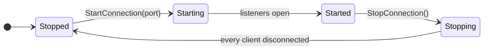

# Server

`ServerManager`, which you reach through `NetworkManager.ServerManager`, runs the server side of a game. It listens for clients, keeps track of the connected peers, spawns objects and decides who observes them.

## Start and stop

```csharp
manager.ServerManager.StartConnection(7777);
Debug.Log($"listening on {manager.ServerManager.Port}");

manager.ServerManager.StopConnection();
```

`State` is a `ServerState`, and `OnServerConnectionState` reports each change:



`StartConnection(port)` opens the transport's listener, plus an in-process listener for a host client. Port 0 lets the operating system choose a port, and `Port` reports the port in use, or 0 while the server is stopped. Calling `StartConnection` on a running server throws `the server is already running`. Right after reaching `Started`, the server spawns every `NetworkObject` placed in the loaded scenes, as described in [spawning](../objects/spawning.md#scene-objects).

`StopConnection()` disconnects every client. Once the state is `Stopped`, the server despawns every object in reverse spawn order, destroying prefab instances and deactivating scene objects, and unloads the network scenes it loaded.

## Peers

Every client gets a peer id when its transport connects, and `OnRemoteConnectionState` reports the client's states:

```csharp
manager.ServerManager.OnRemoteConnectionState += args =>
{
    switch (args.State)
    {
        case ConnectionState.Starting:
            Debug.Log($"peer {args.PeerId} is connecting");
            break;
        case ConnectionState.Started:
            Debug.Log($"peer {args.PeerId} joined");
            break;
        case ConnectionState.Stopped:
            Debug.Log($"peer {args.PeerId} left: {args.Reason}, {args.DiscardedMessages} messages discarded");
            break;
    }
};
```

A peer is `Starting` while the handshake runs and `Started` once it succeeds. Spawn a peer's objects at that point, since it cannot receive them earlier. The server does not expose a list of peer ids, so if you need one, keep your own set from these events. [Lifecycle](../concepts/lifecycle.md#server) shows the whole sequence for one client.

| Member | Purpose |
|---|---|
| `PeerCount` | Connected peers, including those still in the handshake |
| `PeerState(peerId)` | A peer's `ConnectionState`; `Stopped` for an unknown peer |
| `Disconnect(peerId)` | Closes a peer's connection at once; it stops with `LocalStop`, and the client sees the connection drop and reconnects |
| `Kick(peerId)` | Tells the client it was kicked, then closes the connection; the peer stops with `LocalStop`, and the client stops with `ServerClosed` and does not reconnect |
| `HasRtt(peerId)`, `RttOf(peerId)` | The round-trip time the peer's client reported with its clock pings |
| `DroppedInputsOf(peerId)` | Inputs from the peer that the server could not use |
| `FrameBudgetOf(peerId)` | The frame budget of the transport the peer connected through |

`Kick` sends whatever is already queued for the peer, then the kick, then closes the connection. From the call on, sends to that peer return `NotConnected` and its messages are no longer handled. If the queue cannot be sent within Close Timeout Seconds (1 by default), for example because the client stopped reading, the server closes the connection anyway. To tell the player why, such as a ban or a full room, send your own message before calling `Kick`; it arrives first. `Kick` returns false for an unknown peer and for one that is already being closed. A peer still in the handshake cannot receive messages yet, so it is closed at once without the notice.

When a peer stops, the server despawns the objects it owned. Objects whose `NetworkObject` has Despawn With Owner turned off stay and become server-owned instead; see [ownership](../objects/ownership.md).

## Objects

| Member | Guide |
|---|---|
| `Spawn(networkObject, ownerId)`, `Despawn(networkObject)` | [Spawning](../objects/spawning.md) |
| `ChangeOwner(networkObject, ownerId)` | [Ownership](../objects/ownership.md) |
| `IsObserver`, `RebuildObservers`, `ObserverRule`, `ObserverInterval`, `Groups` | [Observers](../objects/observers.md) |
| `Scenes` | [Network scenes](../objects/scenes.md) |
| `Spawned` | All objects spawned by this server, by object id. The values are `INetworkEntity`; in Unity each one is a `NetworkObject`. |

## Messages

`Send(peerId, messageId, payload)`, `SendToObject(...)` and `Broadcast(messageId, payload)` send messages that are not tied to RPCs, and `Dispatcher` registers handlers for incoming messages. [Raw messages](../messaging/messages.md) shows how to use them.

## Errors in handlers

When a handler throws while the server processes a peer's message, such as a server RPC, the server raises `OnHandlerException` with the peer id, the message id and the exception, then closes that peer's connection the way `Kick` does. The peer stops with `StopReason.HandlerException`, and the client stops with `ServerClosed` and a `CloseReason` of `HandlerException`, so it does not reconnect into the same error. If nothing subscribes to the event, the package logs the exception. A message that fails to decode does not disconnect the peer; it is dropped and raises `OnReceiveDropped`.

Exceptions thrown in `apply` of an input model or in an `ObserverRule` are logged and do not disconnect anyone.

The [ServerManager reference](../reference/server-manager.md) lists every member. For running the server on its own or together with a client, see [dedicated server](../deploy/dedicated-server.md) and [host mode](host-mode.md).
