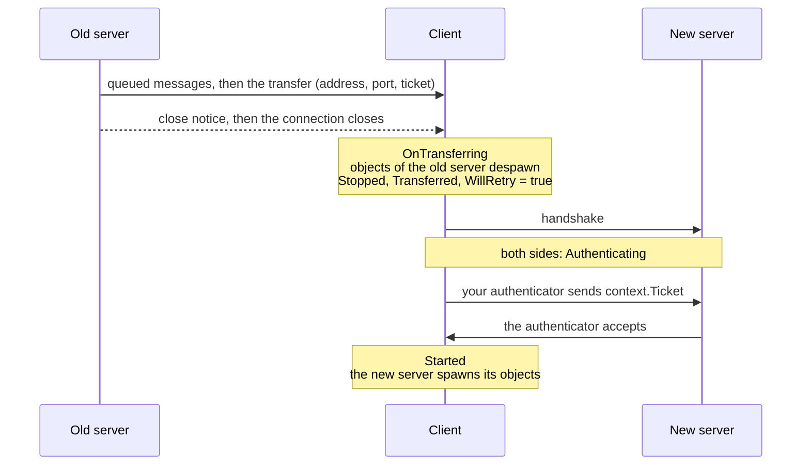

# Server transfer

A game that runs on several servers, such as a lobby and its match servers, or one server per zone, moves a player from one server to another with `ServerManager.Transfer`. The old server tells the client where to go and hands it a ticket, then closes the connection. The client connects to the new server by itself and offers the ticket to the new server's [authenticator](authentication.md), which decides whether to let it in.

A transfer is a new connection. The client despawns every object of the old server, and the new server spawns its own once the client has started there. Nothing that was alive on the old server carries over, except what you put in the ticket.



## On the old server

```csharp
bool started = manager.ServerManager.Transfer(peerId, "arena-2.example.com", 7777, ticket);
```

`Transfer(peerId, address, port, ticket)` works like [`Kick`](server.md#peers). The server sends whatever is already queued for the peer, then the transfer, then a close notice, and closes the connection within Close Timeout Seconds. From the call on, sends to that peer return `NotConnected` and its messages are no longer handled. The peer stops with `StopReason.Transferred`, and the server despawns the objects it owned as it does for any peer that stops.

`address` and `port` mean what they mean in the client's `StartConnection`: a host name, an IP address, or a `ws://` URL with a [WebSocket](transports/websocket.md) transport. The package does not read the ticket; it carries the bytes to the client as they are.

`Transfer` returns false for an unknown peer, for a peer that is already being closed, and for a peer that has not reached `Started`. It throws `ArgumentNullException` when `address` is null, and `InvalidOperationException` for the peer of a host's own client, since [host mode](host-mode.md) cannot move its client to another server.

The server does not wait for the client to agree. A client that ignores the transfer is still disconnected.

## On the client

The client follows the transfer without any code of yours. It raises these events, in this order:

1. `ClientManager.OnTransferring`, with a `TransferringArgs` that holds the new `Address` and `Port`. The objects of the old server are still there, so this is the place to show a loading screen or to read what you need from them.
2. `OnStopClient` on every object of the old server, as they despawn in reverse spawn order.
3. `OnClientConnectionState` with `Stopped`, `StopReason.Transferred` and `WillRetry` set to true.
4. `Starting`, `Authenticating` and `Started` on the new server.

```csharp
manager.ClientManager.OnTransferring += args => loadingScreen.SetActive(true);

manager.ClientManager.OnClientConnectionState += args =>
{
    if (args.State == ConnectionState.Started)
    {
        loadingScreen.SetActive(false);
    }
};
```

The client connects to the new address at once, as if you had called `StartConnection` with it. When that connection fails or drops, the client retries it under the usual [reconnection](client.md#reconnection) rules, always at the new address. It never goes back to the old server. If the new server rejects the ticket, the client stops with `ServerClosed` and a `CloseReason` of `AuthenticationFailed`, and it does not retry.

To refuse a transfer, call `StopConnection()` in `OnTransferring` or in the `Stopped` handler. The client then stays stopped.

## The ticket

On the client, `ClientAuthenticationContext.Ticket` holds the ticket from the transfer. Your client authenticator sends it to the new server in one of its own models, and the server authenticator checks it. The ticket is empty when the connection is not a transfer. The client keeps it for every attempt of the same transfer and forgets it once the client reaches `Started`, or when you call `StartConnection`.

Without an authenticator on the new server, the ticket goes nowhere and the server lets the client in like any other client.

Put in the ticket the data the new server needs from the old one, such as the player's id or score. Only the ticket is signed, so the new server cannot trust anything else the client says about where it came from.

## TransferTickets

`TransferTickets`, in `Fomoxa.Networking`, issues and checks signed tickets. Create one on each server with the same key:

```csharp
var tickets = new TransferTickets(FomoxaRegistry.Default, key);

byte[] ticket = tickets.Issue("arena-2", playerData);

if (tickets.TryVerify(ticket, "arena-2", out ReadOnlyMemory<byte> data))
{
    // data is playerData
}
```

`Issue(target, data)` returns a ticket that holds `data`, the name of the server it is for, an expiry, and a random 128-bit nonce, all signed with HMAC-SHA256 under the key. You choose the server names. `TryVerify(ticket, target, out data)` returns true and the data only when the signature matches the key, the ticket is for `target`, it has not expired, and its nonce has not been used. A ticket verifies once; the second `TryVerify` of the same ticket returns false.

| Member | Purpose |
|---|---|
| `TransferTickets(FomoxaRegistry registry, byte[] key)` | Uses the in-memory nonce store and the system clock. The key is copied. |
| `TransferTickets(FomoxaRegistry registry, byte[] key, IUsedTicketStore usedTickets, Func<DateTime> utcNow)` | Uses your nonce store and clock; null for either takes the default |
| `byte[] Issue(string target, ReadOnlyMemory<byte> data)` | A new signed ticket |
| `bool TryVerify(ReadOnlyMemory<byte> ticket, string target, out ReadOnlyMemory<byte> data)` | Checks a ticket and uses up its nonce |
| `TimeSpan Lifetime` | How long a new ticket stays valid; 30 seconds by default |
| `IUsedTicketStore UsedTickets` | Where used nonces are kept |
| `const int NonceLength` | 16, the length of a nonce in bytes |

The registry has to hold the package's system models. `FomoxaRegistry.Default` holds them once the generated registration has run at startup, and a [console server](../console-server/runtime.md) passes the registry it filled with `FomoxaAdapters.RegisterAll`. A registry without them throws `InvalidOperationException`. A null registry or key throws `ArgumentNullException`, and an empty key throws `ArgumentException`. Use a long random key and keep it on the servers only. A `TransferTickets` can be used from several threads.

The expiry is a UTC time from the clock of the server that issued the ticket, and the server that checks it compares with its own clock. A difference between the two clocks adds to or takes from `Lifetime`, so keep the server clocks in sync.

### Used nonces

`IUsedTicketStore` has one method, `bool TryUse(ReadOnlySpan<byte> nonce, DateTime expiresUtc, DateTime nowUtc)`. It returns true and remembers the nonce until `expiresUtc` when the nonce is new, and false when it has seen it. `TryVerify` calls it last, only for a ticket that passed every other check.

The default, `MemoryUsedTicketStore`, keeps nonces in the memory of one process and forgets them once their tickets have expired. That is enough when each server only accepts tickets for its own name. When several server processes accept tickets for the same name, they need one store between them, for example in Redis, so that a ticket used on one of them is refused on the others.

## Example

Both servers use the same authenticator component. The client side sends the ticket; the server side checks it with the name of the server it runs on:

```csharp
[Network]
[Codec("net")]
[NetworkChannel("net", Channel.ReliableOrdered)]
public class TransferRequest
{
    [Network("bytes")]
    [Codec("net")]
    public byte[] Ticket { get; set; }
}
```

```csharp
using System;
using System.Collections.Generic;
using System.Text;
using Fomoxa.Networking;
using Fomoxa.Unity;
using Generated;
using MyGame.Network.Models;
using UnityEngine;

public sealed class ArenaTicketAuthenticator : NetworkAuthenticator
{
    [SerializeField] private string serverName;
    [SerializeField] private string ticketKey;

    private readonly Dictionary<ulong, int> scores = new Dictionary<ulong, int>();
    private TransferTickets tickets;

    public TransferTickets Tickets =>
        tickets ??= new TransferTickets(FomoxaRegistry.Default, Encoding.UTF8.GetBytes(ticketKey));

    public int ScoreOf(ulong peerId) => scores.TryGetValue(peerId, out int score) ? score : 0;

    private static TransferRequestNetAdapter Codec => TransferRequestNetAdapter.Instance;

    public override void RegisterServer(ServerAuthentication server) =>
        server.On(Codec, OnTransferRequest);

    public override void OnClientAuthenticating(ClientAuthenticationContext context) =>
        context.Send(Codec, new TransferRequest { Ticket = context.Ticket.ToArray() });

    private void OnTransferRequest(ServerAuthenticationContext context, TransferRequest request)
    {
        if (Tickets.TryVerify(request.Ticket, serverName, out ReadOnlyMemory<byte> data))
        {
            scores[context.PeerId] = BitConverter.ToInt32(data.Span);
            context.Accept();
        }
        else
        {
            context.Reject();
        }
    }
}
```

This server only lets in clients that come with a valid ticket. A lobby that players join directly would accept an empty ticket as well, or check a login instead.

The old server issues a ticket for the arena and transfers the player:

```csharp
using System;
using Fomoxa.Unity;
using UnityEngine;

public sealed class ArenaExit : MonoBehaviour
{
    [SerializeField] private NetworkManager manager;
    [SerializeField] private ArenaTicketAuthenticator authenticator;

    public bool SendToArena(ulong peerId, int score, string arenaName, string address, ushort port)
    {
        byte[] ticket = authenticator.Tickets.Issue(arenaName, BitConverter.GetBytes(score));
        return manager.ServerManager.Transfer(peerId, address, port, ticket);
    }
}
```

The [ServerManager](../reference/server-manager.md) and [ClientManager](../reference/client-manager.md) references list the members, and [errors and stop reasons](../reference/errors.md) describes `Transferred`.
