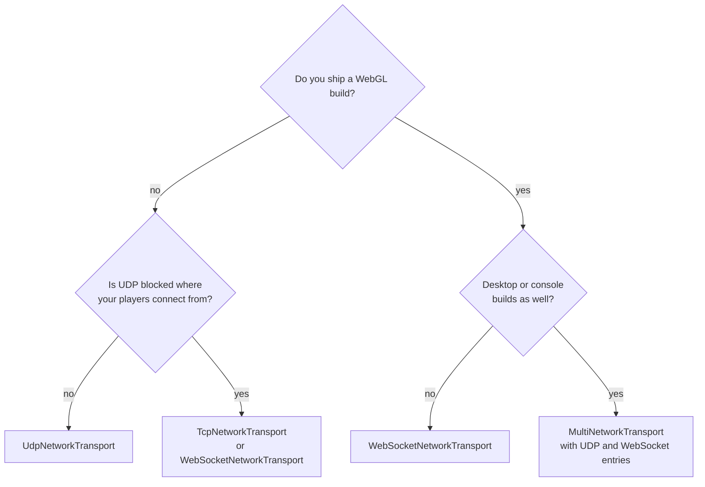

# Transports overview

A transport moves bytes between a client and a server. The package's protocol, reliability and objects work the same on every transport, so a game chooses its transport by adding a component to the `NetworkManager`, without changing its code.

| Component | Protocol | Server | Client | Browser (WebGL) client |
|---|---|---|---|---|
| [`UdpNetworkTransport`](udp.md) | UDP datagrams | Yes | Yes | No |
| [`EncryptedUdpNetworkTransport`](encrypted-udp.md) | UDP datagrams encrypted with ChaCha20-Poly1305 | Yes | Yes, with a grant from your login service | No |
| [`TcpNetworkTransport`](tcp.md) | TCP stream | Yes | Yes | No |
| [`WebSocketNetworkTransport`](websocket.md) | WebSocket (RFC 6455) over TCP | Yes | Yes | Yes |
| [`MultiNetworkTransport`](multi-transport.md) | Several of the above on one server | Yes | Yes, through its first transport | Yes, through its WebSocket entry |

Whatever the transport, a host's own client always uses the in-process [loopback](loopback.md) connection.

## Capabilities

| | UDP | TCP | WebSocket |
|---|---|---|---|
| Connection model | Connectionless; the Fomoxa handshake establishes the session | TCP connection, then handshake | TCP connection, HTTP upgrade, then handshake |
| Reliability of the transport | None | Reliable | Reliable |
| Ordering of the transport | None | Ordered | Ordered |
| Frame budget for bundles | 1200 bytes | Largest Fomoxa frame | Largest Fomoxa frame |
| Addressing | Host name or IP, and port | Host name or IP, and port | Host name, IP, or `ws://` or `wss://` URL, and port |
| Server listens on | All IPv4 interfaces | All IPv4 interfaces | All IPv4 interfaces |
| Encryption | None; [encrypted UDP](encrypted-udp.md) adds it | [Client TLS](tls.md) with Use Tls, through a proxy | [Client TLS](tls.md) for `wss://` URLs, through a proxy |

Encrypted UDP behaves like UDP, with a frame budget of 1175 bytes.

The package's own channels behave the same on every transport, with `ReliableOrdered` messages acknowledged and resent and `Unreliable` messages not. Over a reliable transport, unreliable messages are not lost in practice, but the package does not rely on that.

## Non-blocking operation

The package does not create threads. Instead it polls the transport each tick. A client resolves host names with `Dns.GetHostAddressesAsync` and checks the result on later ticks, preferring IPv4 addresses. TCP and WebSocket clients connect with non-blocking sockets and try each resolved address in turn, and listeners accept connections without blocking.

## Choosing a transport



UDP has the lowest latency under packet loss, because a lost unreliable message does not hold back the ones after it, which makes it the choice for desktop and console games. TCP works where UDP is blocked, but a lost packet delays everything behind it. WebSocket is required for WebGL clients and also works where only HTTP ports are open. With `MultiNetworkTransport`, one server can accept desktop clients over UDP and browser clients over WebSocket at the same time.

## How a transport plugs in

`NetworkTransport` is an abstract `MonoBehaviour` with one method:

```csharp
public abstract ITransportFactory CreateFactory();
```

The `NetworkManager` calls it once in `Awake`. The returned `ITransportFactory`, in `Fomoxa.Networking.Transports`, creates listeners for the server and connectors for the client:

| Member | Meaning |
|---|---|
| `FrameBudget` | The largest frame the package should build for this transport |
| `CreateListener(ushort port, out ushort boundPort)` | Opens a listener and reports the port it bound |
| `CreateConnector(string address, ushort port)` | Starts a connection; the client polls it until it connects or fails |

A transport that needs a grant to connect, such as encrypted UDP, also implements `IConnectionTransportFactory`, which adds `RequiresConnection`, `CanUseConnection(connection)` and `CreateConnector(address, port, connection)`. [Custom transport](custom-transport.md) shows how to write your own.

The transport is used by the [client](../client.md) and the [server](../server.md), [lifecycle](../../concepts/lifecycle.md) gives the order of connection events, and [deployment](../../deploy/deployment.md) covers ports and firewalls on a real server.
