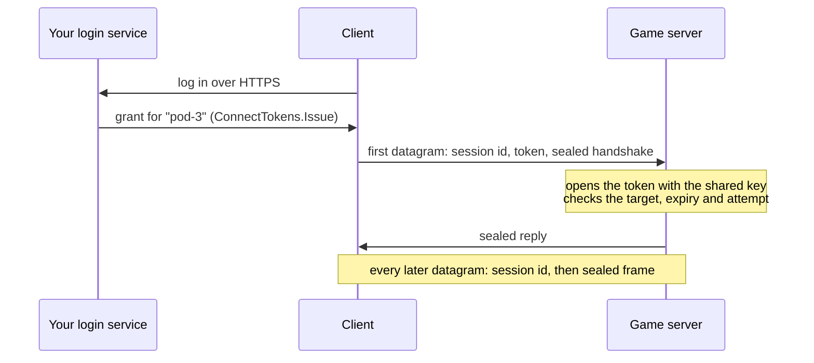

# Encrypted UDP

`EncryptedUdpNetworkTransport` sends Fomoxa frames over UDP and encrypts every datagram with ChaCha20-Poly1305. A client connects only with a grant, which a service of yours issues beforehand: a short-lived token and the session keys that go with it. The service is usually a login server or a matchmaker, or the old server during a [server transfer](../transfer.md).

Encryption is off unless you turn it on. A `NetworkManager` without a transport uses plain [UDP](udp.md), and nothing in the package switches to encryption by itself. Each datagram costs CPU to seal and open, about 23 µs for 1200 bytes under Unity's Mono, and encrypted traffic cannot be read with `fomoxa-inspect`, so keep plain UDP for local tests.



## The shared key

The service that issues grants and every server that accepts them share one 32-byte key. Each of them creates a `ConnectTokens` with it:

```csharp
var tokens = new ConnectTokens(FomoxaRegistry.Default, key);
```

Keep the key on your own machines, in a secret store or an environment variable, never in a client build. Anyone with the key can issue grants that your servers accept.

## On the server

Add `EncryptedUdpNetworkTransport` to the GameObject of the `NetworkManager` and assign it to the Transport field. Before `ServerManager.StartConnection`, give the component its `ConnectTokens` and set Target to the name of this server:

```csharp
using System;
using Fomoxa.Networking;
using Fomoxa.Unity;
using UnityEngine;

public sealed class PodServer : MonoBehaviour
{
    [SerializeField] private NetworkManager manager;
    [SerializeField] private EncryptedUdpNetworkTransport transport;
    [SerializeField] private ushort port = 7777;

    private void Start()
    {
        byte[] key = Convert.FromBase64String(Environment.GetEnvironmentVariable("CONNECT_KEY"));
        transport.Tokens = new ConnectTokens(FomoxaRegistry.Default, key);
        transport.Target = Environment.GetEnvironmentVariable("POD_NAME");
        manager.ServerManager.StartConnection(port);
    }
}
```

| Member | Purpose |
|---|---|
| Target (Inspector), `string Target` | The name of this server. The server only accepts grants issued for this name. |
| `ConnectTokens Tokens` | Opens the tokens of incoming clients. Required to listen; a client build leaves it null. |
| `FomoxaRegistry Registry` | The registry with the package's system models; null means `FomoxaRegistry.Default` |

The component reads `Tokens` and Target when the server starts listening, so you can set them at any time before `StartConnection`. Without `Tokens`, `ServerManager.StartConnection` throws `InvalidOperationException`.

You choose the server names. With one name per server process, a grant for one server is refused by every other one, even though they all share the key.

## Issuing grants

Your service issues a grant for the server the client should join:

```csharp
byte[] grant = tokens.Issue("pod-3", BitConverter.GetBytes(playerId));
```

`Issue(target, data)` returns the grant as one byte array. It holds the token and the two session keys of the client. The token's clear part holds a session id, an expiry and a nonce; its sealed part holds `target`, `data` and the session keys, encrypted and signed with the shared key. Send the grant to the client over an encrypted channel such as HTTPS, since anyone who reads it can connect as that client until it expires.

`data` reaches the server's [authenticator](../authentication.md) as `context.ConnectionData`. Put in it what the server needs to know about the player, such as the account id from the login.

`Issue(target, sessionId, data)` takes the session id instead of picking a random one. A UDP gateway in front of several servers can route datagrams by the session id, so a service that knows which server a client goes to can encode that server in the id. Session id 0 throws `ArgumentOutOfRangeException`.

| Member | Purpose |
|---|---|
| `ConnectTokens(FomoxaRegistry registry, byte[] key)` | Uses the in-memory attempt store and the system clock. The key is copied. |
| `ConnectTokens(FomoxaRegistry registry, byte[] key, IUsedTicketStore usedAttempts, Func<DateTime> utcNow)` | Uses your attempt store and clock; null for either takes the default |
| `byte[] Issue(string target, ReadOnlyMemory<byte> data)` | A new grant with a random session id |
| `byte[] Issue(string target, ulong sessionId, ReadOnlyMemory<byte> data)` | A new grant with your session id |
| `TimeSpan Lifetime` | How long a new token stays valid; 30 seconds by default |
| `IUsedTicketStore UsedAttempts` | Where the server remembers connection attempts |
| `const int KeyLength` | 32, the length of the key in bytes |
| `const byte Version` | 1, the token format this package writes and accepts |

A null registry, key or target throws `ArgumentNullException`, a key that is not 32 bytes throws `ArgumentException`, and a `Lifetime` of zero or less throws `ArgumentOutOfRangeException`. A registry without the package's system models throws `InvalidOperationException`; `FomoxaRegistry.Default` holds them once the generated registration has run, and a [console server](../../console-server/runtime.md) passes the registry it filled with `FomoxaAdapters.RegisterAll`. A `ConnectTokens` can be used from several threads.

The expiry comes from the clock of the service that issued the token, and the server compares it with its own clock, so keep their clocks in sync.

## On the client

The client uses the same component without `Tokens`, and connects with the grant:

```csharp
manager.ClientManager.StartConnection(address, port, grant);
```

`StartConnection(address, port)` throws `InvalidOperationException` on an encrypted transport, since the server ignores a client without a grant. `StartConnection(address, port, connection)` throws `ArgumentException` when the transport does not take a grant, such as plain UDP, or when the bytes are not a grant. A host's own client connects over [loopback](loopback.md) with either overload and ignores the grant.

The client reuses the grant for every retry of the same `StartConnection`, and each attempt picks fresh session keys, so a retry after a lost reply connects normally. Once the token has expired, the server ignores the client and its retries fail like retries to an unreachable server. Get a new grant and call `StartConnection` again.

## In the authenticator

`ServerAuthenticationContext.ConnectionData` holds the `data` of the client's grant. It is empty on a plain transport and for a host's own client.

```csharp
using System;
using System.Collections.Generic;
using Fomoxa.Networking;
using Fomoxa.Unity;

public sealed class PlayerIdAuthenticator : NetworkAuthenticator
{
    private readonly Dictionary<ulong, int> players = new Dictionary<ulong, int>();

    public int PlayerOf(ulong peerId) => players.TryGetValue(peerId, out int player) ? player : 0;

    public override void OnServerAuthenticating(ServerAuthenticationContext context)
    {
        if (context.ConnectionData.Length == sizeof(int))
        {
            players[context.PeerId] = BitConverter.ToInt32(context.ConnectionData.Span);
            context.Accept();
        }
        else
        {
            context.Reject();
        }
    }
}
```

The data is sealed with the shared key, so the client can neither read nor change it.

## Server transfers

To move a client to another encrypted server, issue a grant for that server and pass it to `Transfer`:

```csharp
byte[] grant = tokens.Issue("pod-7", BitConverter.GetBytes(playerId));
manager.ServerManager.Transfer(peerId, "pod-7.example.com", 7777, ReadOnlyMemory<byte>.Empty, grant);
```

The client connects to the new server with that grant. It travels to the client inside the old session, so it stays secret only when the old server is encrypted as well. The client stops with `Transferred` and `WillRetry` false, without connecting, when the grant and its transport do not match: an encrypted client that receives a transfer without a grant, or a plain client that receives one. It then logs an error that names the address. [Server transfer](../transfer.md) describes the rest of the sequence.

## Behind a gateway

In a Fomoxa cluster, clients can reach the pods through `fomoxa-gateway` instead of connecting to them directly. The gateway reads the pod id from the session id of each datagram and forwards the datagram to that pod. It adds a 20-byte header that holds the client's IP address and port. The pod sends its replies back to the gateway with the same header, and the gateway passes them on to the client from its public address.

Tick Behind Gateway on the pod's `EncryptedUdpNetworkTransport`, or set `BehindGateway` from code before `StartConnection`:

```csharp
transport.BehindGateway = true;
```

A console server passes the flag to the factory:

```csharp
new EncryptedUdpTransportFactory(registry, tokens, target, behindGateway: true)
```

| Member | Purpose |
|---|---|
| Behind Gateway (Inspector), `bool BehindGateway` | The server only accepts datagrams that carry the gateway's header, and replies through the gateway. Off by default. |
| `EncryptedUdpTransportFactory(FomoxaRegistry registry, ConnectTokens tokens, string target, bool behindGateway)` | The server factory with the same flag; the three-argument constructor leaves it off |

With the flag on, the server drops every datagram without a valid header, so a client that sends to the pod's own address gets no session. Clients are unchanged: they connect to the gateway's address with their grant and never see the header.

The server sends each reply to the gateway that carried the latest datagram of that session that decrypted, and the header names the client address from that datagram. A forged header on a datagram that fails to decrypt changes neither address. The gateway keeps no state per session, so a reply also gets through when a load balancer sends the client's next datagrams to another gateway.

The directory hands clients the gateway's address when its settings name it in `public_address`; the pod still registers its own address, which the gateway uses to reach it. The `com.fomoxa.rpc` README covers the pod side under "Behind a gateway".

The header only travels between the gateway and the pod. Datagrams between the client and the gateway keep the sizes in the table below.

## Behavior

| | |
|---|---|
| Frame budget | 1175 bytes. A datagram carries 33 bytes besides its frame (session id, kind, sequence number, tag), and stays at the 1208 bytes of a plain UDP datagram. |
| First datagram | The client sends the token with its datagrams until the server answers, which makes them longer by the token and 18 bytes. |
| Session id | Comes from the grant and travels in the clear in every datagram. A client keeps its session when its address changes, but only datagrams that decrypt move the session to a new address. |
| Replays | Each side drops a datagram whose sequence number it has seen, or that is 64 or more behind the newest one. A first datagram that was already used opens nothing. |
| Same grant again | A new attempt with the grant of a running session replaces that session on the server; the earlier session stops as if its connection had closed. A first datagram from another grant with the same session id is dropped. |
| Dropped datagrams | A datagram that fails any check is dropped without a reply, so a wrong key, target or expired token looks like an unreachable server from the client. |
| Limits | 1024 sessions per server; each session holds up to 64 frames the package has not read yet and drops the oldest when full. |
| Addressing | A host name or an IP address, and a port, as with plain UDP |

The server remembers each attempt in `UsedAttempts` until its token expires. The default store keeps them in the memory of one process, which is enough while each process has its own Target. Several processes that share a Target need one store between them; [server transfer](../transfer.md#used-nonces) describes `IUsedTicketStore`.

## Platform limitations

Encrypted UDP is not available in WebGL builds. Creating the factory in a browser throws `EncryptedUdpNetworkTransport cannot run in a browser; assign a WebSocketNetworkTransport or a MultiNetworkTransport to the NetworkManager for WebGL builds`.

With a [`MultiNetworkTransport`](multi-transport.md), a client connects through the first entry, so it needs a grant when that entry is encrypted.

The encryption keeps frames secret and detects any change to them. The session id and the size and timing of datagrams stay visible, and a flood of datagrams still reaches the server.

The encryption runs on BouncyCastle because `AesGcm` does not work under Unity's Mono. Unity moves to CoreCLR from Unity 6.8, and the version of the package for Unity on CoreCLR will use .NET's `AesGcm` ([requirements](../../getting-started/installation.md#requirements)).
