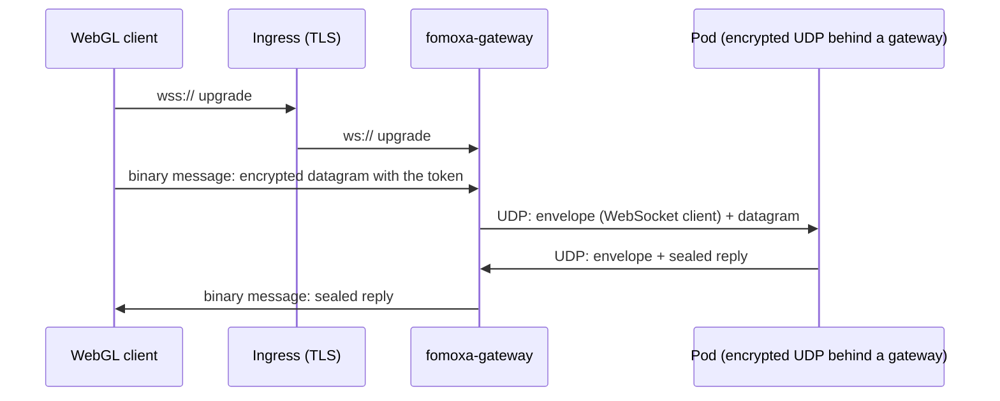

# Encrypted WebSocket

`EncryptedWebSocketNetworkTransport` lets a client that cannot send UDP, such as a WebGL build, join a pod that runs [encrypted UDP](encrypted-udp.md) behind `fomoxa-gateway`. The client sends the same encrypted datagrams as an encrypted UDP client, one binary WebSocket message each, to the gateway. The gateway forwards them to the pod as UDP datagrams and sends the pod's answers back on the WebSocket connection.

The transport is client only. The pod does not change: it listens with `EncryptedUdpNetworkTransport` in its mode for a gateway, and one pod serves UDP and WebSocket clients at the same time. A client needs the gateway in between; it cannot connect to a pod directly.



## On the client

Add `EncryptedWebSocketNetworkTransport` to the GameObject of the `NetworkManager` and assign it to the Transport field. Connect with the WebSocket URL of the gateway and a grant:

```csharp
manager.ClientManager.StartConnection(ticket.WebSocketUrl, 0, ticket.Connection);
```

The directory hands out that URL when its settings set `public_websocket`: `Allocate` and `Relocate` return it in `WebSocketUrl`, next to the UDP `Address` and `Port`. The [game backend](../../deploy/backend.md) passes both to the client, and the client uses the one that fits its transport.

The address follows the rules of the [WebSocket transport](websocket.md): a `ws://` or `wss://` URL with port 0, or a host and a port with the Path field. A WebGL build served over HTTPS can only open `wss://` URLs.

| Field | Default | Meaning |
|---|---|---|
| Path | `/` | The path the client requests when it connects with a host and a port |
| Max Handshake Bytes | 8192 | Largest HTTP upgrade response a desktop client reads |
| Handshake Timeout Seconds | 5 | Time allowed for the upgrade; on a desktop client with a `wss://` URL it also covers the TLS handshake |
| Max Buffered Bytes | 1048576 | In a browser, the amount of unsent data above which the transport stops sending until the browser catches up |

| Member | Purpose |
|---|---|
| `TlsSettings Tls` | Certificate checks for `wss://` URLs on a desktop client, as in [client TLS](tls.md) |
| `FomoxaRegistry Registry` | The registry with the package's system models; null means `FomoxaRegistry.Default` |

A console client uses the factory directly:

```csharp
var factory = new EncryptedWebSocketTransportFactory(registry, new WebSocketSettings());
```

| Member | Purpose |
|---|---|
| `EncryptedWebSocketTransportFactory(FomoxaRegistry registry, WebSocketSettings settings = null)` | A client factory over the package's WebSocket client; null settings take the defaults |
| `int FrameBudget` | 1175 bytes, as encrypted UDP |
| `CreateListener` | Throws `InvalidOperationException`; a pod listens with encrypted UDP |
| `CreateConnector(address, port)` | Throws `InvalidOperationException`; the client needs a grant |
| `CreateConnector(address, port, connection)` | Throws `ArgumentException` when the bytes are not a grant from `ConnectTokens.Issue` |

Grants, retries, expiry and the authenticator's `ConnectionData` work as on [encrypted UDP](encrypted-udp.md#on-the-client).

## On the pod

The pod runs `EncryptedUdpNetworkTransport` with Behind Gateway on, as described under [Behind a gateway](encrypted-udp.md#behind-a-gateway). The gateway marks the datagrams of WebSocket clients, and the server tells you how each client arrived:

```csharp
bool overWebSocket = manager.ServerManager.ArrivedOverWebSocket(peerId);
```

| Member | Purpose |
|---|---|
| `bool ArrivedOverWebSocket(ulong peerId)` | True when the latest datagram that decrypted for this peer came through the gateway's WebSocket side. False for UDP clients, for unknown peers, and on servers that are not behind a gateway. |

Use it when you move a player to another pod. `Relocate` returns both addresses, and the client connects with the transport it already has, so give a WebSocket client the URL:

```csharp
AllocateResponse moved = await pod.Relocate(roomKey, 1, data);
byte[] grant = moved.Connections[0];
if (manager.ServerManager.ArrivedOverWebSocket(peerId))
{
    manager.ServerManager.Transfer(peerId, moved.WebSocketUrl, 0, ReadOnlyMemory<byte>.Empty, grant);
}
else
{
    manager.ServerManager.Transfer(peerId, moved.Address, moved.Port, ReadOnlyMemory<byte>.Empty, grant);
}
```

## Behavior

| | |
|---|---|
| Wire | Each binary message holds one encrypted datagram, byte for byte the same as on encrypted UDP |
| Frame budget | 1175 bytes |
| Ordering | The messages travel over TCP, so a lost packet delays the ones behind it, as with any WebSocket transport |
| Gateway | Drops messages that fail its datagram checks; closes the connection for a text message, a message longer than 65507 bytes or a broken frame |
| Pod replies | Go back on the WebSocket connection the client's latest decrypted datagram came through |
| Platforms | WebGL through the browser's `WebSocket`, and desktop or console clients through the package's WebSocket client |
