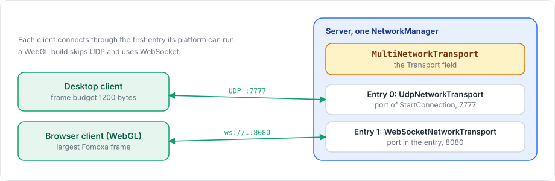

# Multiple transports

`MultiNetworkTransport` lets one server listen on several transports at once, each on its own port. A typical use is a single server that takes desktop clients over UDP and browser clients over WebSocket.

<figure><figcaption><p>The setup from this page: UDP for desktop builds, WebSocket for WebGL builds.</p></figcaption></figure>

## Basic usage

1. Add the transports you need to the `NetworkManager`'s GameObject, for example `UdpNetworkTransport` and `WebSocketNetworkTransport`.
2. Add `MultiNetworkTransport` and fill its Transports list. Each entry has a Transport and a Port.
3. Assign `MultiNetworkTransport` to the Transport field of the `NetworkManager`.

| Entry | Transport | Port |
|---|---|---|
| 0 | `UdpNetworkTransport` | ignored, see below |
| 1 | `WebSocketNetworkTransport` | 8080 |

```csharp
manager.ServerManager.StartConnection(7777);
```

## Ports

The first entry listens on the port passed to `ServerManager.StartConnection`, which `ServerManager.Port` reports. Every other entry listens on the port written in the entry, from 0 to 65535. Port 0 lets the operating system pick one, but clients then cannot know it in advance.

## Clients

A client with a `MultiNetworkTransport` connects through the first entry. In a WebGL build the entries that cannot run in a browser are skipped, so a list of UDP followed by WebSocket gives desktop builds UDP and WebGL builds WebSocket from the same scene. The WebGL client connects to the port you pass to `StartConnection`, so pass the WebSocket entry's port there.

If no entry can run, creating the factory throws `<name> has no transports`, or in a browser `<name> cannot run in a browser; ...`.

## Frame budget per connection

Each connection uses the frame budget of the transport it came in on, so a UDP peer gets 1200 bytes and a WebSocket peer the largest frame. `ServerManager.FrameBudgetOf(peerId)` reports the budget of a peer.

## Configuration

| Field | Meaning |
|---|---|
| Transports | The list of entries, each a transport component and a port |

An entry without a transport throws `<name> has an empty transport entry`, and a port outside 0 to 65535 also throws.

The [transports overview](README.md) compares the transports you can combine, the [WebSocket](websocket.md) and [UDP](udp.md) pages describe the usual pair, and [WebGL](../../deploy/webgl.md) covers the browser side.
