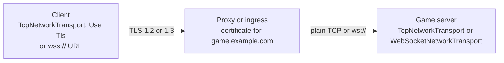

# Client TLS

A desktop, mobile or console client can open a TLS connection over [TCP](tcp.md) or [WebSocket](websocket.md) (`wss://`). TLS runs only on the client. The game server itself stays plain, and a reverse proxy or a Kubernetes ingress in front of it terminates TLS with your certificate and forwards the plain connection to the server's port. In WebGL the browser handles `wss://` and this page does not apply.



The package does TLS with BouncyCastle, which ships in the package, and checks certificates against a root set of its own. The operating system's certificate store is not used. The handshake runs on the client's thread without blocking, like the rest of the connection.

## Turning it on

TLS is off for TCP until you turn it on. Tick Use Tls on the client's `TcpNetworkTransport`, or set `UseTls` from code, and connect with the host name that the certificate is for:

```csharp
manager.ClientManager.StartConnection("game.example.com", 443);
```

The server's own `TcpNetworkTransport` ignores the setting, since the server does not do TLS.

A WebSocket client uses TLS when it connects with a `wss://` URL, and plain WebSocket for a host name or a `ws://` URL. A `wss://` URL without a port uses port 443:

```csharp
manager.ClientManager.StartConnection("wss://game.example.com/play", 0);
```

The component reads its TLS settings when the client connects, so you can change them at any time before `StartConnection`.

## How the client checks the certificate

The client accepts the server's certificate when all of these hold:

- The chain the server sends leads to a root in the package's root set. The set is Mozilla's list of trusted roots, the same list Firefox uses, as of the date in `TlsRoots.MozillaDate`, and it is updated with each package release.
- Every certificate in the chain is within its validity dates.
- If the server certificate lists its purposes, server authentication is one of them.
- The host name you connect to is in the certificate's subject alternative names. Names are compared without regard to case, and a wildcard such as `*.example.com` stands for exactly one label: it covers `eu.example.com` but not `example.com` or `a.eu.example.com`. When you connect to an IP address, it must be an IP entry of the certificate. The certificate's common name is never used.

The client does not check whether a certificate has been revoked. It offers TLS 1.3 and TLS 1.2, and it sends the host name in the handshake (SNI) unless you connect to an IP address. It sends no client certificate.

## Your own roots or your own check

A certificate from a public authority such as Let's Encrypt works without any setup. For a private authority, for example on a staging cluster, add its root to the Mozilla set:

```csharp
using Fomoxa.Networking.Transports;
using Fomoxa.Unity;
using UnityEngine;

public sealed class StagingRoots : MonoBehaviour
{
    [SerializeField] private TcpNetworkTransport transport;
    [SerializeField] private TextAsset stagingRoot;

    private void Awake()
    {
        TlsRoots roots = TlsRoots.Mozilla.With(TlsRoots.FromPem(stagingRoot.text));
        transport.Tls.CertificateCheck = new TlsCertificateCheck(roots);
    }
}
```

`TlsRoots.FromPem(pem)` alone replaces the whole set, so the client trusts only the roots you give it. `FromPem` reads every `BEGIN CERTIFICATE` block in the text and throws `ArgumentException` when there is none or one cannot be read.

To make the decision in your own code, set `CertificateCheck` to an `ITlsCertificateCheck` of yours:

```csharp
bool Accepts(string host, IReadOnlyList<byte[]> chain, out string rejection);
```

`host` is the address you connected to and `chain` holds the certificates the server sent, in DER form, server certificate first. Return false with a short reason to refuse the server. Your check replaces the package's check entirely, so call a `TlsCertificateCheck` from it when you want to keep the standard checks and add your own. An exception thrown by the check refuses the server too.

| Member | Purpose |
|---|---|
| `TcpNetworkTransport.UseTls`, Use Tls (Inspector) | Turns TLS on for the client |
| `TcpNetworkTransport.Tls`, `WebSocketNetworkTransport.Tls` | The `TlsSettings` of the component |
| `TlsSettings.CertificateCheck` | The check the client runs on the server's certificate; by default a `TlsCertificateCheck` with `TlsRoots.Mozilla` |
| `TlsSettings.HandshakeTimeout` | Time allowed for the TLS handshake over TCP; 5 seconds by default |
| `TlsRoots.Mozilla`, `TlsRoots.MozillaDate` | The bundled root set and the date of Mozilla's data in it |
| `TlsRoots.FromPem(pem)`, `roots.With(other)`, `roots.Count` | A root set from PEM text; two sets joined |

In layer 1, `new TcpTransportFactory(tlsSettings)` gives a TCP factory with TLS, and `WebSocketSettings.Tls` holds the settings for `wss://` URLs.

## When TLS fails

A client that refuses the server's certificate, or a server that ends the handshake with a TLS alert, stops the client with `StopReason.TlsRejected`. The client does not retry, since the next attempt would meet the same certificate, and it logs the reason as an error:

```text
Fomoxa stopped the client: the TLS server game.example.com was rejected: the server certificate is not for game.example.com
Fomoxa stopped the client: the TLS server game.example.com ended the handshake with alert handshake_failure(40)
```

Other failures stop the client with `TransportError` and it retries as usual: a refused connection, a connection that closes during the handshake, a reply that is not TLS, and a handshake that does not finish in time. Over TCP the time limit is `TlsSettings.HandshakeTimeout`. Over `wss://` the WebSocket component's Handshake Timeout Seconds covers both the TLS handshake and the HTTP upgrade.

After the handshake, TLS errors and a close from the server end the session like any other transport error or close, and the client retries.

## Limits

- The server does not do TLS. Put a proxy or an ingress that terminates TLS in front of it, as [deployment](../../deploy/deployment.md) describes.
- The client does not resume TLS sessions, so every connection runs a full handshake.
- UDP is encrypted with [encrypted UDP](encrypted-udp.md), not with TLS.
- The package checks certificates itself because `X509Chain` has no root store under Unity's Mono. Unity moves to CoreCLR from Unity 6.8, and the version of the package for Unity on CoreCLR will check certificates with .NET's `X509Chain` ([requirements](../../getting-started/installation.md#requirements)).
