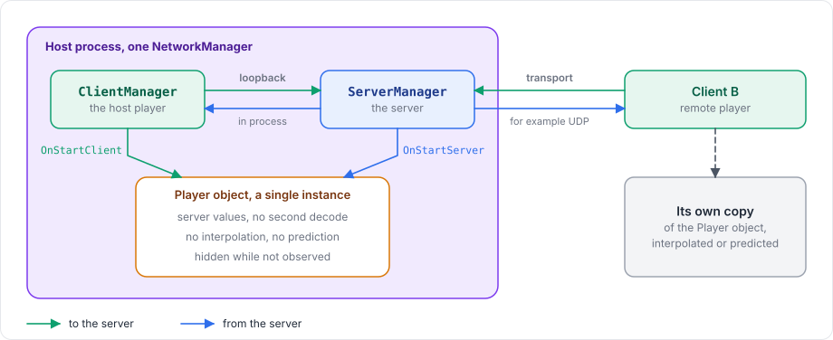

# Documentation

This documentation is kept in its own repository, separate from the package, so it is not part of what users install and Unity never imports it. GitBook publishes it through Git Sync. `gitbook-docs.yaml` describes the site and its two spaces, English and Vietnamese, and `.gitbook.yaml` names `README.md` and `SUMMARY.md` and lists the redirects for pages that moved; both files sit at the root of the documentation.

## Structure

| Section | Purpose |
|---|---|
| Get started | A new user installs the package and builds a small game in a three-part tutorial |
| Learn the basics | How the package works: layers, server and clients, ticks, authority, replication, prediction, lifecycle |
| Connections, Network objects, Messaging, Synchronization, Prediction, Physics | One guide per feature, with working code |
| Deploy | Dedicated servers, ports, proxies and WebGL |
| Advanced | Editor integration, custom codecs, performance, debugging |
| Rapier physics, Console server | The optional Rapier backend and servers that run without Unity |
| Examples | Existing games ported with the package, step by step, with their real code and commits. Generic explanations stay in the feature guides and are linked from here |
| Reference | Short, exact descriptions of the public API, for lookup |
| Contributing | Working on the package and on these pages |

`SUMMARY.md` is the table of contents, and every page must be listed in it. When a page moves, add its old path to `redirects` in `.gitbook.yaml` and in `vi/.gitbook.yaml`, so old links keep working.

## Rules

- Write the English pages in plain technical prose. Use sentence case for headings.
- Describe the current code. A feature that is not implemented is marked as such and not described as if it worked.
- Check every type, member and message against the source before writing it down.
- Code examples compile against the current API and use the generated adapter names, such as `ShotNetAdapter.Instance`.
- Use the same name for the same thing everywhere: `NetworkObject`, `NetworkBehaviour`, `NetworkManager`, prediction, reconciliation, rollback, replay.
- Write the labels of Unity's UI as they appear, in bold, when the reader has to find them: **Tools > Fomoxa > Generate**, **Collected Prefabs**. In tables of fields, the field name alone is enough.
- Link related pages with relative links, and keep links to headings working when you rename a heading.
- Use GitBook hints (``) only for warnings a reader must not miss.

## Figures

A page explains a flow, a timeline or a structure with a figure rather than with ASCII art in a code block.

Short flows, state machines and message sequences are Mermaid blocks, which GitBook renders. Keep `;` and `#` out of Mermaid labels, and use `<br/>` for line breaks.

Larger diagrams are SVG files generated by the scripts in `diagrams/`. Each diagram is a function in one of the `d_*.py` modules, marked with `@diagram('<name>')`, and returns its English or Vietnamese version through `pick(language, english, vietnamese)`. `svg.py` holds the drawing primitives and the colors: blue for the server, green for clients, purple for the host, amber for what the reader should notice, red for failures.

```
python3 diagrams/build.py                       write every diagram, in both languages
python3 diagrams/build.py --only host-mode      write the diagrams whose names match
python3 diagrams/build.py --preview <folder>    also render PNG previews with Microsoft Edge
python3 diagrams/build.py --check               fail when a written SVG is out of date
```

The script writes `.gitbook/assets/diagrams/<name>.svg` and `vi/.gitbook/assets/diagrams/<name>.svg`. Never edit these files by hand. Embed a diagram with a figure, an `alt` text that says everything the diagram shows, and a short caption:

```html
<figure><figcaption><p>...</p></figcaption></figure>
```

## Screenshots

Screenshots live in `.gitbook/assets/screenshots/`, with the same file in `vi/.gitbook/assets/screenshots/`. Inspector screenshots are 460 pixels wide and show one component with the values the page talks about. They are captured by script from a small Unity project in the package's development repository, which also runs the tutorial in Play Mode to check that it works, so they can be taken again whenever a component changes. Give each screenshot an `alt` text that lists the values it shows and `width="460"` in the `img` tag.

## Vietnamese translation

The Vietnamese pages live in `vi/`, with their own `README.md` and `SUMMARY.md`, and mirror the English pages file for file. GitBook publishes them as a second space with the language set to `vi`, so readers switch languages from the language picker.

The English pages are the source. When you change an English page, change the Vietnamese page at the same path in the same commit. A Vietnamese page keeps the code blocks of its English page unchanged and has the same headings in the same order. Mermaid blocks are the exception: their labels are translated. Each translated heading ends with an anchor tag that carries the English anchor, such as `## Teleport <a href="#teleporting" id="teleporting"></a>`, so links to headings work in both languages. Technical terms such as model, codec, tick, peer and owner stay in English in the Vietnamese text.

GitBook only serves files inside a space, so a Vietnamese page never links to an image outside `vi/`. Every image a Vietnamese page uses has its own copy under `vi/.gitbook/assets/`, at the same relative path as the English page uses.

## Checking the pages

```
python3 tools/check_docs.py
```

The checker reads every page of both spaces and reports:

- links to pages or headings that do not exist, and links that leave their space
- pages that `SUMMARY.md` does not list
- Vietnamese pages whose headings, anchors, code blocks or images differ from their English page
- diagrams whose SVG files are out of date

Run it before every commit; it must report `0 problems`.

## Open questions

`DOCUMENTATION-TODO.md` at the root of the documentation lists what the documentation could not settle from the code. It is not part of the published table of contents.
