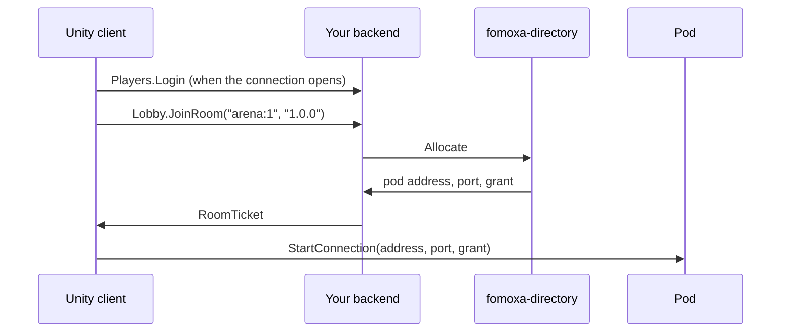

# Game backend

When your game servers run as pods behind the Fomoxa directory, a client cannot pick a pod by itself. It needs a grant for the pod that holds its room, and only the directory knows which pod that is. Your backend sits between the two: it logs the player in, asks the directory for the room, and returns the grant. Pods call it as well, when the game moves a player to another room.

You write the backend yourself, starting from the `fomoxa-backend` template. The template gives you a working .NET service with an empty login, the call to the directory, a health check and a Dockerfile. This page takes you from an empty folder to a Unity client that joins a room through it.

> **Outcome:** a Unity client logs in to your backend, gets a grant for a room, and connects to the pod that holds the room.

## Prerequisites

- The .NET 8 SDK on the machine that builds the backend.
- A running `fomoxa-directory`, its address, and the key of its `backend` role.
- Pods that register with the directory through `DirectoryPod` and listen with [encrypted UDP](../connections/transports/encrypted-udp.md). The `com.fomoxa.rpc` README covers the pod side under "Running as a pod".
- A Unity project with `com.fomoxa.networking` and `com.fomoxa.rpc`.

## What you will build



The backend has two kinds of port. Players reach the public ports, one for TCP and one for WebSocket, and log in with `Players.Login`. Pods reach the internal port and log in with `Pods.Login`, which carries the pod key. `TransferPlayer` exists only on the internal port, so a logged-in player cannot ask for a grant to someone else's room.

## 1. Create the backend

Run these commands in a terminal, in the folder where the backend should live:

```
dotnet new install Fomoxa.Backend.Templates
dotnet new fomoxa-backend -n MyGame.Backend
cd MyGame.Backend
dotnet build
```

`MyGame.Backend` is your choice; the template uses it for the folder, the project and the namespaces. The new folder holds:

| Path | Contents |
|---|---|
| `MyGame.Backend/` | The backend: `Program.cs`, the services, the settings |
| `MyGame.Backend/Models/` | The models of the calls between the client and the backend |
| `MyGame.Backend/Generated/` | Codecs written by `fomoxac`; commit them |
| `fomoxa-rpc/` | fRPC for C# and the directory's models, as source |
| `tools/fomoxac/` | `fomoxac` for Linux x64 and Windows x64 |
| `Dockerfile` | An image with the backend and its health check |

**Check:** the build succeeds. It runs `fomoxac generate` first, which leaves `Generated/` as it is until you change a model. On macOS no `fomoxac` is bundled, so the build prints a notice and uses the committed `Generated/` folder.

## 2. Point it at the directory

Open `MyGame.Backend/appsettings.json`:

```json
{
  "Fomoxa": {
    "Directory": {
      "Address": "127.0.0.1:9500",
      "Key": { "File": "/run/secrets/fomoxa/backend" }
    },
    "Players": {
      "Tcp": "0.0.0.0:9600",
      "WebSocket": "0.0.0.0:9601"
    },
    "Pods": {
      "Tcp": "0.0.0.0:9602",
      "Key": { "File": "/run/secrets/fomoxa/pod" }
    }
  }
}
```

Set `Directory:Address` to the `host:port` of the directory. The file never holds a key. Each key names a file (`"File"`) or an environment variable (`"Env"`), exactly one of the two. The backend removes one trailing newline and refuses a key shorter than 16 bytes. `Directory:Key` is the directory's `backend` key. `Pods:Key` is the key your pods will present on the internal port.

Environment variables override the file, with `__` between the parts of a name. For a local run with the keys in variables:

```
export Fomoxa__Directory__Address=127.0.0.1:9500
export Fomoxa__Directory__Key__File=
export Fomoxa__Directory__Key__Env=BACKEND_KEY
export BACKEND_KEY=<THE_DIRECTORY_BACKEND_KEY>
export Fomoxa__Pods__Key__File=
export Fomoxa__Pods__Key__Env=POD_KEY
export POD_KEY=<A_KEY_OF_16_BYTES_OR_MORE>
dotnet run --project MyGame.Backend
```

Clearing `__File` matters: a key with both `File` and `Env` is refused. An empty address turns that port off, and the pod key is only read while the internal port is on.

**Check:** the backend prints one line to stderr and keeps running:

```
backend: players on tcp 0.0.0.0:9600, websocket 0.0.0.0:9601; pods on tcp 0.0.0.0:9602; directory at 127.0.0.1:9500
```

A settings mistake prints the reason instead, such as `backend: Directory:Key: the environment variable BACKEND_KEY is not set`, and the process exits with code 1. The backend connects to the directory on the first `JoinRoom`, not at startup, so a wrong directory address or key shows up as an error of that call.

## 3. Write the login

`MyGame.Backend/Players.cs` holds the login. The template accepts any player name that is not empty and checks nothing else:

```csharp
public (Identity Identity, PlayerWelcome Response) Authenticate(CallContext context, PlayerLogin request)
{
    if (string.IsNullOrEmpty(request.Player))
    {
        throw new RpcException(Status.Unauthenticated("a player name is required"));
    }

    return (new Identity(request.Player, new[] { Roles.Player }), new PlayerWelcome { Player = request.Player });
}
```

> **Warning:** with this login anyone can play under any name. Replace the body with your game's check before the backend faces players, and keep `Roles.Player` in the identity, since `JoinRoom` requires it.

`PlayerLogin` has a `Secret` field of type `bytes` for whatever your check needs, and you can change the model. The first value of the identity is the name that `JoinRoom` sends to the directory. It reaches the pod's [authenticator](../connections/authentication.md) as `context.ConnectionData`, as UTF-8 bytes.

## 4. Share the models with the Unity project

The client and the backend must declare the same models. Copy these files into the Unity project:

| From the backend | Into the Unity project |
|---|---|
| `MyGame.Backend/Models/*.cs` | The Models Folder of the Fomoxa settings asset |
| `MyGame.Backend/Services.cs` | The assembly of the Generated Folder, which must reference `Fomoxa.Rpc` |

Unity runs `fomoxac` and the fRPC source generator, which writes `PlayersClient`, `LobbyClient`, `PodsClient`, `PodGateClient` and their `Methods` classes from `Services.cs`. Each time you change a model on one side, copy it to the other. If the two drift apart, the fRPC handshake compares the models both sides know and refuses the connection.

**Check:** Unity compiles without errors, and `LobbyClient` resolves in your scripts.

## 5. Ask for a room from the client

The client talks to the backend through a transport component that is not the `NetworkManager`'s transport. Add a second `TcpNetworkTransport` to another GameObject for native builds, or a `WebSocketNetworkTransport` for WebGL, and leave it off the `NetworkManager`. Its settings, such as Use Tls, apply to the backend connection.

Add this component to a GameObject and assign the transport components and the `NetworkManager` in the Inspector. The `NetworkManager` uses `EncryptedUdpNetworkTransport`, as for any pod.

```csharp
using System;
using System.Threading.Tasks;
using Fomoxa.Net;
using Fomoxa.Net.Transports;
using Fomoxa.Networking.Transports;
using Fomoxa.Rpc;
using Fomoxa.Rpc.Net;
using Fomoxa.Unity;
using MyGame.Backend;
using MyGame.Backend.Models;
using UnityEngine;

public sealed class RoomJoiner : MonoBehaviour
{
    [SerializeField] private NetworkManager manager;
    [SerializeField] private NetworkTransport backendTransport;
    [SerializeField] private string backendAddress = "backend.example.com";
    [SerializeField] private ushort backendPort = 9600;

    private ITransportConnector connector;
    private TaskCompletionSource<ITransport> connecting;
    private RpcConnection connection;

    public async Task Join(string player, string roomKey)
    {
        connecting = new TaskCompletionSource<ITransport>();
        connector = backendTransport.CreateFactory().CreateConnector(backendAddress, backendPort);
        ITransport transport = await connecting.Task;

        var options = new ConnectOptions
        {
            Credential = Credential.Of(PlayersMethods.Login, new PlayerLogin { Player = player }),
        };
        connection = RpcConnection.Driven(transport, NetSchema.Build(), LobbyClient.Declare(PlayersClient.Registry()).Build(), options);
        await connection.Opened;

        try
        {
            RoomTicket ticket = await new LobbyClient(connection).JoinRoomAsync(new JoinRoomRequest
            {
                RoomKey = roomKey,
                Version = Application.version,
            });
            manager.ClientManager.StartConnection(ticket.Address, ticket.Port, ticket.Connection);
        }
        catch (RpcException failed) when (failed.Status.Details is NoRoomForVersion missing)
        {
            Debug.LogWarning($"No server runs version {missing.Version}; update the game.");
        }
    }

    private void Update()
    {
        if (connector != null)
        {
            ConnectStatus status = connector.Poll(out ITransport transport);
            if (status == ConnectStatus.Connected)
            {
                connector.Dispose();
                connector = null;
                connecting.SetResult(transport);
            }
            else if (status != ConnectStatus.Pending)
            {
                connector.Dispose();
                connector = null;
                connecting.SetException(new InvalidOperationException($"cannot reach the backend: {status}"));
            }
        }

        connection?.Tick(MonotonicClock.Now);
    }

    private void OnDestroy()
    {
        connector?.Dispose();
        connection?.Dispose();
    }
}
```

`NetSchema` is the class that `fomoxac` writes into your Generated Folder. The connection runs on the main thread: `Update` polls the connector and ticks the connection, and every `await` above resumes inside that tick. The connection logs in once, when it opens, so later calls on it need no credential. A refused login fails `connection.Opened` with a `ConnectException` whose `Status` is `UNAUTHENTICATED`.

This code was checked against the package source; it has not been run in a game yet.

`JoinRoom` fails in these ways:

| Status | When |
|---|---|
| `FAILED_PRECONDITION` with `NoRoomForVersion` | No pod runs the version the client sent |
| `UNAVAILABLE` | The backend cannot reach the directory, or the directory refused the backend key |
| `INVALID_ARGUMENT` | The room key is empty |
| `UNAUTHENTICATED` | The connection has not logged in |

**Check:** call `Join("ana", "arena:1")` while a pod of the same version is registered. The client reaches `Started` on the pod, and the pod's authenticator sees `ana` in `context.ConnectionData`. Two players who join the same room key get grants for the same pod.

## 6. Move a player from a pod

When the game moves a player to another room, the pod asks the backend for a grant on the internal port. The pod opens its own connection, as in step 5, with the pod key and the pod registry:

```csharp
var options = new ConnectOptions
{
    Credential = Credential.Of(PodsMethods.Login, new PodLogin { Key = podKey }),
};
RpcConnection gate = RpcConnection.Driven(transport, NetSchema.Build(), PodGateClient.Declare(PodsClient.Registry()).Build(), options);
await gate.Opened;

RoomTicket ticket = await new PodGateClient(gate).TransferPlayerAsync(new TransferPlayerRequest
{
    Player = player,
    RoomKey = "arena:2",
    Version = Application.version,
});
manager.ServerManager.Transfer(peerId, ticket.Address, ticket.Port, ReadOnlyMemory<byte>.Empty, ticket.Connection);
```

`podKey` is the key you set as `Pods:Key`, read from your secret store on the pod. Like the client, the pod ticks `gate` every frame. `Transfer` with a grant is described under [server transfers](../connections/transports/encrypted-udp.md#server-transfers); pass a signed ticket instead of `ReadOnlyMemory<byte>.Empty` when the new pod needs data from the old one, as [server transfer](../connections/transfer.md) explains. `TransferPlayer` fails like `JoinRoom`.

**Check:** the player stops on the old pod with `StopReason.Transferred` and reaches `Started` on the pod that holds `arena:2`.

## 7. Deploy

Build the image from the backend folder:

```
docker build -t mygame-backend .
```

The image runs the backend as the `app` user and exposes ports 9600, 9601 and 9602. Mount the keys at the paths in `appsettings.json`, or set the variables from step 2.

| Port | Reached by | Notes |
|---|---|---|
| 9600, TCP | Native clients | Through an ingress or load balancer that ends TLS |
| 9601, WebSocket | WebGL clients | Through an ingress that ends TLS and forwards WebSocket upgrades; clients use `wss://` |
| 9602, TCP | Pods | Inside the cluster only |

The ports carry fRPC without TLS, so never expose them directly. The backend has its own ingress; it does not go through the UDP gateway.

The image's `HEALTHCHECK` asks `FRpc.Health` on port 9600. If you turn that port off or move it, change the address in the Dockerfile. In Kubernetes, use the same command as an exec probe:

```
dotnet /app/health/fomoxa-rpc-health.dll 127.0.0.1:9600
```

It prints `SERVING` and exits with 0 while the backend answers. The backend stops cleanly on SIGTERM.

## Verify the result

- [ ] `dotnet build` succeeds and `Generated/` does not change.
- [ ] The backend prints its ports and the directory address at startup.
- [ ] `fomoxa-rpc-health` prints `SERVING` on port 9600.
- [ ] A client logs in, gets a `RoomTicket` and reaches `Started` on the pod.
- [ ] A client of a version no pod runs gets `NoRoomForVersion`.
- [ ] Port 9602 is not reachable from outside the cluster.

## Common mistakes

- **Every `JoinRoom` fails with `UNAVAILABLE`:** the directory address is wrong, the directory is down, or `Directory:Key` is not the directory's `backend` key. The status message says which.
- **The backend exits at startup with "needs exactly one of File and Env":** a variable added `Env` while `appsettings.json` still names `File`. Clear `Fomoxa__Directory__Key__File` as in step 2.
- **The client cannot open the backend connection after a model change:** the models of the client and the backend differ. Copy the changed files again, as in step 4.
- **The health check fails although the backend runs:** port 9600 is off or moved, and the Dockerfile still asks it.
- **A pod's `TransferPlayer` is refused:** the pod called the public port, which has no `TransferPlayer`, or its key is not `Pods:Key`.

## Next steps

- [Encrypted UDP](../connections/transports/encrypted-udp.md): grants on the pod and in its authenticator.
- [Server transfer](../connections/transfer.md): signed tickets between pods.
- [Client TLS](../connections/transports/tls.md) and [WebSocket](../connections/transports/websocket.md): the backend connection behind an ingress.
- [Deployment](deployment.md): ports and versions of the game servers.
