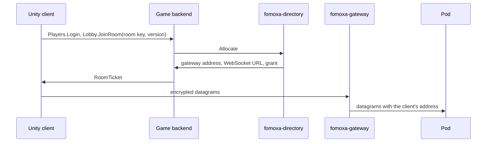

# Cluster

When one server cannot hold all of a game's players, the game runs many servers, called pods, and each player connects to the pod that holds their room. Fomoxa provides the parts for this: a directory that knows which pod holds which room, a gateway that gives all pods one public address, a template for the game's backend, and the pod side in `com.fomoxa.rpc`. This page shows how they fit together and links to the page of each part.

## The parts

| Part | What it does | Where it comes from |
|---|---|---|
| Unity client | Logs in to the backend, then connects to its pod with [encrypted UDP](../connections/transports/encrypted-udp.md) or, in WebGL, [encrypted WebSocket](../connections/transports/encrypted-websocket.md) | Your game, with `com.fomoxa.networking` and `com.fomoxa.rpc` |
| Game backend | Logs players in, asks the directory for a room, and hands back a connect grant | You write it from the `fomoxa-backend` template; see [game backend](backend.md) |
| `fomoxa-directory` | Maps room keys to pods, places new rooms, issues grants, follows pods as they register, report load and drain | Source in [fomoxa/gateway](https://github.com/fomoxa/gateway) |
| `fomoxa-gateway` | Gives the pods one public UDP address and, optionally, a WebSocket endpoint, and routes each datagram to its pod | Source in [fomoxa/gateway](https://github.com/fomoxa/gateway) |
| Pod | Your game server. It registers with the directory through `DirectoryPod` and listens with encrypted UDP behind the gateway | Your game; see "Running as a pod" in the [`com.fomoxa.rpc` README](https://github.com/fomoxa/com.fomoxa.rpc) |

The directory, the backend and the pods talk to each other over fRPC. The gateway carries only game traffic. The backend has its own public address and does not go through the gateway.

## Joining a room

1. The client logs in to the backend and calls `JoinRoom` with a room key and its build version. The room key is a string your game chooses, such as `arena:1`.
2. The backend calls `Allocate` on the directory. If a pod already holds the room, the directory returns that pod. Otherwise it picks a pod with the placement rules in its settings, for example only pods that run the client's version, and maps the room to it.
3. The directory issues a grant for that pod. Its settings `public_address` and `public_websocket` name the gateway's public address and WebSocket URL, so the ticket points the client at the gateway instead of the pod. Without a gateway, leave them out and the ticket holds the pod's own address.
4. The client calls `StartConnection` with the address, port and grant on encrypted UDP, or with the WebSocket URL and port 0 on encrypted WebSocket.
5. The gateway reads the pod id in each datagram's session id and forwards the datagram to that pod. The pod answers through the gateway.
6. The pod's [authenticator](../connections/authentication.md) receives the player name from the grant as `ConnectionData`. Your game decides how the client names the room it came for, for example in its authentication message, and the pod records a room it starts holding with `AcquireRoom`.

## Draining a pod

A pod is drained when an operator calls `Drain` on the directory's admin service, or when the pod asks for it with `RequestDrain`, for example when the platform is about to stop it. The directory stops placing new rooms on the pod and tells it through `OnDrain`, with a deadline.

1. For each room, the game calls `pod.Relocate(roomKey, tickets, data)`. The directory moves the room to another pod in one step and returns the new address, the WebSocket URL and one grant per player.
2. The game calls `ServerManager.Transfer` for each player. A player keeps its transport when it moves, so check `ServerManager.ArrivedOverWebSocket(peerId)` and give a WebSocket player the WebSocket URL with port 0.
3. Each client connects to the new pod through the gateway by itself. See [server transfer](../connections/transfer.md).
4. At the deadline the pod stops its server whether or not rooms are left. Exiting the process is up to the game or the platform.

## Keys

| Key | Held by | Used for |
|---|---|---|
| `backend` role key | Directory, backend | The backend's calls to `Allocate` |
| `pod` role key | Directory, pods | Registration, load, rooms and drains |
| `gateway` role key | Directory, gateways | Following the table of pods |
| `admin` role key | Directory, operators | `Drain` and reading the state of the pods |
| Root key | Directory only | Deriving each pod's ticket key |
| Pod key of the backend | Backend, pods | Pods calling the backend's internal port, such as `TransferPlayer` |

A pod gets its ticket key from the directory when it registers, and uses it to open the grants issued for it. No other process needs that key. The directory and the backend read keys from files or environment variables, never from their settings files, so the settings can live in a ConfigMap or in Git.

## Running the parts

| Part | How to run it |
|---|---|
| Directory and gateway | Build both from [fomoxa/gateway](https://github.com/fomoxa/gateway) at tag `0.2.0` with `cargo build --release -p fomoxa-directory -p fomoxa-gateway`. The binaries are in `target/release/`. The repository's README describes their settings. |
| Backend | `dotnet run`, or the `Dockerfile` the template creates |
| Pods | Your game's server build, a Unity player or a [console server](../console-server/overview.md) |

These must reach each other:

| From | To |
|---|---|
| Clients | The backend's public ports, and the gateway's UDP address or WebSocket endpoint |
| Backend | The directory's service port |
| Pods | The directory's service port, the backend's internal port, and the gateway's address they answer to |
| Gateway | The directory's service port, and the pods' UDP ports |
| Operators | The directory's admin port |

Put a TLS terminator in front of the backend's public ports and the gateway's WebSocket endpoint if clients connect with TLS or `wss://`. Neither the backend nor the gateway ends TLS itself.

There are no prebuilt binaries, container images or Kubernetes manifests for the directory and the gateway yet.
