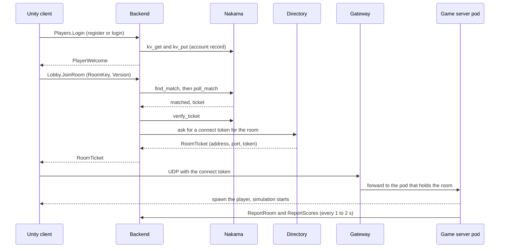

# Architecture overview

Top of this document: [documentation home](../README.md) · Next: [backend.md](backend.md)

This section explains how the pieces fit together and where each one lives in the repository. Read it before changing code. The other pages cover one component each: [backend](backend.md), [Nakama module](nakama-module.md), [game server](game-server.md), [Unity client](client-code.md), [RPC interface](rpc-api.md) and [development guide](development.md).

## Components

| Component | Where | Language | Job |
|---|---|---|---|
| Unity client | `MyGame/` | C# (Unity 6) | login, lobby, the match, the UI |
| Backend | `MyGame.Backend/` | C# (.NET 8) | the only server clients talk to for accounts, rooms, friends and scores |
| Directory | `gateway/` (built from the Rust source) | Rust | registry of game server pods, hands out tickets, tracks drains |
| Gateway | `gateway/` | Rust | UDP entry point that forwards encrypted game traffic to the right pod |
| Game server (pod) | `MyGame/Server~/` | C# (.NET 8) | runs one room, simulates movement and jumping |
| Nakama | `deploy/nakama/modules/main.lua` | Lua inside Nakama | matchmaking, tickets, and key-value storage for accounts |
| Postgres | `deploy/k8s/postgres.yaml` | | Nakama's database |
| TLS proxy | `deploy/k8s/tls-proxy.yaml` | nginx | terminates TLS in front of the backend ([details](../deploy/traffic-and-tls.md)) |
| Agones | installed with Helm | Go | game server lifecycle: `Ready`, `Allocated`, `Shutdown` |
| Mock cluster | `tools/MockCluster/` | C# (.NET 8) | stands in for directory, backend and pods on one machine |

## Ports

| Port | Protocol | Who listens | Who connects |
|---|---|---|---|
| 9600 | TCP, fRPC | backend | clients (plain) and the TLS proxy |
| 9601 | WebSocket, fRPC | backend | browser clients |
| 9643 | TCP, TLS | TLS proxy | clients |
| 7777 | UDP | gateway | clients (game traffic) |
| 7778 | UDP | each game server pod | the gateway |
| 9602 | TCP, fRPC | backend, cluster internal | game server pods |
| 9500 | TCP, fRPC | directory | backend, gateway, pods |
| 9501 | TCP, fRPC | directory | admin tools |
| 7350 | HTTP | Nakama | backend, test scripts |
| 9610, 9611 | HTTP | backend, pods | Prometheus (`/metrics`) |

A client only ever reaches TCP 9600 or 9643 and UDP 7777. Everything else stays inside the cluster.

## From login to playing

In words:

1. The client opens an fRPC connection to the backend and logs in. The backend checks the account in Nakama storage.
2. The client asks to join a room. For `auto` the backend sends the request to Nakama, which pairs two players and returns a ticket. For a named room such as `arena:1` the same module pairs the two players who ask for that room.
3. The backend verifies the ticket with Nakama, then asks the directory for a connect token for the pod that holds the room.
4. The client sends UDP packets with the token to the gateway. The gateway forwards them to that pod. All game traffic is encrypted with keys derived from the token.
5. The pod reports player counts and scores to the backend over port 9602, which feeds the room list, the scoreboard and the records.

## Who is trusted with what

Every connection between components authenticates with a key from `deploy/secrets` ([list](../reference.md#3-secrets)). Each key opens only one door.

| Key | Used between | Purpose |
|---|---|---|
| `directory/root` | the directory itself | its root key; 64 hex characters |
| `directory/backend` | backend and directory | the backend asks the directory for tickets |
| `directory/gateway` | gateway and directory | the gateway asks the directory where to forward |
| `directory/pod` | game server and directory | the pod registers and claims a room |
| `directory/admin` | admin tools and directory | directory administration (`Drain`, `ReadPods`) |
| `backend-pod` | game server and backend | `ReportRoom` and `ReportScores` on port 9602 |
| Nakama `http-key` | backend and Nakama | the backend-only RPCs (`verify_ticket`, `kv_get`, `kv_put`, `reset_match`) |
| Nakama `server-key` | client side of the Nakama API | device and email authentication |

A game server pod holds only `pod` and `backend-pod`. If a pod were compromised, it could not issue tickets or read accounts.

## What is stored where

| Data | Stored in | Lifetime |
|---|---|---|
| Account, password hash, recovery hash | Nakama storage, collection `account` | permanent |
| Profile (best steps, matches) | Nakama storage, collection `profile` | permanent |
| Friends and invitations | Nakama storage, collection `social` | permanent |
| Matchmaking queue, tickets, results | Nakama storage, collections `match_queue`, `match_ticket`, `match_result`, `room_stat` | seconds to minutes |
| Online presence | backend memory | 20 seconds without a ping |
| Room player counts, scoreboards | backend memory, fed by pod reports | until the next report |
| Login failure counters | backend memory | 60 second lockout |

Because presence, scoreboards and failure counters live in memory, the backend runs as a single replica. Restarting it clears them, and players reappear as they ping again.
