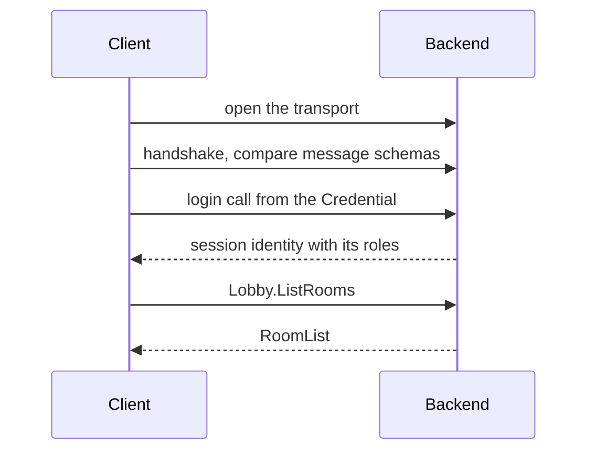

# Using fRPC

Top of this document: [documentation home](../README.md) · Previous: [rpc-api.md](rpc-api.md) · Next: [frpc-add-a-method.md](frpc-add-a-method.md)

fRPC is the RPC library the demo uses for everything except gameplay: logging in, listing rooms, asking for a ticket, reporting scores. You declare a service as a C# interface, and the tools generate a typed client and server from it.

The [RPC interface](rpc-api.md) page lists the existing services and messages. To add your own method, follow [Add an fRPC method](frpc-add-a-method.md).

## Where the demo uses fRPC

| Caller | Called | Port | Services | Connection in the code |
|---|---|---|---|---|
| Unity client | backend | TCP 9600, or WebSocket 9601 | `Players`, `Lobby` | `RoomJoiner` |
| Game server | backend | TCP 9602 | `Pods`, `PodGate` | `BackendReporter` |
| Backend | directory | TCP 9500 | `Directory` | `DirectoryLink` |
| Game server | directory | TCP 9500 | `Directory` | `DirectoryPod` from `com.fomoxa.rpc` |

`MoveInput` and the replicated state travel over encrypted UDP, outside fRPC.

A connection goes through three stages before your first call:



If the schemas conflict or the login is refused, the connection fails and no call runs.

## The parts of a method

| Part | Where it lives | Who writes it |
|---|---|---|
| Messages (`[Network]` and `[Codec("rpc")]` classes) | `Models/*.cs` in each tree | you |
| Service interface (`[Service]`, `[Unary]`) | `Services.cs` in each tree | you |
| Codecs and `NetSchema` | `Generated/` in each tree | `fomoxac` |
| `LobbyClient`, `LobbyServer`, `LobbyMethods` | not on disk, produced at compile time | the source generator in `Fomoxa.Rpc.Generator` |
| Handler class that implements `ILobby` | `Players.cs`, `MockBackend.cs` | you |

The repository has two trees, each with its own copy of the messages and of `Services.cs`:

| Tree | Messages | Services | Generated code | Compiled into |
|---|---|---|---|---|
| Backend | `MyGame.Backend/MyGame.Backend/Models/` | `MyGame.Backend/MyGame.Backend/Services.cs` | `MyGame.Backend/MyGame.Backend/Generated/` | the real backend |
| Unity | `MyGame/Assets/Network/Models/Backend/` | `MyGame/Assets/Network/Rpc/Services.cs` | `MyGame/Assets/Network/Generated/` | the Unity client, the game server and the mock cluster |

## Open a connection

`RpcConnection` has three ways to start, and the demo uses all of them:

| Call | Who runs the network | Used by |
|---|---|---|
| `RpcConnection.Connect(address, ...)` | the connection itself, over TCP | game server, backend, mock selftest |
| `RpcConnection.Open(transport, ...)` | the connection itself, over a transport you opened | mock selftest with TLS |
| `RpcConnection.Driven(transport, ...)` | your loop, through `connection.Tick(now)` | Unity client |

This is how the game server connects, in `BackendReporter.cs`:

```csharp
var options = new ConnectOptions
{
    Credential = Credential.Of(PodsMethods.Login, new PodLogin { Key = key }),
};
return RpcConnection.Connect(address, NetSchema.Build(), PodGateClient.Declare(PodsClient.Registry()).Build(), options);
```

- `NetSchema` is the generated class of the tree you compile in.
- The registry lists every service this connection calls. `Registry()` starts the list and `Declare` adds a service to it.
- `Credential` names the login method and its request. The connection sends it right after the handshake.

In Unity, `connection.Tick` has to run every frame, as `RoomJoiner.Update` does. An awaited call completes inside `Tick`, on the main thread, so without `Tick` it never completes. `RoomJoiner.LoginCore` waits for `connection.Opened` before it makes calls.

A connection does not retry calls by default. After it drops, `IsOpen` is false and calls fail with `UNAVAILABLE`. The demo's code handles this in three places: `BackendReporter` reconnects on its next round, `DirectoryLink` opens a new connection and repeats the call once, and `RoomJoiner.JoinWithRetry` tries `JoinRoom` up to three times.


The login call carries the player's password, and on port 9600 it travels unencrypted. Outside your own network, connect through TLS on port 9643 ([traffic path and TLS](../deploy/traffic-and-tls.md)).


## Log in and check roles

The login is a method on its own service, handled by a class that implements `IAuthenticator`. It returns an `Identity`, which holds a principal (the name of the caller) and its permissions. `PodKeys` in `Pods.cs` is the shortest example:

```csharp
if (!CryptographicOperations.FixedTimeEquals(request.Key, key))
{
    throw new RpcException(Status.Unauthenticated("the pod key does not match"));
}

return (new Identity(Roles.Pod, new[] { Roles.Pod }), new FRpcVoid());
```

`Backend.cs` attaches it to the server with `.Authenticate(new PodKeys(settings.PodKey))`. Every later call on that connection carries the identity, and a handler reads it from `context.Session.Principal`.

| Situation | What the caller gets |
|---|---|
| The login is refused, for example a wrong password | `ConnectException` while connecting, with the reason in `.Status` |
| The connection sent no `Credential` | `RpcException` with `UNAUTHENTICATED` on the first call |
| The identity lacks the role in `Requires` | `RpcException` with `PERMISSION_DENIED` |
| Nothing listens on the address | `ConnectException` after `ConnectOptions.Timeout` (5 seconds by default), and `.Status` is null |

## Handle errors

A handler refuses a call by throwing `RpcException` with a status, and the caller receives the same code and message:

```csharp
throw new RpcException(Status.InvalidArgument("Echo needs some text"));
```

The caller catches it and reads the status. This example also reads a typed detail:

```csharp
try
{
    await lobby.JoinRoomAsync(request, CallOptions.Within(TimeSpan.FromSeconds(30)));
}
catch (RpcException failed) when (failed.Status.Details is NoRoomForVersion missing)
{
    Debug.LogWarning($"no pod runs version {missing.Version}");
}
```

A method lists the detail classes it may send in `Details`, such as `Details = new[] { typeof(NoRoomForVersion) }`, and the handler passes one to the status: `Status.FailedPrecondition(message, new NoRoomForVersion { Version = version })`. A detail the method does not list reaches the caller as `INTERNAL`.


Any other exception also reaches the caller, as `INTERNAL` with the exception's message. If that message can contain internal addresses or data, catch the exception and throw an `RpcException` with your own text.


The [RPC interface](rpc-api.md#errors) page lists the codes clients meet in this demo.

## Deadlines and slow handlers

A call that runs out of time ends with `DEADLINE_EXCEEDED`.

| You pass | Deadline |
|---|---|
| nothing | the `Deadline` option of the method, or else 5 seconds |
| `CallOptions.Within(TimeSpan.FromSeconds(10))` | 10 seconds |
| `CallOptions.WithoutDeadline` | none on the caller's side |

Choose the deadline from what the call does. `RoomJoiner` gives `JoinRoom` 30 seconds because the backend can wait 15 seconds for a match. The server also limits each unary handler to 30 seconds.

A handler that returns a plain value runs on the loop of its connection, and later calls from that connection wait for it. On the mock backend, a plain handler that slept for 1.5 seconds delayed the next call on its connection by 1.5 seconds, while a call from another connection answered in 1 ms. With a `Task` handler awaiting the same delay, the next call on the connection answered in 1 ms too. Return `Task` for anything that waits on Nakama, the directory or a file, as `JoinRoom` and `ListRooms` do. Plain return values suit quick work such as `Presence`.

## Options on a method

| Option | Example | Effect | Used in the demo |
|---|---|---|---|
| `Requires` | `Requires = Roles.Player` | the caller's identity must have this permission | yes |
| `Details` | `Details = new[] { typeof(NoRoomForVersion) }` | the typed details the method may send | yes |
| `Deadline` | `Deadline = "10s"` | the deadline when the caller passes none. Units are `ms`, `s`, `m`, `h` | no |
| `Idempotent` | `Idempotent = true` | allows a retry policy to repeat the call after `UNAVAILABLE` | no |

The services in this demo declare only `[Unary]` methods, with one request and one response. The library also has `[ServerStream]`, which this page does not cover.

## Change a message safely

The handshake compares the messages both sides know, so the two trees can have different schemas: the Unity tree has gameplay messages the backend lacks. A message on both sides must have the same fields. Against the real backend:

| Change | Result |
|---|---|
| The backend gains a new method and new messages, and the client is not updated | the client connects, and its existing calls work |
| The client calls a method the backend does not have | that call fails with `UNIMPLEMENTED`, and other calls work |
| One tree adds a field to a message both sides use | the connection fails: `ConnectException: the handshake failed: SchemaConflict` |

For a running system, that gives two rules:

- To add a method, deploy the backend first, then the clients.
- Changing the fields of an existing message locks out every client and pod not built from the same models, so update them together. To avoid that, add a new message and method and retire the old ones later.

The game server is built from the Unity tree, so a change there also means a new server image ([updates](../operations/01-status-and-updates.md)).

## Common mistakes

| Symptom | Cause | Fix |
|---|---|---|
| `FRPC003: Lobby.X uses YRequest, which is not a [Network] model with an rpc codec` | the codec is not generated, or the class lacks `[Codec("rpc")]` | check the attributes, then [regenerate](development.md#regenerate-the-code) |
| `FRPC001: Lobby.A and Lobby.B share the request model` | two methods use one request class | give each method its own request class |
| `CS0535` on `MockLobby` or `Lobby` | a method was added to `ILobby` without a handler | implement it in both classes |
| `the handshake failed: SchemaConflict` | a message differs between the trees, or the generated code is stale | copy the model to the other tree, regenerate both, rebuild both |
| CI fails on `generate --check` | the generated files were not committed | regenerate and commit `Generated/` and `.fomoxa/` |
| `UNIMPLEMENTED`, `no handler for request type` | the running backend is older than the client | deploy the backend |
| `UNAUTHENTICATED`, `the session has no identity` | the connection has no `Credential` | set it in `ConnectOptions` |
| `DEADLINE_EXCEEDED` after exactly 5 seconds | the call passed no deadline and took longer than the default | pass `CallOptions.Within` with a longer time |
| `the session was not ready before the timeout` | nothing listens on that address and port | start the backend, or check the address |
| An awaited call never finishes in Unity | `connection.Tick` is not running | tick the connection in `Update`, on an active object |

## Next steps

- [Add an fRPC method](frpc-add-a-method.md): every file a new method touches, with a working example.
- [RPC interface](rpc-api.md): every service, message and error code in the demo.
- [`com.fomoxa.rpc`](https://github.com/fomoxa/com.fomoxa.rpc): the package README, including `DirectoryPod`.
