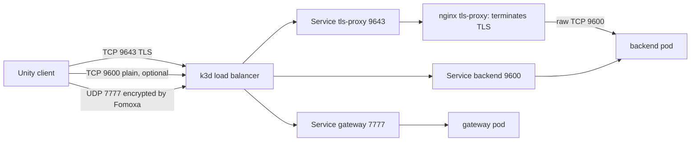

# Traffic path and where TLS is configured

Top of this document: [03-DEPLOY-KUBERNETES](README.md) · Previous: [manifest-walkthrough.md](manifest-walkthrough.md)

This page answers one question: what sits in front of the backend, and which component handles TLS. In this repository the answer is a small nginx proxy called `tls-proxy`, plus the Kubernetes `LoadBalancer` Services that expose it. The backend itself speaks plain TCP and knows nothing about certificates.

## The path of a request



There are three layers, from outside to inside:

| Layer | What it is | Configured in |
|---|---|---|
| 1. Port mapping on your machine | the k3d load balancer container `k3d-fomoxa-serverlb` maps host ports 7777/udp, 9600, 9643 and 7350 into the cluster | `k3d cluster create ... --port ...` ([step 5](03-cluster-and-agones.md)) |
| 2. Kubernetes Services of type `LoadBalancer` | `tls-proxy` (9643), `backend` (9600, 9601), `gateway` (7777/udp), `nakama` (7350) | `deploy/k8s/*.yaml` |
| 3. The TLS terminator | nginx in the `tls-proxy` pod decrypts TLS and forwards raw bytes to `backend:9600` | `deploy/k8s/tls-proxy.yaml` and secret `fomoxa-tls` |

The game traffic over UDP 7777 is not proxied by nginx. Fomoxa encrypts it itself with the key material in the ConnectToken the client receives after login, so it needs no certificate.

## The proxy configuration

This is the nginx configuration stored in the ConfigMap `tls-proxy-config` (file `deploy/k8s/tls-proxy.yaml`):

```
worker_processes 1;
pid /tmp/nginx.pid;
events { worker_connections 1024; }
stream {
  server {
    listen 9643 ssl;
    ssl_certificate     /tls/tls.crt;
    ssl_certificate_key /tls/tls.key;
    ssl_protocols       TLSv1.2 TLSv1.3;
    proxy_pass          backend.fomoxa.svc.cluster.local:9600;
    proxy_connect_timeout 5s;
    proxy_timeout       1h;
  }
}
```

Reading it line by line:

| Line | Meaning |
|---|---|
| `stream { }` | nginx's raw TCP mode. The fRPC protocol is not HTTP, so the `http { }` block would not work |
| `listen 9643 ssl` | accept TLS connections on 9643 and decrypt them |
| `ssl_certificate`, `ssl_certificate_key` | the certificate and private key, mounted from the secret `fomoxa-tls` at `/tls` |
| `ssl_protocols TLSv1.2 TLSv1.3` | refuse older protocol versions |
| `proxy_pass backend.fomoxa.svc.cluster.local:9600` | after decrypting, forward the bytes to the backend Service inside the cluster |
| `proxy_connect_timeout 5s` | give up if the backend does not accept within 5 seconds |
| `proxy_timeout 1h` | close a connection that is idle for an hour |
| `pid /tmp/nginx.pid` | the unprivileged image cannot write elsewhere |

The proxy pod mounts two things: the ConfigMap as `/etc/nginx/nginx.conf` and the secret as `/tls`. Both are read-only.

```bash
kubectl get configmap tls-proxy-config -n fomoxa -o jsonpath='{.data.nginx\.conf}'
kubectl exec deploy/tls-proxy -n fomoxa -- ls /tls
```

The second command should list `tls.crt` and `tls.key`.

## The Service that exposes it

```yaml
apiVersion: v1
kind: Service
metadata:
  name: tls-proxy
  namespace: fomoxa
spec:
  type: LoadBalancer
  selector:
    app: tls-proxy
  ports:
    - name: tls
      port: 9643
      targetPort: 9643
```

`type: LoadBalancer` is what lets the k3d load balancer forward host port 9643 to this Service. Check it:

```bash
kubectl get svc tls-proxy -n fomoxa
docker port k3d-fomoxa-serverlb | grep 9643
```

## Where the certificate comes from

| Item | Value |
|---|---|
| Files on disk | `deploy/secrets/tls/tls.crt` and `tls.key`, created by `./scripts/gen-tls-cert.sh` ([step 2](01-prepare-and-keys.md)) |
| Kubernetes object | secret `fomoxa-tls` of type `kubernetes.io/tls`, created in [step 8](04-secrets.md) |
| Mounted by | only `tls-proxy`, at `/tls` |
| Kind of certificate | self-signed; the script prints its SHA-256 fingerprint, the pin |

## How the client trusts it

The client connects to port 9643 with `-tls` or with a pin:

```
MyGame.exe -backend:127.0.0.1:9643 -tlspin:<SHA-256 fingerprint without colons>
```

With a pin, the client compares the SHA-256 of the certificate the server presents with the pin and refuses any other. This is how a self-signed certificate is trusted without a certificate authority. With a certificate from a public CA, pass only `-tls`.

The mock cluster has the same thing built in (`TlsTerminator` in `tools/MockCluster`), so you can try the client side without Kubernetes: it listens on 9643 and prints the pin on startup.

## Options for production

| Option | When to use it | What changes |
|---|---|---|
| Keep nginx `tls-proxy`, use a CA certificate | one cluster, a domain name | replace the secret `fomoxa-tls` (cert-manager can manage it); clients pass `-tls` and no pin |
| A cloud TCP load balancer that terminates TLS | managed cloud | the load balancer holds the certificate and forwards raw TCP to the `backend` Service on 9600. The `tls-proxy` pod is then not needed |
| Close the plain port | always in production | `TLS_ONLY=1 ./scripts/k8s-up.sh`, or change `backend` to `ClusterIP` ([operations part 3](../operations/03-tls-and-keys.md#83-allow-only-the-encrypted-path)) |

Whatever you choose, nginx or a cloud load balancer must forward the bytes unchanged. The backend identifies players by the login inside the fRPC stream, not by the source address.

## Checks

```bash
# The proxy answers TLS and shows its certificate
openssl s_client -connect 127.0.0.1:9643 </dev/null 2>/dev/null | openssl x509 -noout -fingerprint -sha256

# The proxy forwards to the backend (logs show connections)
kubectl logs deploy/tls-proxy -n fomoxa --tail=20
```

If the fingerprint does not match the client's pin, see [operations part 3](../operations/03-tls-and-keys.md#82-replace-the-certificate). If port 9643 does not answer at all, see [troubleshooting](../troubleshooting.md).
