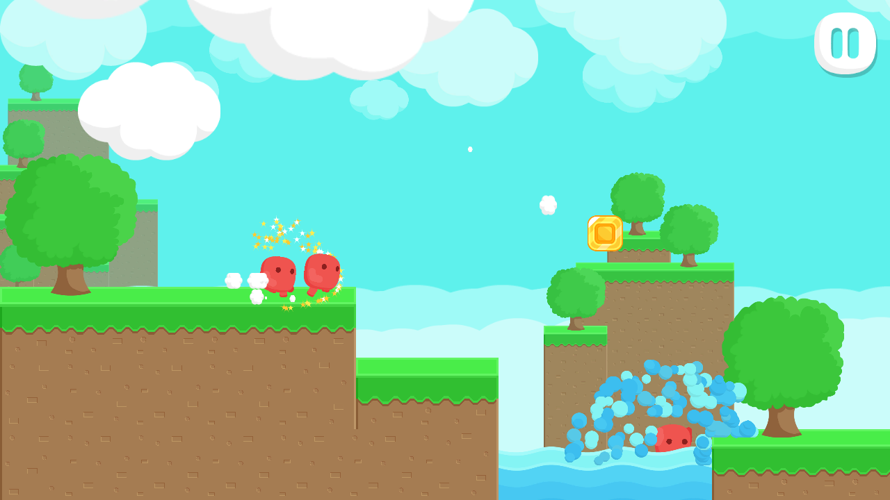

# Red Runner

Red Runner is a free 2D platformer by Bayat Games, written for one player. The character runs to the right through a level of blocks, jumps over water, saws, spikes and swinging maces, and picks up coins on the way. This example turns that game into an online game built on `com.fomoxa.networking`, one step at a time.

Where the other pages of this documentation explain how each part of the package works, these pages show what had to change in a real game that was never written for a network, in the order the changes were made.

## Why this game

Red Runner is small enough to read in an afternoon, yet it has the problems most offline games bring with them:

- One scene object holds the only character, and several other objects point at it.
- The character reads the keyboard in `Update` and moves with `Time.deltaTime`.
- `UnityEngine.Random` builds an endless level while the character runs.
- Enemies kill the character from their own collision callbacks.
- The pause screen sets `Time.timeScale` to 0.
- Maces wait for the character to come near before they move.

Each of these works for one player in one process, and every one of them has to change once the game goes online.

## The game before

The single-player game is [BayatGames/RedRunner](https://github.com/BayatGames/RedRunner), and its `master` branch at commit `2b675b5` is the starting point of this example. The port is [fomoxa/RedRunner](https://github.com/fomoxa/RedRunner), a fork whose `master` branch continues from that commit. The [offline baseline](offline-baseline.md) page describes how the starting version works.

## The game after

One dedicated server runs the game. A player opens the client, types the server address on the start screen and is placed straight in the level, without lobbies or rooms. Every player runs through the same level, which the server and each client build from a seed that the server picks. The level has a start block, twenty middle blocks and an end block, and reaching the end block sends the player back to the start.

The server decides when a player dies. Saws, spikes, water and the mace kill on the server, the client shows the skeleton when the server says so, and the player respawns at the start two seconds later. Coins and chests stay on each client as decoration, there is no score, and players pass through each other.

Your own character moves as soon as you press a key, because the client predicts it with `Rigidbody2D` physics and corrects it when the server's result differs. Other players' characters are interpolated from the server.

## Where Fomoxa is used

| Part of the game | Fomoxa feature | Page |
|---|---|---|
| Starting a server, a host or a client | `NetworkManager`, `ServerManager`, `ClientManager` | [Server](../../core/server.md), [Client](../../core/client.md), [Host mode](../../core/host-mode.md) |
| The level seed | State on a scene object | [State](../../synchronization/state.md), [Spawning](../../core/spawning.md#scene-objects) |
| One character per player | Prefab spawning with an owner | [Spawning](../../core/spawning.md), [Ownership](../../core/ownership.md) |
| Other players' positions | `NetworkTransform` | [NetworkTransform](../../synchronization/transform.md) |
| Your own character | Input, prediction and reconciliation with 2D physics | [Prediction overview](../../prediction/overview.md), [Rollback with physics](../../prediction/rollback.md) |
| Deaths and respawns | State, `NetworkTransform.Teleport` | [State](../../synchronization/state.md), [Teleporting](../../synchronization/transform.md#teleporting) |
| Maces and moving saws | Tick events and tick numbers | [Ticks and timing](../../concepts/tick.md) |

## What you learn

- How to find the parts of an offline game that assume one player and one process.
- How to give the server the decisions and leave presentation on the client.
- How to turn a frame-based character controller into a tick step that the server and the client both run.
- How to replicate a whole procedural level with four bytes.
- How to handle a respawn, which breaks both interpolation and prediction.
- What happens when a player quits or crashes.

## How the pages are organized

1. [Offline baseline](offline-baseline.md) describes the single-player game.
2. [Offline to online](offline-to-online/README.md) is the migration, in nine steps. Each step names the files it changes, the code, how to test it and the commit that made it.
3. [Online architecture](architecture.md) describes the finished game.
4. [Troubleshooting](troubleshooting.md) lists problems specific to this port.
5. [Rapier and a console server](rapier-and-console/README.md) continues from the finished game in four more steps. It moves the game onto the Rapier physics backend and adds a server that runs without Unity. Read it once the Unity version works; nothing in the first part depends on it.

If you have not used the package before, read [ticks and timing](../../concepts/tick.md), [authority](../../concepts/authority.md) and [prediction](../../concepts/prediction.md) first. The steps link to the pages they rely on instead of repeating them.

## Requirements

- Unity 6000.5 or later. The package needs 6000.5, while Red Runner's `master` branch is on 6000.2.6f2.
- A Windows x64 or Linux x64 Editor, for code generation.
- Some experience with the Unity Editor and C#.
