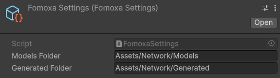
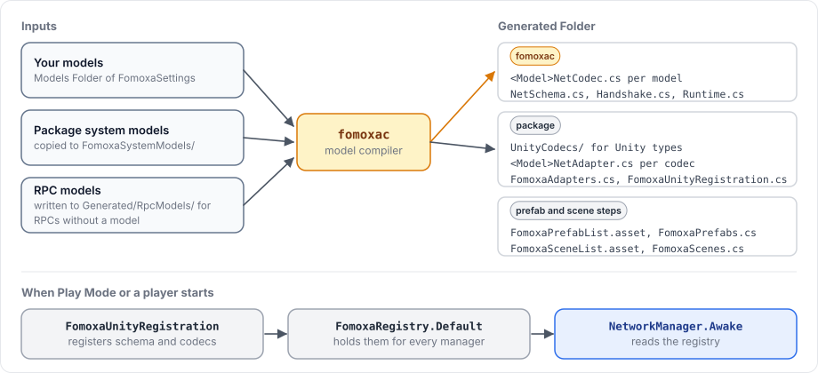

# Installation

This page adds the package to a Unity project and sets up code generation. When you finish, the project compiles together with the generated code and is ready for the [tutorial](tutorial/README.md).

## Requirements

- Unity 6000.5 or later.
- A Windows x64 or Linux x64 Editor. The `fomoxac` code generator is bundled for these two platforms only, so in the macOS Editor generation stops with `the fomoxac binary for this editor platform is missing`.

The package depends on the built-in Physics, Physics 2D and Animation modules. It declares them as dependencies, so Package Manager enables them for you.

## Add the package

### From a Git URL

1. In Unity, open **Window > Package Manager**.
2. Click the **+** button and choose **Install package from git URL**.
3. Enter the URL and click **Install**:

```
https://github.com/fomoxa/com.fomoxa.networking.git
```

To pin a version, add a branch, tag or commit after `#`, for example `https://github.com/fomoxa/com.fomoxa.networking.git#<tag>`.

### From a local folder

To work against a local copy, choose **Install package from disk** in the same menu and select the package's `package.json`. Package Manager then adds a `file:` entry to `Packages/manifest.json`. You can also write that entry yourself. A path relative to the project's `Packages` folder works on every machine with the same folder layout:

```json
"com.fomoxa.networking": "file:../../com.fomoxa.networking"
```

## Create the settings asset

The package needs to know where your models are and where to write the generated code. Both folders are set in a `FomoxaSettings` asset.

1. Create a folder for models, for example `Assets/Network/Models`, and one for generated code, for example `Assets/Network/Generated`.
2. Right-click a folder in the Project window and choose **Create > Fomoxa > Settings**.
3. Select the new asset and set **Models Folder** and **Generated Folder** in the Inspector.

<figure><figcaption><p>The settings asset used in the tutorial.</p></figcaption></figure>

| Field | Default | Meaning |
|---|---|---|
| Models Folder | `Assets/Models` | The folder `fomoxac` reads your models from |
| Generated Folder | `Assets/Generated` | The folder the package writes codecs, adapters and lists to |

Keep exactly one `FomoxaSettings` asset in the project. With two, the package logs `more than one FomoxaSettings asset exists; keep exactly one` and generates nothing.

The models folder must exist before the first generation, even while it is empty, because `fomoxac` stops when a source folder is missing. Git does not keep empty folders, so put an empty `.gitkeep` file in it. Unity ignores files whose names start with a dot.

## How code generation works

The package generates code after every script compilation. You can also run it with **Tools > Fomoxa > Generate**.

<figure><figcaption><p>What one generation reads and writes, and how the result reaches a NetworkManager.</p></figcaption></figure>

A generation goes through these steps:

1. The package copies its own models, such as the spawn and transform messages, into `FomoxaSystemModels/` at the project root, so that your models and its models form one schema.
2. For every RPC declared without a model, it writes a small model into `RpcModels/` inside the Generated Folder.
3. It writes `fomoxa.toml` from the settings asset and runs `fomoxac`, which writes a codec for every model, `NetSchema.cs` with the message ids and fingerprints, `Handshake.cs` and `Runtime.cs`.
4. It writes codecs for the Unity types your models use, such as `Vector3`, into `UnityCodecs/`. The folder only appears once a model uses a Unity type.
5. It writes an adapter for every codec, `FomoxaAdapters.cs`, which registers them, and `FomoxaUnityRegistration.cs`, which runs that registration when Play Mode or a player starts.

The prefab and scene lists come from two separate steps, which run when you save a prefab, change a scene or the Build Profiles scene list, and before every player build. The [tutorial](tutorial/project-setup.md#4-make-the-player-prefab) shows when they matter. [Editor integration](../advanced/editor-integration.md) describes every step and every generated file.

You never call the registration yourself. When Play Mode or a player starts, `FomoxaUnityRegistration` registers the schema and the codecs in `FomoxaRegistry.Default`, and every `NetworkManager` reads them from there in `Awake`.

## Files to commit

| Path | Contents |
|---|---|
| `fomoxa.toml` | The `fomoxac` configuration, written from the settings asset. Edit the asset, not this file. |
| `FomoxaSystemModels/` | The package's own models. The folder is outside `Assets`, so Unity does not compile it. |
| `.fomoxa/` | The schema files that `fomoxac` writes, such as `schema.json`. |
| Generated Folder | Everything listed above, plus the prefab list, the scene list, their constants and a scene file for each network scene. |

Commit all of them, so that a fresh clone compiles before the generator has run.

## Check the result

After Unity finishes compiling:

- The Console shows no error that starts with `[Fomoxa]`.
- The Generated Folder contains `NetSchema.cs`, `FomoxaAdapters.cs`, `FomoxaUnityRegistration.cs` and adapters such as `MessageBundleNetAdapter.cs`.

Whenever the schema changes, for example after you add a model, the package logs a `[Fomoxa]` warning that lists each change, such as `+ new message`, and whether it is compatible with builds made before it. This warning is expected and is not an error.

If generation failed, see [troubleshooting](troubleshooting.md#code-generation-fails).

The generated code lives in a namespace named after the last folder of the Generated Folder path. For `Assets/Network/Generated` that namespace is `Generated`, which is why the examples in this documentation start with `using Generated;`.

Continue with the [tutorial](tutorial/README.md).
