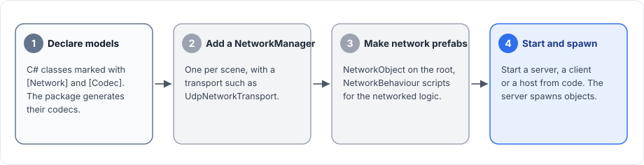

# Introduction

Fomoxa for Unity adds multiplayer networking to a Unity project. It is server-authoritative: one process runs the server and owns the game state, and every player runs a client that sends requests and input to the server and shows what the server sends back.

A server can run on its own as a dedicated server, or together with a player's client in one process, which is called a host.

<figure><figcaption>
A dedicated server and a host. In both, every message between players goes through the server.
</figcaption></figure>

## How a game uses the package

A game goes through four steps to use the package.

<figure><figcaption>
The four steps, in the order the tutorial follows them.
</figcaption></figure>

1. The game declares the data it sends as C# classes called models, marked with `[Network]` and `[Codec]`. The package runs the `fomoxac` compiler on them and generates a codec for each model, which turns the model into bytes and back.
2. It puts a `NetworkManager` in a scene, together with a transport component such as `UdpNetworkTransport`.
3. It adds a `NetworkObject` to every prefab that exists on the network, and writes `NetworkBehaviour` scripts for the networked logic of those prefabs.
4. It starts a server, a client or a host from code, and the server spawns objects, which then appear on the clients.

Once an object is spawned, its `NetworkBehaviour` scripts can call RPCs, keep a state that the server sends to clients, and register input so that the owner's client can predict its own character. A `NetworkTransform` on the prefab sends the object's position, rotation and scale.

## Main types

| Type | What it does |
|---|---|
| [`NetworkManager`](../connections/network-manager.md) | The component that runs networking in a scene: configuration, the tick loop, the server and the client |
| [`ServerManager`](../connections/server.md) | Starts and stops the server, spawns and despawns objects, changes owners |
| [`ClientManager`](../connections/client.md) | Connects to a server, reconnects, and holds the objects spawned on this client |
| [`NetworkObject`](../objects/network-object.md) | Marks a GameObject as a network object with an object id and an owner |
| [`NetworkBehaviour`](../objects/network-behaviour.md) | Base class for networked scripts: lifecycle callbacks, RPCs, state and input |
| [`NetworkTransform`](../synchronization/transform.md) | Sends position, rotation and scale from the server to clients |
| [`NetworkAnimator`](../synchronization/animator.md) | Sends Animator parameters, triggers and layer states |
| [`NetworkTransport`](../connections/transports/README.md) | Base class of the transport components: UDP, TCP, WebSocket and several at once |

## Feature status

| Feature | Status |
|---|---|
| UDP, TCP and WebSocket transports, several transports on one server | Available |
| Host mode over an in-process connection | Available |
| Spawning, scene objects, ownership, observers | Available |
| RPCs with and without a model, declared by attribute or registered by hand | Available |
| State with delta encoding, `NetworkTransform`, `NetworkAnimator` | Available |
| Network scenes | Available |
| Client-side prediction, reconciliation and replay | Available |
| Rollback of Unity physics (`Rigidbody` and `Rigidbody2D`) | Available, approximate (see [rollback](../prediction/rollback.md)) |
| WebGL client | Available |
| `fomoxac` binary for macOS | Not bundled; code generation fails in the macOS Editor |

## What is not included

The package has no lockstep simulation, and it cannot record a whole match and replay it later. It also has no deterministic random number generator and no state hashing.

Matchmaking, relay servers, lobbies and NAT traversal are outside the package. The package encrypts UDP when you assign [encrypted UDP](../connections/transports/encrypted-udp.md), with grants your own login service issues. Over TCP and WebSocket a client can connect with TLS to a proxy in front of the server, as described in [client TLS](../connections/transports/tls.md).

## Next steps

Install the package as described in [installation](installation.md), then follow the [tutorial](tutorial/README.md), which builds a small game with a server, a host and clients. The pages under [Learn the basics](../concepts/architecture.md) explain how the package works underneath.
