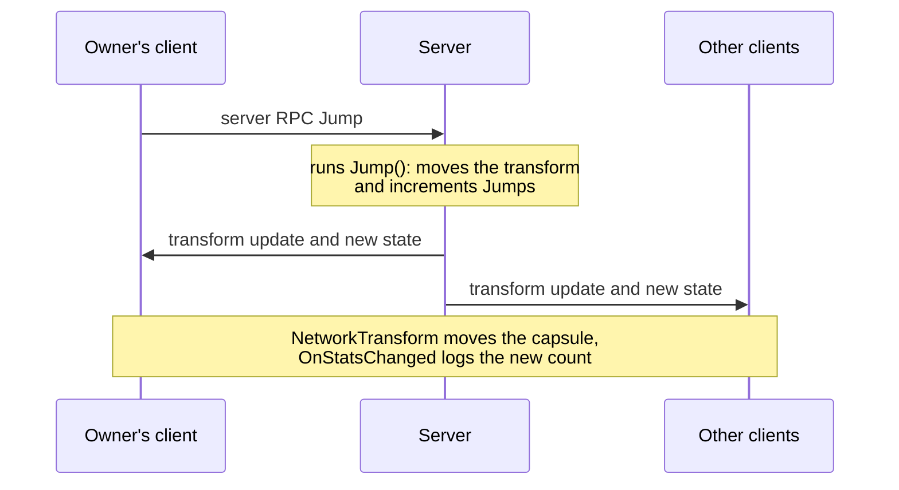

# Tutorial: your first multiplayer game

This tutorial builds a small multiplayer game in three parts. Every connected player is a capsule. The player who owns a capsule clicks **Jump**, the server moves the capsule up and counts the jump, and every client sees the capsule move and the count change.

<figure><figcaption>
The finished game, running as a host with a second client connected.
</figcaption></figure>

## What you build

| Part | You add | You learn |
|---|---|---|
| [1. Set up the project](project-setup.md) | A `NetworkManager`, a model and a player prefab | Models and generated code, `NetworkObject`, `NetworkBehaviour`, state, RPCs |
| [2. Start a server](server.md) | A launcher that starts a server and spawns a player per client | `ServerManager`, connection events, spawning, dedicated servers |
| [3. Connect clients](clients.md) | Clients and a host | `ClientManager`, reconnection, host mode |

## Before you start

- Complete [installation](../installation.md), with the models folder `Assets/Network/Models` and the generated folder `Assets/Network/Generated`.
- Know how to create scripts, prefabs and scenes in Unity.

The game draws its buttons with `OnGUI`, so it needs no UI setup.

## What happens when a player jumps

Everything in the game follows one path. The owner's client asks the server to jump, the server changes the capsule, and the server sends the result to every client.

The client never moves the capsule itself, because the server owns the game state. [Authority](../../concepts/authority.md) explains why, and [prediction](../../prediction/overview.md) shows how a game makes its own character respond at once.

## Tested result

The code in this tutorial was run in Unity 6000.5.7f1: as a host, with a second client that connected over UDP, jumped, and disconnected. The screenshots come from that run.

Start with [part 1](project-setup.md).
