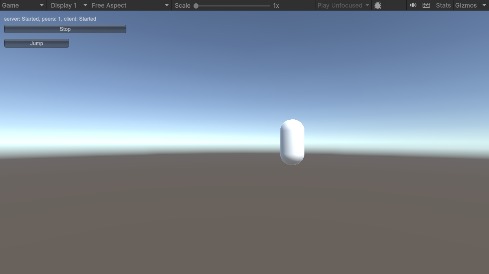

# 3. Connect clients

In this part you connect clients to the server from [part 2](server.md), try the Jump RPC and the state, and finally run the game as a host.

## How the client part works

The launcher's **Client** button calls:

```csharp
manager.ClientManager.StartConnection(address, port);
```

The address can be a host name or an IP address. The client resolves it, opens the transport and runs the Fomoxa handshake, and `ClientManager.OnClientConnectionState` reports its progress: `Starting` while it connects, `Started` once messages can flow, and `Stopped` when the connection ends.

If the connection fails or drops, the client tries again every 0.5 seconds, without limit by default. On a `Stopped` event, `ConnectionStateArgs.Reason` tells why the connection stopped, and `ConnectionStateArgs.WillRetry` tells whether another attempt follows. [Client](../../connections/client.md) explains reconnection and its settings.

Once the client reaches `Started`, the server spawns a player for it, and the client creates its own instance of the `Player` prefab. Objects the server spawned earlier, such as the players of other clients, arrive the same way.

## 1. Connect a client to the server

1. Start the dedicated server from part 2. You can instead enter Play Mode in a second copy of the project and click **Server**.
2. In the Editor, enter Play Mode, keep `127.0.0.1` in the text field and click **Client**.

What you should see:

- The Console shows `client: Starting None`, then `client: Started None`.
- A capsule appears at an x position of twice the client's peer id.
- The Console shows `player <id> spawned, owner <peer id>, mine: True, jumps: 0`.
- A **Jump** button appears below the status line, because this client owns the capsule.
- On a dedicated server, `server.log` shows `peer <id>: Starting None` and `peer <id>: Started None`.

## 2. Call the RPC

Click **Jump**. The capsule moves up by one unit and the Console shows `player <id> jumps: 0 -> 1`.

The click sent a server RPC. The server ran `Jump`, which moved the transform and changed the state, and at the end of the tick it sent the new position through `NetworkTransform` and the new state through the state model. The client applied both, and applying the new state called `OnStatsChanged`.

## 3. Add a second client

Build a player again, or reuse the build from part 2, and start it without `-server` so that it opens a window. Click **Client** in it.

Both clients now show two capsules, and each shows one **Jump** button, for the capsule it owns. A jump on one client moves its capsule on both clients and logs the new count on both.

<figure><figcaption><p>Two players connected. The left capsule has jumped once. This view comes from a host, which is the next step.</p></figcaption></figure>

## 4. Run a host

Stop everything, enter Play Mode in the Editor and click **Host**. The launcher starts a server and then connects a client in the same process. That client ignores the address and connects over an in-process loopback connection instead of UDP.

What you should see:

- The label reads `server: Started, peers: 1, client: Started`.
- A capsule spawns for the host's own client, with a **Jump** button.
- A client in another process can connect to the host with **Client**, as it did to the dedicated server, and the label then shows `peers: 2`.

<figure><figcaption><p>A host after its player has jumped once.</p></figcaption></figure>

In host mode the server and the host's client share one instance of each object. [Host mode](../../connections/host-mode.md) explains what that means for your code.

## 5. Disconnect

Click **Stop** on a client. The client stops and its objects disappear, and the server despawns that client's player for everyone else.

## What you built

| Step | Feature | Guide |
|---|---|---|
| Network Manager with a UDP transport | Transport and tick loop | [NetworkManager](../../connections/network-manager.md), [UDP](../../connections/transports/udp.md) |
| `PlayerStats` model | Models and generated codecs | [Models and codecs](../../messaging/models.md) |
| Player prefab with `NetworkObject` | Network objects and prefab ids | [NetworkObject](../../objects/network-object.md), [Spawning](../../objects/spawning.md) |
| `ServerManager.Spawn` with an owner | Spawning and ownership | [Ownership](../../objects/ownership.md) |
| `[ServerRpc] Jump` | RPCs | [RPCs](../../messaging/rpc.md) |
| `state.Use` | State | [State](../../synchronization/state.md) |
| `NetworkTransform` | Transform replication | [NetworkTransform](../../synchronization/transform.md) |
| **Host** button | Host mode | [Host mode](../../connections/host-mode.md) |

In this game the jump waits for the server before anything moves. A game whose characters move every frame lets each client predict its own character instead, as [prediction](../../prediction/overview.md) shows. If a step does not work, see [troubleshooting](../troubleshooting.md).
