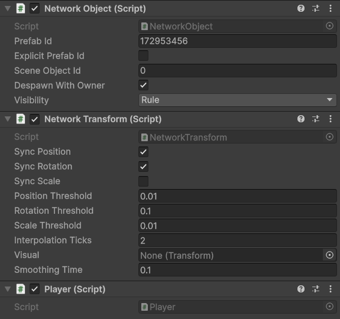

# 1. Set up the project

In this part you set up everything the game needs before it can run: a `NetworkManager` in the scene, a model for the player's state, a script with the jump logic and a player prefab. Nothing networks yet at the end of this page; [part 2](server.md) starts the server.

Before you start, complete [installation](../installation.md) with the models folder `Assets/Network/Models` and the generated folder `Assets/Network/Generated`.

## 1. Add a NetworkManager to the scene

The `NetworkManager` runs networking for the scene. It needs a transport, the component that carries the bytes, and this tutorial uses UDP.

1. Create a scene, `Assets/Scenes/Game.unity`, and open it.
2. Open **File > Build Profiles** and add the scene to the **Scene List**. A player build needs the scene there, and the package collects its scenes from that list.
3. Create an empty GameObject at the root of the scene and name it `Network Manager`.
4. Add the **Udp Network Transport** component to it.
5. Add the **Network Manager** component and drag the `UdpNetworkTransport` component into its **Transport** field.

Leave the other fields at their defaults: **Tick Rate** 30 and **Timing Mode** Tick. [NetworkManager](../../connections/network-manager.md) describes every field. A `NetworkManager` without a transport adds a `UdpNetworkTransport` to itself when it starts, but assigning one in the scene makes the choice visible.

## 2. Write a model

A model is a C# class that the package can send. The player's state here is a single counter. Create `Assets/Network/Models/PlayerStats.cs`:

```csharp
using Fomoxa;
using Fomoxa.Networking;

namespace MyGame.Network.Models
{
    [Network]
    [Codec("net")]
    [NetworkChannel("net", Channel.ReliableOrdered)]
    public class PlayerStats
    {
        [Network("u32")]
        [Codec("net")]
        public uint Jumps { get; set; }
    }
}
```

The attributes tell the package how to send the class:

- `[Network]` and `[Codec("net")]` on the class make it a model with a codec named `net`.
- Each property carries its wire type, here `u32`, an unsigned 32-bit integer, and the codec it belongs to.
- `[NetworkChannel]` puts the model on the reliable, ordered channel, which a state model requires.

[Models and codecs](../../messaging/models.md) explains these attributes in detail.

Save the file and let Unity compile. The package then generates `PlayerStatsNetAdapter` in `Assets/Network/Generated`. The script in the next step uses it, so wait until the file exists before you continue. If the Console shows a `[Fomoxa]` warning with `+ new message`, that is expected: the package reports every change to the schema.

## 3. Write the player script

Create `Assets/Network/Player.cs`:

```csharp
using Fomoxa.Networking;
using Fomoxa.Unity;
using Generated;
using MyGame.Network.Models;
using UnityEngine;

namespace MyGame.Network
{
    public sealed partial class Player : NetworkBehaviour
    {
        private readonly PlayerStats stats = new PlayerStats();

        protected override void OnRegisterState(NetworkState state)
        {
            state.Use(PlayerStatsNetAdapter.Instance, stats, OnStatsChanged);
        }

        public override void OnStartClient()
        {
            Debug.Log($"player {NetworkObject.ObjectId} spawned, owner {NetworkObject.OwnerId}, mine: {NetworkObject.IsOwner}, jumps: {stats.Jumps}");
        }

        private void OnGUI()
        {
            if (NetworkObject == null || !NetworkObject.IsOwner)
            {
                return;
            }

            GUILayout.BeginArea(new Rect(10, 70, 160, 30));
            if (GUILayout.Button("Jump"))
            {
                SendServerRpc(nameof(Jump));
            }

            GUILayout.EndArea();
        }

        [ServerRpc]
        private void Jump()
        {
            transform.position += Vector3.up;
            stats.Jumps++;
        }

        private void OnStatsChanged(PlayerStats previous)
        {
            Debug.Log($"player {NetworkObject.ObjectId} jumps: {previous.Jumps} -> {stats.Jumps}");
        }
    }
}
```

`OnRegisterState` registers `stats` as the behaviour's state. The server sends it whenever it changes, and each client decodes it into the same field and calls `OnStatsChanged` with the previous value. `OnStartClient` runs on a client when the object appears there, and by then `stats` already holds the server's value.

`OnGUI` draws the Jump button only on the client that owns this player. Clicking it calls `SendServerRpc(nameof(Jump))`, which asks the server to run `Jump`.

`[ServerRpc]` marks `Jump` as a method the server runs when a client calls it. By default only the owner may call it. `Jump` runs on the server: it moves the transform, which `NetworkTransform` sends to clients, and changes the state, which the package sends at the end of the tick.

The class is `partial` because the package generates the code that registers the RPC. When Unity compiles this file, the package writes a model for the parameterless RPC to `Assets/Network/Generated/RpcModels/PlayerJump.cs` and registers it, and Unity compiles a second time with the new files.

## 4. Make the player prefab

1. In the scene, create a capsule with **GameObject > 3D Object > Capsule** and name it `Player`.
2. Add three components to it: **Network Object**, **Network Transform** and **Player**.
3. Drag it into `Assets/Prefabs` to make a prefab, then delete it from the scene.
4. Choose **Tools > Fomoxa > Assign Prefab Ids**.

<figure><figcaption><p>The Player prefab after Assign Prefab Ids. Your Prefab Id will be a different number.</p></figcaption></figure>

The last step gives the prefab a prefab id, which the server and the clients use to agree on what to spawn, and writes `Assets/Network/Generated/FomoxaPrefabList.asset`. Select the prefab and check that **Prefab Id** is not 0. The package also runs this step by itself whenever you save a prefab in the Editor, and before every player build.

The `NetworkObject` must sit on the root of the prefab, and the prefab must not contain a second `NetworkObject`.

## 5. Give the NetworkManager the generated lists

Select `Network Manager` and drag two generated assets into it:

- `Assets/Network/Generated/FomoxaPrefabList.asset` into **Collected Prefabs**.
- `Assets/Network/Generated/FomoxaSceneList.asset` into **Collected Scenes**.

The `NetworkManager` registers every prefab in the list when it starts. A player build assigns both lists during the build, but in the Editor that would happen after the `NetworkManager` has already started, so assign them in the scene. Without them, spawning fails with `prefab id 0x... of Player(Clone) is not registered`.

Save the scene.

## Check your work

- The project compiles without errors.
- `Assets/Network/Generated` contains `PlayerStatsNetAdapter.cs`, `PlayerJumpNetAdapter.cs`, `RpcModels/PlayerJump.cs`, `FomoxaPrefabList.asset` and `FomoxaPrefabs.cs`.
- `FomoxaPrefabs.cs` has the constants `PlayerId` and `PlayerFingerprint`.
- Entering Play Mode does nothing visible yet, because a `NetworkManager` stays idle until code starts a server or a client.

Continue with [part 2: start a server](server.md).
