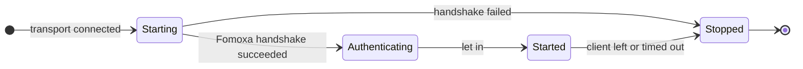
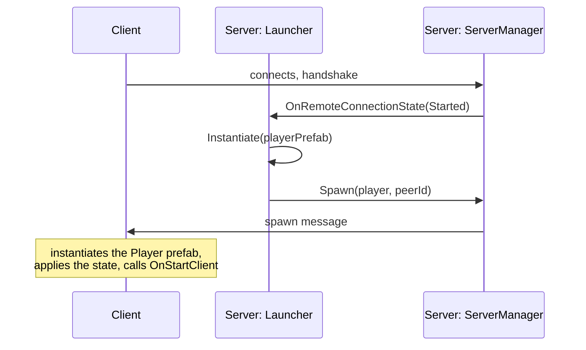

# 2. Start a server

In this part you add a launcher to the scene from [part 1](project-setup.md). The launcher draws three buttons, **Server**, **Host** and **Client**, and the server it starts spawns a `Player` for every client that connects. You test only the server on this page; [part 3](clients.md) connects clients to it.

## 1. Write the launcher

Create `Assets/Network/Launcher.cs`:

```csharp
using System;
using Fomoxa.Networking;
using Fomoxa.Networking.Sessions;
using Fomoxa.Unity;
using UnityEngine;

namespace MyGame.Network
{
    public sealed class Launcher : MonoBehaviour
    {
        [SerializeField] private NetworkManager manager;
        [SerializeField] private NetworkObject playerPrefab;
        [SerializeField] private ushort port = 7777;

        private string address = "127.0.0.1";

        private void Start()
        {
            manager.ServerManager.OnRemoteConnectionState += OnRemoteConnectionState;
            manager.ClientManager.OnClientConnectionState += OnClientConnectionState;
            if (Array.IndexOf(Environment.GetCommandLineArgs(), "-server") >= 0)
            {
                StartServer();
            }
        }

        private void OnDestroy()
        {
            if (manager != null && manager.ServerManager != null)
            {
                manager.ServerManager.OnRemoteConnectionState -= OnRemoteConnectionState;
                manager.ClientManager.OnClientConnectionState -= OnClientConnectionState;
            }
        }

        private void OnGUI()
        {
            GUILayout.BeginArea(new Rect(10, 10, 300, 120));
            DrawControls();
            GUILayout.EndArea();
        }

        private void DrawControls()
        {
            bool serverRunning = manager.ServerManager.State != ServerState.Stopped;
            bool clientRunning = manager.ClientManager.State != ConnectionState.Stopped;
            if (serverRunning || clientRunning)
            {
                GUILayout.Label($"server: {manager.ServerManager.State}, peers: {manager.ServerManager.PeerCount}, client: {manager.ClientManager.State}");
                if (GUILayout.Button("Stop"))
                {
                    manager.ClientManager.StopConnection();
                    manager.ServerManager.StopConnection();
                }

                return;
            }

            address = GUILayout.TextField(address);
            if (GUILayout.Button("Server"))
            {
                StartServer();
            }

            if (GUILayout.Button("Host"))
            {
                StartServer();
                manager.ClientManager.StartConnection(address, manager.ServerManager.Port);
            }

            if (GUILayout.Button("Client"))
            {
                manager.ClientManager.StartConnection(address, port);
            }
        }

        private void StartServer()
        {
            manager.ServerManager.StartConnection(port);
            Debug.Log($"server listening on port {manager.ServerManager.Port}");
        }

        private void OnRemoteConnectionState(ConnectionStateArgs args)
        {
            Debug.Log($"peer {args.PeerId}: {args.State} {args.Reason}");
            if (args.State != ConnectionState.Started)
            {
                return;
            }

            var position = new Vector3(args.PeerId * 2f, 0f, 0f);
            NetworkObject player = Instantiate(playerPrefab, position, Quaternion.identity);
            manager.ServerManager.Spawn(player, args.PeerId);
        }

        private void OnClientConnectionState(ConnectionStateArgs args)
        {
            Debug.Log($"client: {args.State} {args.Reason}");
        }
    }
}
```

The launcher subscribes to connection events in `Start` rather than `Awake`, because `NetworkManager` creates its `ServerManager` and `ClientManager` in its own `Awake`, and Unity runs every `Awake` in a scene before any `Start`.

## 2. How the server part works

`ServerManager.StartConnection(port)` opens the transport's listener on that port. Port 0 asks the operating system for a free port, and `ServerManager.Port` always reports the port in use.

Each client that connects gets a peer id, `args.PeerId`, and `ServerManager.OnRemoteConnectionState` reports every change of its connection. A client goes through four states:



`Starting` covers the Fomoxa handshake, in which the client and the server check that they were built from the same models. `Authenticating` is where an [authenticator](../../connections/authentication.md) would check the client; this tutorial has none, so the server lets every client in at once. Messages can flow only once the client reaches `Started`, so that is where the launcher spawns its player:



`ServerManager.Spawn(player, args.PeerId)` gives the object an object id, makes the peer its owner and sends it to every client that observes it. The object you pass must be an instance in a scene, not the prefab asset, and its prefab must be registered with the `NetworkManager`, which the **Collected Prefabs** list did in part 1.

A `NetworkObject` despawns together with its owner by default. When a client leaves, the package despawns its player, and on the server a despawn destroys the instance. `ServerManager.StopConnection()` disconnects every client and despawns every object.

## 3. Add the launcher to the scene

1. Select `Network Manager` and add the **Launcher** component.
2. Drag the `NetworkManager` component into its **Manager** field, and the `Player` prefab into **Player Prefab**.
3. Save the scene.

<figure><figcaption><p>The Launcher component on the Network Manager GameObject.</p></figcaption></figure>

## 4. Test the server

Enter Play Mode and click **Server**.

- The Console shows `server listening on port 7777`.
- The label at the top left reads `server: Started, peers: 0, client: Stopped`.

Click **Stop** and leave Play Mode.

If `StartConnection` throws a `SocketException` instead, the port could not be opened, for example because another process is already using UDP port 7777. Change the **Port** field of the launcher and try again.

## 5. Run a dedicated server

A dedicated server is a player build that runs without graphics. The launcher starts a server whenever the command line contains `-server`.

1. Open **File > Build Profiles**, select your desktop platform and build the player, for example to `Builds/MyGame.exe` on Windows.
2. Start it from a terminal:

```
MyGame.exe -batchmode -nographics -server -logFile server.log
```

`server.log` should contain `server listening on port 7777`. Keep the process running for the next part, and stop it with your operating system's process tools when you are done. [Dedicated server](../../deploy/dedicated-server.md) covers frame rate, ports and other details.

Continue with [part 3: connect clients](clients.md).
