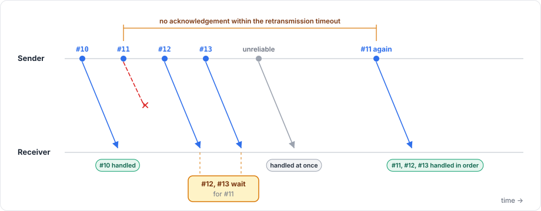

# Channels and reliability

Every message id travels on one of two channels:

| Channel | Delivery | Order | Use for |
|---|---|---|---|
| `Channel.Unreliable` (default) | May be lost | No guarantee | Data that is replaced soon anyway: positions, effects, frequent updates |
| `Channel.ReliableOrdered` | Delivered once | In send order, among all reliable messages of the connection | Events that must not be lost: state, spawns, chat, purchases |

The package implements reliability itself, on top of any transport. Even over TCP and WebSocket, which are reliable already, reliable messages still carry their sequence number and acknowledgements.

## Choosing a channel

The channel belongs to a message id, so you declare it on the model, once per codec:

```csharp
[Network]
[Codec("net")]
[NetworkChannel("net", Channel.ReliableOrdered)]
public class ChatLine
{
    [Network("string")]
    [Codec("net")]
    public string Text { get; set; }
}
```

A model without `[NetworkChannel]` is unreliable. Each `[NetworkChannel]` must name a codec the model declares, and a codec can have at most one.

The generated registration records the channels in `FomoxaRegistry.Channels`, so you never choose a channel when sending. How the channel applies depends on what the model is used for:

| Use | Channel |
|---|---|
| State model | Must be `ReliableOrdered`; registration throws otherwise |
| RPC with a model | The model's channel |
| Parameterless RPC | `ReliableOrdered` by default, set with the attribute's `Channel` property |
| Input and reconcile models | Ignored; the package carries them inside its own unreliable messages |
| Raw messages | The model's channel |

## How reliability works

<figure><figcaption><p>Reliable messages keep their order, so one loss delays the reliable messages behind it but not the unreliable ones.</p></figcaption></figure>

Every reliable message carries a 2-byte sequence number. The receiver acknowledges with the next sequence number it expects and a 32-bit mask of the messages it has received after that one, and these acknowledgements travel in the same bundles as other messages. A message that arrives ahead of a missing one waits in a buffer until the gap is filled, and duplicates are dropped.

The sender resends a message whose acknowledgement does not arrive within the retransmission timeout. That timeout starts at 200 ms and then follows the measured round trip, staying between 50 ms and 1 s. At most Reliable Window messages (1024 by default) can be in flight without acknowledgement, and further reliable messages wait in the send queue.

Because order is kept across all reliable messages of a connection, one lost message holds back the reliable messages behind it until it has been resent. Unreliable messages are not held back.

## Message size

A flush packs messages into bundles that fit the transport's frame budget, which is 1200 bytes for UDP and the largest Fomoxa frame for TCP and WebSocket. A single message larger than the budget is still sent, alone in its own bundle.

The first limit a large message meets is the queue: a send larger than Byte Capacity (1 MiB by default) returns `SendResult.TooLargeForQueue` and is not queued. After that comes the transport. Over UDP a bundle must fit in one datagram whose frame is at most 65499 bytes, frame header included, while over TCP and WebSocket the protocol allows messages up to 16 MiB. A message the transport cannot send at all is dropped, and the package raises `OnSendDropped` with `SendStatus.TooLarge` and logs `Fomoxa dropped message 0x... (N bytes) to peer <id>: TooLarge`.

Channels are declared on [models](models.md). The [networking model](../concepts/networking-model.md) shows where they fit in the send path, and [performance](../advanced/performance.md) covers the cost of reliable messages.
