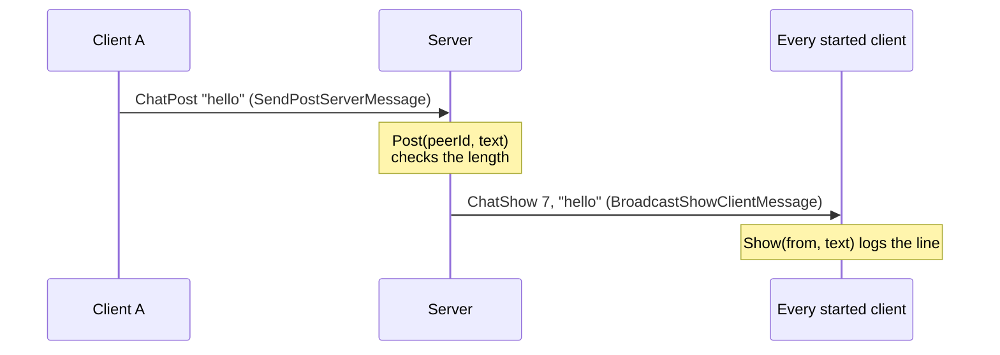

# Raw messages

RPCs are tied to a spawned object, and raw messages are not. A raw message goes from a client to the server or from the server to its clients, and a handler registered for its message id handles it. They suit game-wide messages such as chat, match events or lobby data.

## When to use them

Use a raw message when the message has no natural object, when it must work before any object is spawned, or when you want to handle it once per connection rather than once per object.

Raw messages bypass observers and ownership checks. The server sends them to whichever peers you choose, and the handler receives the sender's peer id, so validate everything a client sends.

## Basic usage

In Unity, declare raw messages as methods of a `partial` class that derives from `NetworkMessageBehaviour`. The following component relays chat through the server:

```csharp
using Fomoxa.Networking.Sessions;
using Fomoxa.Unity;
using UnityEngine;

public sealed partial class Chat : NetworkMessageBehaviour
{
    private const int MaxLength = 200;

    public SendResult Say(string text) => SendPostServerMessage(text);

    [ServerMessage]
    private void Post(ulong peerId, string text)
    {
        if (string.IsNullOrWhiteSpace(text) || text.Length > MaxLength)
        {
            return;
        }

        BroadcastShowClientMessage(peerId, text);
    }

    [ClientMessage]
    private void Show(ulong from, string text) => Debug.Log($"{from}: {text}");
}
```

Add `Chat` to a GameObject in the scene and drag the `NetworkManager` into its **Manager** field. `Post` runs on the server and `Show` on every client. A host runs both.

The relay works like this:



## Declaring messages

| Attribute | Handler runs on | Signature |
|---|---|---|
| `[ServerMessage]` | The server | `void M(ulong peerId, ...)` or `void M(...)`. A first parameter of type `ulong` receives the sender's peer id and is not sent |
| `[ClientMessage]` | The clients | `void M(...)`. Every parameter is sent |

Both attributes are in the namespace `Fomoxa.Unity`. The method may be private, but it must not be static or generic, return a value, or have `ref`, `out`, `in` or `params` parameters. Parameters travel as they do for [RPCs](rpc.md#parameter-types), and `[NetworkType("...")]` sets the wire type of a parameter.

The Editor step writes a model for each message into the `MessageModels` subfolder of the Generated Folder, in the namespace `FomoxaMessageModels`. Its name is the class followed by the method, `ChatPost` and `ChatShow` in the example, with one property per sent parameter. A message travels on `ReliableOrdered`; set another channel on the attribute, for example `[ClientMessage(Channel = Channel.Unreliable)]`.

Renaming the class or the method changes the model and its message id, as it does for an RPC, unless the attribute keeps the name: `[ServerMessage("ChatPost")]`. Every message needs its own model name, which also must not be the name of an RPC or state model; generation stops with an error that names both declarations. Parameters follow the [RPC rules](rpc.md#the-generated-model) for staying compatible with older builds, and a player build fails while a message model is missing or out of date.

## Sending

The generator writes `protected` send methods on the class:

| Message | Send methods | Returns |
|---|---|---|
| `[ServerMessage] void Post(ulong peerId, string text)` | `SendPostServerMessage(string text)` | `SendResult` |
| `[ClientMessage] void Show(ulong from, string text)` | `SendShowClientMessage(ulong peerId, ulong from, string text)` | `SendResult` |
| | `BroadcastShowClientMessage(ulong from, string text)` | The number of peers in the `Started` state it was queued for |

A client calls the `ServerMessage` methods and the server calls the `ClientMessage` ones. The send methods exist from the first compilation, before the model is generated. Calling one whose model is still missing throws `InvalidOperationException`: `<Type>.<Method> has no generated message model for its parameters; run Tools > Fomoxa > Generate`. A `string` or a model argument must not be `null`; the send method throws `ArgumentNullException` with the parameter's name.

The arguments are encoded and copied into the send queue during the call. `SendResult.NotConnected` means the connection or the peer does not exist. A message sent while the connection is `Starting` or `Authenticating` waits in the queue and goes out once the connection has started.

## Enabling and disabling

A `NetworkMessageBehaviour` registers its handlers on the `ServerManager.Dispatcher` and the `ClientManager.Dispatcher` of its `NetworkManager` in `OnEnable`, and removes them in `OnDisable`. A message that arrives while the component is disabled has no handler and is dropped without a log entry.

`OnEnable` initializes the `NetworkManager` first, so it does not matter whether it runs before or after the manager's `Awake`. When the **Manager** field is empty, `OnEnable` registers nothing and throws `InvalidOperationException` with `<Class> has no NetworkManager; assign one in the Inspector or set NetworkManager`. The send methods throw the same exception.

Each message id has one handler per dispatcher, so only one enabled instance of a class can use a `NetworkManager`. Enabling a second one throws `HandlerRegistrationException` and registers none of its messages; the first instance keeps working.

To create the component from code, add it to an inactive GameObject, set its manager, then activate the GameObject:

```csharp
var chatObject = new GameObject("Chat");
chatObject.SetActive(false);
Chat chat = chatObject.AddComponent<Chat>();
chat.NetworkManager = manager;
chatObject.SetActive(true);
```

Setting `NetworkManager` on an enabled component removes the handlers from the old manager and registers them on the new one. On a disabled component it only changes the field.

A subclass that needs `OnEnable` or `OnDisable` overrides them and calls the base method:

```csharp
protected override void OnEnable()
{
    base.OnEnable();
    Debug.Log("Chat is ready");
}
```

## Receiving

The handler receives the values the sender passed, and a `[ServerMessage]` handler also receives the sender's peer id. On a client the messages always come from the server.

A handler that throws on the server closes that peer's connection: the peer stops with `StopReason.HandlerException`, and the client stops with `ServerClosed` and a `CloseReason` of `HandlerException`. One that throws on a client stops the client with `HandlerException`. A message whose body cannot be decoded is dropped instead.

## Sending through the managers

`ClientManager` and `ServerManager` send raw messages directly, with any [model](models.md) and its adapter. The console server uses these methods, and they are open to Unity code that does not fit a component. Start with the model:

```csharp
using Fomoxa;
using Fomoxa.Networking;

namespace MyGame.Network.Models
{
    [Network]
    [Codec("net")]
    [NetworkChannel("net", Channel.ReliableOrdered)]
    public class ChatLine
    {
        [Network("string")]
        [Codec("net")]
        public string Text { get; set; }
    }
}
```

Then register a handler on each side that should receive it, and send with the adapter:

```csharp
ChatLineNetAdapter codec = ChatLineNetAdapter.Instance;
manager.ServerManager.Dispatcher.Register(codec, (ulong peerId, ChatLine line) => Debug.Log($"{peerId}: {line.Text}"));
manager.ClientManager.Send(codec, new ChatLine { Text = "hello" });
```

| Method | Sends to |
|---|---|
| `ClientManager.Send(codec, value)` | The server |
| `ServerManager.Send(peerId, codec, value)` | One peer |
| `ServerManager.Broadcast(codec, value)` | Every peer in the `Started` state; returns how many it was queued for |

`Dispatcher.Register(codec, handler)` decodes every message into one instance that it creates when you register, so the handler sees the same object each time. Copy the values you want to keep. `Dispatcher.Unregister(messageId)` removes the handler of a message id, and does nothing when the id has none.

The message id must be in the generated schema, and each id can have only one handler per dispatcher. Otherwise `Register` throws `HandlerRegistrationException` with `message id 0x... is not declared in the schema` or `already has a handler`. Register after the `NetworkManager` has run `Awake`, for example in `Start`, and before the messages arrive. On a client, `peerId` is always 0.

The same methods also take a message id and the encoded bytes: `ClientManager.Send(messageId, payload)`, `ServerManager.Send(peerId, messageId, payload)`, `ServerManager.Broadcast(messageId, payload)` and `Dispatcher.Register(messageId, (peerId, payload) => { })`. The payload passed to such a handler is only valid during the call, so decode or copy it before returning. A `MessageDecodeException` from `Decode` drops the message.

`ClientManager.SendToObject` and `ServerManager.SendToObject` send a message addressed to one behaviour of one object, the way RPCs do. RPCs are built on top of them, and game code should prefer RPCs.

## Compile errors

The source generator reports these compile errors for messages:

| Id | Meaning |
|---|---|
| `FOMOXA023` | The method is not in a `NetworkMessageBehaviour` |
| `FOMOXA024` | The class, or a class containing it, is not `partial` |
| `FOMOXA025` | Unsupported message signature |
| `FOMOXA026` | The method carries both `[ServerMessage]` and `[ClientMessage]` |
| `FOMOXA027` | A send method would take the name of an existing member |
| `FOMOXA028` | The class declares `OnEnable` or `OnDisable` without `override` |

Raw messages are [models](models.md) on their [channel](channels.md), as [RPCs](rpc.md) are. The [messaging API](../reference/messaging.md) lists `NetworkMessageBehaviour`, the dispatcher and the send members.
