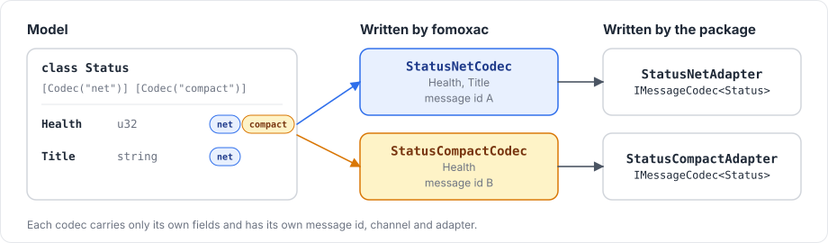

# Models and codecs

A model is a C# class that describes a message, that is, its fields and their wire types. The bundled `fomoxac` compiler generates a codec for each model, and the package wraps each codec in an adapter, which is what the rest of the API works with.

The package generates the models that carry the RPCs, state and input of your behaviours, so you do not write those. You write a model for structured data that an RPC parameter or a state field holds, for [raw messages](messages.md), for [authentication](../connections/authentication.md) and [transfer](../connections/transfer.md) data, and for the RPCs and state of a [console server](../console-server/runtime.md) that a Unity behaviour does not declare.

## Basic usage

Model classes go in the Models Folder set in the `FomoxaSettings` asset:

```csharp
using Fomoxa;

namespace MyGame.Network.Models
{
    [Network]
    [Codec("net")]
    public class Shot
    {
        [Network("u32")]
        [Codec("net")]
        public uint Weapon { get; set; }

        [Network("Vector3")]
        [Codec("net")]
        public UnityEngine.Vector3 Direction { get; set; }

        [Network("Array<u16>")]
        [Codec("net")]
        public System.Collections.Generic.List<ushort> Targets { get; set; } = new System.Collections.Generic.List<ushort>();
    }
}
```

After compilation the package generates `ShotNetCodec` and `ShotNetAdapter` in the Generated Folder. The model can then be the type of an RPC parameter or a state field, which travel with its `net` codec:

```csharp
[ServerRpc]
private void Fire(Shot shot)
{
}
```

Where the API asks for an `IMessageCodec<Shot>`, as for [raw messages](messages.md), pass the adapter, `ShotNetAdapter.Instance`.

## Attributes

| Attribute | On | Meaning |
|---|---|---|
| `[Network]` | Class | The class is a model |
| `[Codec("name")]` | Class | The model has a codec with this name. A class can name several codecs. |
| `[Network("type")]` | Property or field | The member is a field with this wire type |
| `[Codec("name")]` | Property or field | The member belongs to this codec. `[Codec("net", "compact")]` names several at once. |
| `[NetworkChannel("codec", Channel.ReliableOrdered)]` | Class | The channel of one codec of the model; see [channels](channels.md) |

`[Network]` and `[Codec]` come from `Fomoxa.Attributes.dll`, in the namespace `Fomoxa`, while `[NetworkChannel]` and `Channel` are in the namespace `Fomoxa.Networking`.

A codec carries a property only when the property has both `[Network("type")]` and a `[Codec("name")]` with that codec's name. The codec ignores every other property, so a model can hold local data next to its network fields.

## Wire types

| Wire type | C# type |
|---|---|
| `bool` | `bool` |
| `i8`, `u8` | `sbyte`, `byte` |
| `i16`, `u16` | `short`, `ushort` |
| `i32`, `u32` | `int`, `uint` |
| `i64`, `u64` | `long`, `ulong` |
| `f32`, `f64` | `float`, `double` |
| `string` | `string` |
| `bytes` | `ReadOnlyMemory<byte>` |
| `Array<T>` | `List<T>` of the element's C# type |
| Another model's name | That model's class |
| `Vector2`, `Vector3`, `Vector4`, `Vector2Int`, `Vector3Int`, `Quaternion`, `Color`, `Color32`, `Rect` | The `UnityEngine` type of the same name |

The package writes codecs for the Unity types into the `UnityCodecs` subfolder of the Generated Folder, and only for the types your models actually use. An array of a Unity type, such as `Array<Vector3>`, does not compile, and the package warns about it; send the elements as separate fields or wrap each one in a model instead. To add types of your own, see [custom codecs](../advanced/custom-codecs.md).

## Generated names

For a model `Shot` with a codec `net`:

| Generated | Name | Contents |
|---|---|---|
| Codec | `ShotNetCodec` | Static `MessageId`, `Encode` and `Decode`, written by `fomoxac` |
| Adapter | `ShotNetAdapter` | `IMessageCodec<Shot>` with a static `Instance` |

The codec name is converted to PascalCase, so a codec named `wide` gives `ShotWideAdapter` and one named `wide_one` gives `ShotWideOneAdapter`. All generated types share one namespace, named after the last folder of the Generated Folder path, so `Assets/Network/Generated` gives `Generated`.

The adapters implement `IMessageCodec<T>`, which has three members:

| Member | Meaning |
|---|---|
| `MessageId` | The message id of this model and codec |
| `Encode(T value)` | Encodes a value. The returned memory is reused by the next call on the same adapter, so copy it if you keep it. |
| `Decode(ReadOnlyMemory<byte> payload, ref T value)` | Decodes into an existing instance and leaves the properties this codec does not carry unchanged; throws `MessageDecodeException` on invalid data |

## Several codecs per model

<figure><figcaption><p>The Status example below: one class, two codecs, two message ids.</p></figcaption></figure>

A model can declare more than one codec, each with its own selection of fields:

```csharp
[Network]
[Codec("net")]
[Codec("compact")]
public class Status
{
    [Network("u32")]
    [Codec("net")]
    [Codec("compact")]
    public uint Health { get; set; }

    [Network("string")]
    [Codec("net")]
    public string Title { get; set; }
}
```

Each codec gets its own message id and its own adapter, here `StatusNetAdapter` and `StatusCompactAdapter`. An RPC parameter or a state field of type `Status` uses the `net` codec, so a model used that way needs one.

## Schema and compatibility

Every generation also writes `NetSchema.cs`, the list of all message ids and their layouts. During the handshake the client and the server compare their schemas message by message. Two versions of a model work together when the fields of one are the first fields of the other, so adding properties at the end of a model, or removing the last ones, keeps older builds connected. Inserting, reordering, retyping or renaming a property makes the handshake fail with `HandshakeFailure.SchemaConflict`, so after such a change, rebuild both the server and the clients. When the package generates the code, the Console shows a verdict for every changed model, starting with `COMPATIBLE:` or `BREAKING:`.

## Limitations

Apart from the package's own models and the models it generates for RPCs, state and input, only classes in the Models Folder get codecs. The `fomoxac` binary is bundled for Windows x64, Linux x64 and macOS Editors.

Models carry [RPCs](rpc.md), [state](../synchronization/state.md), [input](../prediction/input.md) and [raw messages](messages.md). The [messaging API](../reference/messaging.md) lists the codec types, and [editor integration](../advanced/editor-integration.md) describes the generation step.
