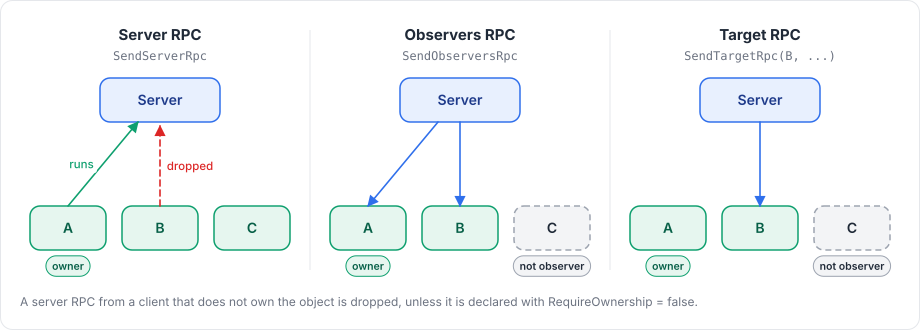

# RPCs

An RPC (remote procedure call) runs a method of a `NetworkBehaviour` on the other side of the connection. RPCs go in three directions:

| RPC | From | To | Send with |
|---|---|---|---|
| Server RPC | A client | The server | `SendServerRpc` |
| Observers RPC | The server | Every client that observes the object | `SendObserversRpc` |
| Target RPC | The server | One client that observes the object | `SendTargetRpc` |

Each RPC takes either no argument or a single [model](models.md).

<figure><figcaption><p>Which side sends each kind of RPC, and who receives it.</p></figcaption></figure>

## Declaring RPCs with attributes

```csharp
using Fomoxa.Networking;
using Fomoxa.Unity;
using Generated;
using MyGame.Network.Models;
using UnityEngine;

public sealed partial class Turret : NetworkBehaviour
{
    public void RequestFire(Shot shot) => SendServerRpc(ShotNetAdapter.Instance, shot);

    public void RequestReload() => SendServerRpc(nameof(Reload));

    [ServerRpc]
    private void Fire(ulong peerId, Shot shot)
    {
        Debug.Log($"peer {peerId} fires weapon {shot.Weapon}");
        SendObserversRpc(ShotNetAdapter.Instance, shot);
    }

    [ServerRpc]
    private void Reload()
    {
        SendObserversRpc(nameof(PlayReload));
    }

    [ClientRpc]
    private void ShowShot(Shot shot)
    {
        Debug.DrawRay(transform.position, shot.Direction, Color.red, 1f);
    }

    [ClientRpc]
    private void PlayReload()
    {
        GetComponent<AudioSource>().Play();
    }
}
```

The class must be `partial`, and so must every class that contains it, because a source generator in the package writes the code that registers each attributed method when the object spawns.

### Allowed signatures

| Attribute | Signatures |
|---|---|
| `[ServerRpc]` | `void M()`, `void M(ulong peerId)`, `void M(TModel value)`, `void M(ulong peerId, TModel value)` |
| `[ClientRpc]` | `void M()`, `void M(TModel value)` |

`TModel` is a model with a generated adapter, and `peerId` receives the caller's peer id. The method may be private, but it must not be static or generic.

### RPCs with a model

The server and the client look the RPC up by the model's message id, so it is the model that decides which method runs. In the example, `SendObserversRpc(ShotNetAdapter.Instance, shot)` runs `ShowShot` on the clients.

When the model has one codec, the generator uses its adapter. When it has several, name the one to use, as in `[ServerRpc(Codec = "compact")]`. The RPC travels on the model's channel, declared with `[NetworkChannel]` on the model, and is unreliable if the model declares none.

### RPCs without a model

For every parameterless RPC the package generates an empty model in the `RpcModels` subfolder of the Generated Folder, and you call these RPCs by method name:

```csharp
SendServerRpc(nameof(Reload));
SendObserversRpc(nameof(PlayReload));
SendTargetRpc(peerId, nameof(PlayReload));
```

The generated model is named after the class followed by the method, `TurretReload` in the example. When two methods would produce the same name, give one of them another name through the attribute's argument, as in `[ServerRpc("TurretReloadRequest")]`. The channel is set on the attribute and defaults to `ReliableOrdered`, so an unreliable one is declared as `[ClientRpc(Channel = Channel.Unreliable)]`.

When you add or rename such a method, the package generates its model after the next compilation and Unity compiles again. A player build fails as long as a generated model is missing or out of date. A method declared in a base class can be called by name from a derived class.

### Ownership

A server RPC only runs when the caller owns the object. The server drops other calls and logs `Fomoxa dropped server RPC 0x... to object <id> from peer <id>, which does not own the object`. To let any client call it, for example on a door anyone can open, declare it with `[ServerRpc(RequireOwnership = false)]`.

## Sending

The send methods are `protected` members of `NetworkBehaviour`:

| Method | Returns |
|---|---|
| `SendServerRpc<T>(IMessageCodec<T> codec, T value)`, `SendServerRpc(string rpc)` | `SendResult` of the queue |
| `SendObserversRpc<T>(IMessageCodec<T> codec, T value)`, `SendObserversRpc(string rpc)` | The number of observers the RPC was queued for |
| `SendTargetRpc<T>(ulong peerId, IMessageCodec<T> codec, T value)`, `SendTargetRpc(ulong peerId, string rpc)` | `SendResult`; `NotObserver` when the peer does not observe the object |

The value is encoded during the call, so you may change or reuse it afterwards, and the RPC leaves with the next flush at the end of the tick.

A server RPC can only be sent where the object is spawned on a client, and an observers or target RPC only where it is spawned on the server. Otherwise the call throws `<name> is not spawned on the client` or `on the server`. On a host, an observers RPC also reaches the host's client if that client observes the object, and the client RPC then runs on the shared instance.

## Registering by hand

Instead of using attributes, you can register handlers in code in `OnRegisterRpcs`, which runs once per instance before `OnStartServer` or `OnStartClient`:

```csharp
using Fomoxa.Networking;
using Fomoxa.Unity;
using Generated;
using UnityEngine;

public sealed class Lever : NetworkBehaviour
{
    public void RequestPull() => SendServerRpc(nameof(Pull));

    protected override void OnRegisterRpcs(NetworkRpcs rpc)
    {
        rpc.OnServer(nameof(Pull), peerId => Pull(), requireOwnership: false);
        rpc.OnClient(nameof(PlayClick), PlayClick);
        rpc.OnClient(ShotNetAdapter.Instance, shot => Debug.Log($"weapon {shot.Weapon}"));
    }

    [NetworkRpc]
    private void Pull()
    {
        SendObserversRpc(nameof(PlayClick));
    }

    [NetworkRpc]
    private void PlayClick()
    {
        GetComponent<AudioSource>().Play();
    }
}
```

| Method | Registers |
|---|---|
| `OnServer<T>(IMessageCodec<T> codec, Action<ulong, T> handler, bool requireOwnership = true)` | A server RPC with a model |
| `OnClient<T>(IMessageCodec<T> codec, Action<T> handler)` | A client RPC with a model |
| `OnServer(string rpc, Action<ulong> handler, bool requireOwnership = true)` | A parameterless server RPC |
| `OnClient(string rpc, Action handler)` | A parameterless client RPC |

A parameterless RPC registered by hand still needs its generated model. `[NetworkRpc]` generates that model without generating a registration, so a class that only uses `[NetworkRpc]` does not need to be `partial`. It accepts the same model name argument and `Channel` property as `[ServerRpc]`. Without the model, registration throws `<Type>.<Method> has no generated parameterless RPC model; mark the method with [NetworkRpc] and run Tools > Fomoxa > Generate`.

Do not register a method by hand if it also carries `[ServerRpc]` or `[ClientRpc]`, because a behaviour that registers the same message id twice on one side throws `HandlerRegistrationException`.

Each handler call receives a new instance of the model, so a handler may keep it.

## Errors in handlers

A server RPC handler that throws closes the calling client's connection: the peer stops with `StopReason.HandlerException`, and the client stops with `ServerClosed` and a `CloseReason` of `HandlerException`. A client RPC handler that throws stops that client with `HandlerException`. In both cases the client does not reconnect. A model that fails to decode is handled differently: it is dropped and raises `OnReceiveDropped`. Validate the arguments of server RPCs, and write handlers so that bad input does not make them throw.

## Compile errors

The source generator reports these compile errors:

| Id | Meaning |
|---|---|
| `FOMOXA001` | The method is not in a `NetworkBehaviour` |
| `FOMOXA002` | The class, or a class containing it, is not `partial` |
| `FOMOXA003` | Unsupported `[ServerRpc]` signature |
| `FOMOXA004` | Unsupported `[ClientRpc]` signature |
| `FOMOXA005` | The method carries more than one of `[NetworkRpc]`, `[ServerRpc]`, `[ClientRpc]` |
| `FOMOXA006` | The model has no generated adapter; run Tools > Fomoxa > Generate |
| `FOMOXA007` | The model has several codecs and the attribute does not name one |
| `FOMOXA008` | The named codec does not exist for the model |
| `FOMOXA009` | `Codec` is set on an RPC without a model |
| `FOMOXA010` | A model name or `Channel` is set on an RPC with a model; declare the channel on the model |

## Limitations

An RPC takes one argument at most, so several values go into one model. On each side a message id belongs to one behaviour type: a model used as a server RPC by one type cannot be a server RPC of another type, and a model used as an RPC cannot also be a state model. The same model may still be both a server RPC and a client RPC, as `Shot` is in the example above.

An RPC is always addressed to one behaviour of one spawned object. To send a message without an object, use [raw messages](messages.md).

The arguments are [models](models.md) that travel on their [channel](channels.md). The [attributes reference](../reference/attributes.md) lists every RPC attribute and property, and [NetworkBehaviour](../objects/network-behaviour.md) summarizes the send methods.
