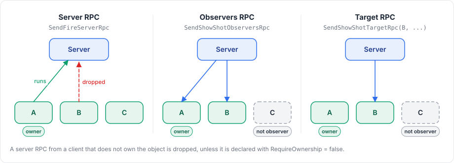

# RPCs

An RPC (remote procedure call) runs a method of a `NetworkBehaviour` on the other side of the connection. RPCs go in three directions:

| RPC | From | To | Send with |
|---|---|---|---|
| Server RPC | A client | The server | `Send<Method>ServerRpc` |
| Observers RPC | The server | Every client that observes the object | `Send<Method>ObserversRpc` |
| Target RPC | The server | One client that observes the object | `Send<Method>TargetRpc` |

An RPC takes any number of parameters, and the package writes a send method for each one from its signature.

<figure><figcaption><p>Which side sends each kind of RPC, and who receives it.</p></figcaption></figure>

## Declaring RPCs

```csharp
using Fomoxa.Networking;
using Fomoxa.Unity;
using UnityEngine;

public sealed partial class Turret : NetworkBehaviour
{
    public void RequestFire(Vector3 direction, byte weapon) => SendFireServerRpc(direction, weapon);

    public void RequestReload() => SendReloadServerRpc();

    [ServerRpc]
    private void Fire(ulong peerId, Vector3 direction, byte weapon)
    {
        Debug.Log($"peer {peerId} fires weapon {weapon}");
        SendShowShotObserversRpc(direction);
    }

    [ServerRpc]
    private void Reload()
    {
        SendPlayReloadObserversRpc();
    }

    [ClientRpc]
    private void ShowShot(Vector3 direction)
    {
        Debug.DrawRay(transform.position, direction, Color.red, 1f);
    }

    [ClientRpc]
    private void PlayReload()
    {
        GetComponent<AudioSource>().Play();
    }
}
```

The class must be `partial`, and so must every class that contains it. A source generator in the package adds the send methods to it and the code that registers each RPC when the object spawns.

### Signatures

| Attribute | Signature |
|---|---|
| `[ServerRpc]` | `void M(...)`. A first parameter of type `ulong` receives the caller's peer id and is not sent |
| `[ClientRpc]` | `void M(...)`. Every parameter is sent |

The method may be private, but it must not be static or generic, return a value, or have `ref`, `out`, `in` or `params` parameters.

### Parameter types

The package works out how each parameter travels:

| C# type | Sent as |
|---|---|
| `bool`, `sbyte`, `byte`, `short`, `ushort`, `int`, `uint`, `long`, `ulong`, `float`, `double`, `string` | The matching primitive |
| `Vector2`, `Vector3`, `Vector4`, `Vector2Int`, `Vector3Int`, `Quaternion`, `Color`, `Color32`, `Rect`, and types registered with `FomoxaUnityTypes.Register` | The package's [Unity types](../advanced/custom-codecs.md#unity-types) |
| A class marked `[Network]` with a `net` codec | That [model](models.md) |

For any other type, or to send a value in another form, give the parameter `[NetworkType("...")]` with a wire type, for example `[NetworkType("f16")] float yaw` or `[NetworkType("Array<u32>")] List<uint> targets`. A parameter whose type the package cannot work out stops the generation with `[ServerRpc] <Type>.<Method>: the parameter <name> has the type <type>, whose wire type com.fomoxa.networking cannot infer; give the parameter [NetworkType("...")]`.

A `string` or a model argument must not be `null`; the send method throws `ArgumentNullException` with the parameter's name.

### The generated model

The parameters of an RPC travel in a model that the package generates in the `RpcModels` subfolder of the Generated Folder. Its name is the class followed by the method, `TurretFire` in the example, and it has one field per sent parameter, named after the parameter with an upper-case first letter. A parameterless RPC gets an empty model.

When you add an RPC or change its parameters, the package generates the model after the next compilation and Unity compiles again. A player build fails as long as a generated model is missing or out of date.

Parameters follow the same rules as [state fields](../synchronization/state.md#changing-the-fields). Adding a parameter at the end, or removing the last one, keeps older builds connected; a parameter that an older build does not send arrives as zero, `false` or an empty value. Inserting, reordering, retyping or renaming a parameter, apart from its case or underscores, does not, and neither does renaming the class or the method unless the attribute keeps the model name. The Console shows the verdict when the model is generated. An RPC that an older build does not have at all is not covered by these rules: ship the server and the clients together when you add one.

When two RPCs would produce the same model name, give one of them another name with the attribute's argument, as in `[ServerRpc("TurretReloadRequest")]`.

### Channels

An RPC travels on `ReliableOrdered` by default. Set another channel on the attribute, for example `[ClientRpc(Channel = Channel.Unreliable)]` for an effect that may be lost.

### Ownership

A server RPC only runs when the caller owns the object. The server drops other calls and raises `ServerManager.OnServerRpcRejected` with the peer, the object, the behaviour and the RPC's message id. While nothing subscribes, it logs `Fomoxa dropped server RPC 0x... to object <id> from peer <id>, which does not own the object` instead. To let any client call it, for example on a door anyone can open, declare it with `[ServerRpc(RequireOwnership = false)]`.

## Sending

For each RPC the generator writes `protected` send methods on the class:

| RPC | Send methods | Returns |
|---|---|---|
| `[ServerRpc] void Fire(ulong peerId, Vector3 direction, byte weapon)` | `SendFireServerRpc(Vector3 direction, byte weapon)` | `SendResult` of the queue |
| `[ClientRpc] void ShowShot(Vector3 direction)` | `SendShowShotObserversRpc(Vector3 direction)` | The number of observers the RPC was queued for |
| | `SendShowShotTargetRpc(ulong peerId, Vector3 direction)` | `SendResult`; `NotObserver` when the peer does not observe the object |

The peer id parameter of a server RPC is filled in by the server, so it is not part of the send method. The send methods exist from the first compilation, before the model is generated. A send method whose name another member of the class already has is not generated, and the generator reports `FOMOXA011`.

The arguments are encoded during the call, so you may change or reuse them afterwards, and the RPC leaves with the next flush at the end of the tick.

A server RPC can only be sent where the object is spawned on a client, and an observers or target RPC only where it is spawned on the server. Otherwise the call throws `<name> is not spawned on the client` or `on the server`. On a host, an observers RPC also reaches the host's client if that client observes the object, and the client RPC then runs on the shared instance.

### Sending by name

The generated methods call `protected` methods of `NetworkBehaviour` that take the RPC's name, and you can call them yourself:

| Method | Arguments |
|---|---|
| `SendServerRpc(string rpc)`, `SendObserversRpc(string rpc)`, `SendTargetRpc(ulong peerId, string rpc)` | None |
| `SendServerRpc<TValues>(string rpc, TValues values)`, `SendObserversRpc<TValues>(...)`, `SendTargetRpc<TValues>(ulong peerId, ...)` | One value, or a tuple for several |

```csharp
SendServerRpc(nameof(Reload));
SendServerRpc(nameof(Fire), (direction, weapon));
SendTargetRpc(peerId, nameof(ShowShot), direction);
```

The values must have the types of the RPC's sent parameters, in order. Otherwise the call throws `ArgumentException`; with the generated methods, the compiler catches the mistake. A method declared in a base class can be sent by name from a derived class.

## Receiving

The RPC method runs on the receiving side with the sent values. A server RPC's `ulong` first parameter holds the id of the peer that called it. Each call receives new instances of model arguments, so the method may keep them.

## Errors in handlers

A server RPC that throws closes the calling client's connection: the peer stops with `StopReason.HandlerException`, and the client stops with `ServerClosed` and a `CloseReason` of `HandlerException`. A client RPC that throws stops that client with `HandlerException`. In both cases the client does not reconnect. On the server, a subscriber to `OnHandlerException` can set `Disconnect` to `false` to keep the client connected. A message that fails to decode is handled differently: it is dropped and raises `OnReceiveDropped`. Validate the arguments of server RPCs, and write them so that bad input does not make them throw; [errors](../concepts/error-handling.md#validate-client-data-in-server-handlers) shows how.

## Compile errors

The source generator reports these compile errors for RPCs on a `NetworkBehaviour`:

| Id | Meaning |
|---|---|
| `FOMOXA001` | The method is not in a `NetworkBehaviour` |
| `FOMOXA002` | The class, or a class containing it, is not `partial` |
| `FOMOXA003` | Unsupported `[ServerRpc]` signature |
| `FOMOXA004` | Unsupported `[ClientRpc]` signature |
| `FOMOXA005` | The method carries more than one of `[NetworkRpc]`, `[ServerRpc]`, `[ClientRpc]` |
| `FOMOXA009` | `Codec` is set on the attribute; it does not apply on a `NetworkBehaviour` |
| `FOMOXA011` | A send method would take the name of an existing member |
| `FOMOXA022` | The method carries `[NetworkRpc]`; declare it with `[ServerRpc]` or `[ClientRpc]` |

## Limitations

An RPC is always addressed to one behaviour of one spawned object. To send a message without an object, use [raw messages](messages.md).

The generated models travel on the RPC's [channel](channels.md). The [attributes reference](../reference/attributes.md) lists every RPC attribute and property, and [NetworkBehaviour](../objects/network-behaviour.md) summarizes the send methods. A [console server](../console-server/runtime.md) declares and registers RPCs on `EntityBehaviour`, with models written by hand.
