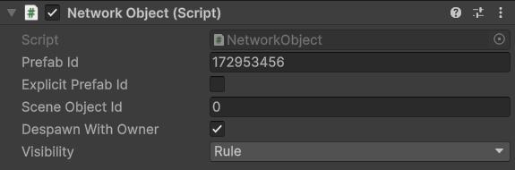

# NetworkObject

`NetworkObject` marks a GameObject as an object that exists on the network. The server assigns it an object id when it spawns, and every client that observes it creates or activates a matching instance. Every `NetworkBehaviour` on the GameObject and on its children belongs to it.

## When to use it

Put a `NetworkObject` on the root of every prefab that the server spawns, such as players, projectiles or pickups, and on objects placed in a scene that the server should control, such as doors or moving platforms. Objects that never change, or that every client can compute on its own, do not need one.

## Basic usage

1. Add `NetworkObject` to the root of a prefab.
2. Add `NetworkBehaviour` components to the prefab, on the root or on children.
3. Save the prefab. The package assigns a prefab id.
4. Make sure the prefab is registered with the `NetworkManager`, through Collected Prefabs or the Prefabs list.
5. On the server, instantiate the prefab and call `ServerManager.Spawn`.

[Spawning](spawning.md) covers the last two steps in detail.

## Fields

<figure><figcaption>
The NetworkObject of the tutorial's Player prefab.
</figcaption></figure>

| Field | Default | Meaning |
|---|---|---|
| Prefab Id | assigned | The id that server and clients use for this prefab. The Editor fills it from the prefab's asset GUID. |
| Explicit Prefab Id | off | Keeps a hand-written Prefab Id instead of the one derived from the GUID |
| Scene Object Id | assigned | The id of an object placed in a scene. The Editor fills it when the scene is saved. Prefab assets have 0. |
| Despawn With Owner | on | The server despawns the object when its owner disconnects. Off: the object stays and becomes owned by the server. |
| Visibility | Rule | `Rule`: the `NetworkManager`'s Observer Rule decides. `Everyone`: every client observes it. `OwnerOnly`: only the owner does. See [observers](observers.md). |

`DespawnWithOwner` and `Visibility` can also be set from code, and the server reads their current values at the moment it needs them. After you change `Visibility` on a spawned object, call `ServerManager.RebuildObservers(networkObject)` to apply it. Otherwise the change waits for the next recalculation of that object, and without an observer rule that [recalculates periodically](observers.md#when-observers-are-recalculated) that can take a long time.

## Properties

| Property | Meaning |
|---|---|
| `ObjectId` | The id the server assigned; 0 while not spawned |
| `PrefabId` | The prefab id |
| `SceneObjectId` | The scene object id; 0 for prefab instances |
| `OwnerId` | The owner's peer id; 0 when the server owns it or when not spawned |
| `IsOwner` | True on the client that owns the object, including a host's client |
| `IsSpawned` | True while spawned on the server or on a client of this process |
| `Behaviours` | The object's `NetworkBehaviour` components, in behaviour index order |
| `Body`, `Body2D` | The object's physics body, see [PhysicsBody](../physics/physics-body.md) |

`IsOwner` can only be true on a client. On a dedicated server it is always false, even for objects the server owns.

## How it works

<figure><figcaption>
Behaviour indexes follow the hierarchy, and the fingerprint checks that both sides agree on them.
</figcaption></figure>

When the object spawns, the package collects every `NetworkBehaviour` under the GameObject, including inactive ones, with `GetComponentsInChildren`, and the position of a behaviour in that list becomes its behaviour index. Messages to the object carry the object id and the behaviour index, so the list must be identical on the server and on the clients.

The package checks this with a fingerprint, a hash of the full type names of the behaviours in order. The server sends the fingerprint with each spawn, and a client whose prefab has a different list stops with `PrefabMismatch`.

## Limitations

On a prefab, the `NetworkObject` must be on the root. A scene object may sit anywhere in the hierarchy, but not under another `NetworkObject`, because nested `NetworkObject` components are not supported. One object can have at most 256 `NetworkBehaviour` components.

Destroying the `GameObject` on the server despawns the object. Destroying it on a client without a despawn from the server only drops it from the client's objects, with a warning.

The scripts that belong to the object are described in [NetworkBehaviour](network-behaviour.md). [Spawning](spawning.md), [ownership](ownership.md) and [observers](observers.md) cover what the server does with the object, and the [NetworkObject reference](../reference/network-object.md) lists every member.
