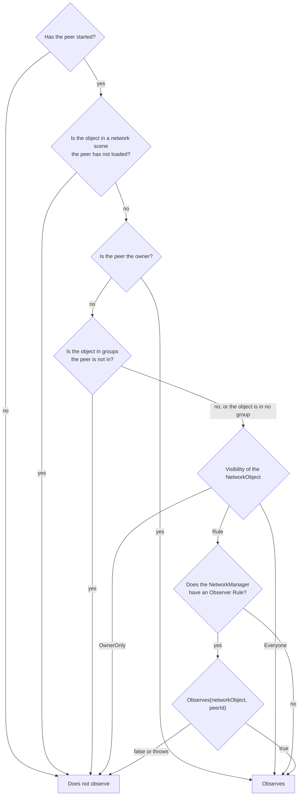
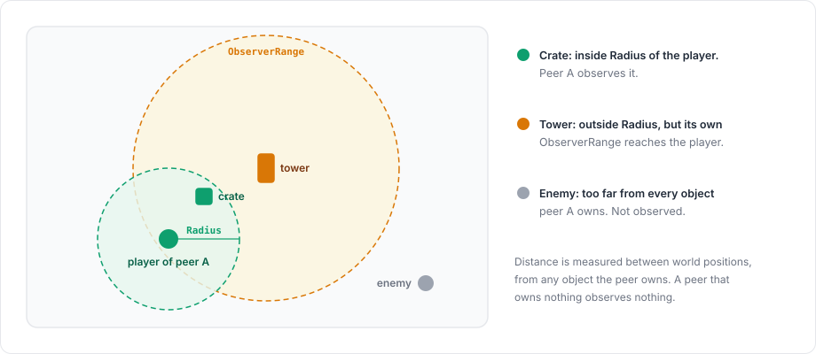

# Observers

An observer of an object is a client that receives it. For each spawned object the server keeps the set of peers that observe it. A peer that enters the set receives the object's spawn, a peer that leaves it receives a despawn, and state, transform updates and RPCs to observers go only to the peers in the set.

Limiting observers saves bandwidth and keeps information away from clients that should not have it, such as enemies behind a wall or the units of other teams.

## Who observes an object

For each peer and each object, the server goes through the checks below in order and stops at the first one that gives an answer.



1. A peer that has not started yet observes nothing.
2. An object in a network scene is observed only by peers that have loaded that scene. This applies to the owner too.
3. The owner observes its own objects, even when it is in none of the object's groups.
4. An object that belongs to at least one [group](#groups) is not observed by peers that are in none of those groups.
5. The object's Visibility field decides next. With `Everyone`, the peer observes the object, and with `OwnerOnly`, it does not.
6. With `Rule`, the default, the `ObserverRule` of the `NetworkManager` decides, and if there is no rule, the peer observes the object. If the rule throws, the exception is logged and the peer does not observe the object.

The group check comes before Visibility, so an object with `Everyone` that belongs to a group is observed by every peer of that group and by nobody else.

## ObserverRule

An observer rule is a `ScriptableObject` that answers whether a given peer observes a given object:

```csharp
using Fomoxa.Unity;
using UnityEngine;

[CreateAssetMenu(menuName = "Game/Team Rule")]
public sealed class TeamRule : ObserverRule
{
    public override bool Observes(NetworkObject networkObject, ulong peerId)
    {
        Team team = networkObject.GetComponent<Team>();
        return team == null || team.IsVisibleTo(peerId);
    }
}
```

`Team` here stands for a component of your own. Create an asset of the rule and assign it to the Observer Rule field of the `NetworkManager`.

`Observes` runs on the server only. It must not spawn, despawn, change owners or rebuild observers, and those calls throw while the server is deciding. If `Observes` throws, the exception is logged and the answer counts as "does not observe".

## DistanceRule

<figure><figcaption><p>DistanceRule measures from every object the peer owns. ObserverRange gives one object its own radius.</p></figcaption></figure>

`DistanceRule` is the rule that comes with the package, and you create one with Assets > Create > Fomoxa > Distance Rule. A peer observes an object when the object is within Radius (50 units by default) of any object the peer owns, measured between the world positions of the transforms. An `ObserverRange` component on an object replaces Radius for that object, for example to give a tall building a larger radius.

A peer that owns no object observes nothing through this rule, so spawn the peer's player before you expect it to see the world. As soon as a peer gets its first owned object, the server rebuilds that peer's observers.

## Groups

A group holds peers and objects that belong together, such as the players and objects of one match. Groups live on the server in `ServerManager.Groups`, and you identify each group with a `uint` of your choice. A peer or an object can be in several groups.

```csharp
using Fomoxa.Unity;
using UnityEngine;

public sealed class MatchRooms : MonoBehaviour
{
    [SerializeField] private NetworkManager manager;
    [SerializeField] private NetworkObject cratePrefab;

    public void Join(uint matchId, ulong peerId)
    {
        manager.ServerManager.Groups.Add(matchId, peerId);
    }

    public void Leave(uint matchId, ulong peerId)
    {
        manager.ServerManager.Groups.Remove(matchId, peerId);
    }

    public void SpawnCrate(uint matchId, Vector3 position)
    {
        NetworkObject crate = Instantiate(cratePrefab, position, Quaternion.identity);
        manager.ServerManager.Groups.Add(matchId, crate);
        manager.ServerManager.Spawn(crate);
    }
}
```

An object in no group is decided as if groups did not exist. Once an object is in a group, only the peers of its groups and its owner can observe it, and Visibility and the observer rule choose among them (steps 4 to 6 above). Groups work with or without an observer rule, so a server that hosts many rooms can rely on groups alone and leave the Observer Rule field empty.

Adding or removing a peer or an object recalculates the affected pairs at once and queues their spawns and despawns before the method returns, as `RebuildObservers` does. Add an object to its groups before you spawn it, and the spawn never reaches peers outside them. A peer that disconnects leaves all its groups, and so does an object that is despawned, so add an object again if you spawn it again. Stopping the server clears every group. Calling a group method from inside `ObserverRule.Observes` throws.

The periodic recalculation only looks at the peers that share a group with an object, and the observer rule is never asked about a pair outside the groups. With groups, the cost of both follows the size of the groups. Without groups, it follows the number of objects times the number of peers on the server.

## When observers are recalculated

The server recalculates what an event affects as soon as the event happens: a spawn, a peer that starts, a change of owner, a peer that loads or unloads a network scene, and a change of groups.

Because positions keep changing, the server also recalculates observers periodically. Each tick it handles a share of the objects, so that every object is recalculated once every Observer Interval ticks (15 by default), which at 30 ticks per second means twice per second.

The periodic recalculation runs only when the `NetworkManager` has an observer rule whose `RebuildsPeriodically` is true, which is the default. A rule whose answer changes only when the game changes something, such as a team rule, can turn it off:

```csharp
using Fomoxa.Unity;
using UnityEngine;

[CreateAssetMenu(menuName = "Game/Team Rule")]
public sealed class TeamRule : ObserverRule
{
    public override bool RebuildsPeriodically => false;

    public override bool Observes(NetworkObject networkObject, ulong peerId)
    {
        Team team = networkObject.GetComponent<Team>();
        return team == null || team.IsVisibleTo(peerId);
    }
}
```

The server then asks such a rule only on the events above and when you call one of the methods below, for example `RebuildObservers(networkObject)` after a player changes team. Without an observer rule, there is no periodic recalculation.

When something the rule depends on changes, you can recalculate immediately instead of waiting:

| Method | Recalculates |
|---|---|
| `ServerManager.RebuildObservers(networkObject)` | One object for every peer. Returns false when the object is not spawned by this server. |
| `ServerManager.RebuildObserversOfPeer(peerId)` | Every object for one peer |
| `ServerManager.RebuildObservers()` | Every object for every peer |

`ServerManager.IsObserver(networkObject, peerId)` tells whether a peer currently observes an object.

## Host mode

The host's client is a peer like any other and only observes what the rule allows. Objects it does not observe still exist in the host's process because the server needs them, but the package hides their renderers, as described in [host mode](../connections/host-mode.md).

The Visibility field is set on the [NetworkObject](network-object.md), [network scenes](scenes.md) explains the scene step of the decision, and the [ServerManager reference](../reference/server-manager.md) lists the observer members.
