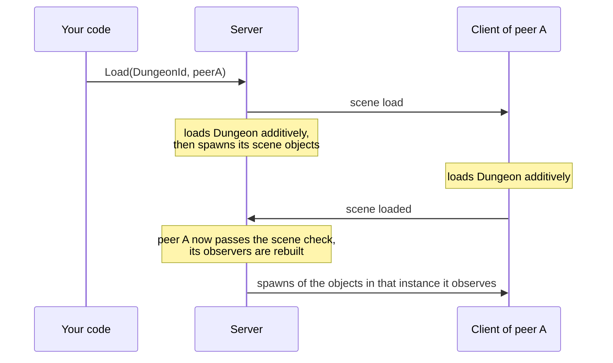

# Network scenes

A network scene is a scene that the server loads additively, both on itself and on selected clients. Each load creates an instance of the scene asset, and the server can hold several instances of one asset at the same time, such as one copy of a dungeon for each group of players. An instance is either global, meaning every client loads it, or loaded only for chosen peers. Objects in an instance, including objects spawned into it, only reach peers that have loaded that instance.

The scene a game starts with is not a network scene. Both sides open it the usual way, and its scene objects are visible to every peer that passes the observer rules.

## Scene ids

A scene id names a scene asset: it is a 32-bit hash of the asset's GUID. The Editor writes the ids into two files. `FomoxaSceneList.asset` holds the id and path of every scene in the Build Profiles scene list and is refreshed whenever that list or a scene asset changes. `FomoxaScenes.cs` holds a constant `<SceneName>Id` for every scene asset under `Assets`, including scenes outside the build list.

Assign `FomoxaSceneList.asset` to Collected Scenes on the `NetworkManager`. The manager then registers each listed scene with a loader that calls `SceneManager.LoadSceneAsync(path, LoadSceneMode.Additive)` and `UnloadSceneAsync`, and `NetworkManager.Scenes.IdOf("Assets/Scenes/Arena.unity")` returns the id of a listed scene, or 0 for one that is not listed.

## Instances

A `NetworkScene` names one loaded instance. The server hands out instance ids counting up from 1 and never reuses one while it runs, so an instance that was unloaded is not confused with a later instance of the same asset. `default(NetworkScene)` means no network scene. The load calls take scene ids and return `NetworkScene` values, and every other scene call takes a `NetworkScene`.

## Load a scene for everyone

```csharp
NetworkScene arena = manager.ServerManager.Scenes.LoadGlobal(new[] { FomoxaScenes.ArenaId })[0];
```

The server starts loading the scene and, in the same call, tells every started peer to load it, so the server and the clients load in parallel. A peer that connects later loads every global scene when it starts. A scene asset has at most one global instance: calling `LoadGlobal` for an asset that already has one returns that instance and sends nothing. `LoadGlobal(sceneIds, replace: true)` unloads the current global instances before loading the new ones.

`UnloadGlobal(scenes)` unloads global instances and throws for one that is not global.

## Load a scene for some peers

```csharp
NetworkScene dungeon = manager.ServerManager.Scenes.Load(FomoxaScenes.DungeonId, new[] { peerA, peerB });
```

`Load` always creates a new instance, even when the asset already has one, so two groups that each call it get two separate dungeons. The list of peers can be empty. Peers that are not started are skipped. Keep the returned `NetworkScene` with your room or match, because the later calls need it.

`AddPeers(dungeon, peerIds)` and `RemovePeers(dungeon, peerIds)` change who has the instance and return how many peers they added or removed. A peer that is removed gets the despawns of the instance's objects, then the unload. The instance stays loaded on the server even when no peer has it any more, and when its last peer disconnects. `Unload(dungeon)` despawns its objects, unloads it on its peers and then unloads it on the server.

A global instance and a per-peer instance are always two different instances. `AddPeers`, `RemovePeers` and `Unload` throw for a global instance, and `UnloadGlobal` throws for a per-peer one.

Every load call takes an optional `ScenePhysics`. With the default, `Shared`, the instance uses the default physics world, so a scene asset can have only one `Shared` instance at a time, and a second instance needs `ScenePhysics.Own`. Loading a `Shared` instance of an asset whose previous instance is still unloading waits until that unload has finished.

## Objects in network scenes



When the server finishes loading an instance, it spawns the scene objects in it, and when it unloads the instance, it despawns every object in it. Each instance has its own copies of the scene objects, so the same scene object id can be spawned once in every instance.

An object the server spawns into an instance, by moving it into that instance's `Scene` before `Spawn`, only reaches peers that have loaded the instance, as shown in [spawning](spawning.md#spawning-into-a-network-scene). A peer starts observing such an object only after its client reports that it has finished loading the instance.

## Server events and queries

| Member | Meaning |
|---|---|
| `OnLoaded(NetworkScene scene)` | The server finished loading an instance |
| `OnLoadFailed(NetworkScene scene, Exception exception)` | The server could not load it; the exception is also logged |
| `OnUnloaded(NetworkScene scene)` | The server finished unloading an instance |
| `OnPeerLoaded(ulong peerId, NetworkScene scene)` | A peer's client reported an instance as loaded |
| `Global` | The global instances |
| `Contains(scene)` | The instance exists |
| `IsGlobal(scene)` | The instance is global |
| `HasLoaded(peerId, scene)` | The peer's client reported the instance as loaded |
| `PeersOf(scene)` | Peers that have the instance |
| `ScenesOf(peerId)` | Instances the peer has |
| `InstancesOf(sceneId)` | Instances of a scene asset |
| `SceneIdOf(scene)` | The scene id of an instance, or 0 |
| `TryGetScene(scene, out Scene unityScene)` | The Unity `Scene` the server loaded for the instance |

All of these members are on `ServerManager.Scenes`.

## On the client

The client loads and unloads instances one at a time, in the order the server asked for them, and reports each finished load to the server. If a load fails, the client logs the exception and stops with `PrefabMismatch`, raising `OnObjectMismatch` with the kind `UnknownScene`. When the connection stops, the client keeps the instances it has loaded. After a reconnect it keeps an instance only when the server lists it again with the same instance id, scene id and physics mode, and replaces it otherwise.

`ClientManager.Scenes` has the client side of the queries and events:

| Member | Meaning |
|---|---|
| `OnLoadStarted(NetworkScene scene, uint sceneId)` | The client started loading an instance |
| `OnLoaded(NetworkScene scene)` | The client finished loading an instance |
| `OnUnloaded(NetworkScene scene)` | The client finished unloading an instance |
| `SceneIdOf(scene)` | The scene id of an instance the client has or is loading, or 0 |
| `TryGetScene(scene, out Scene unityScene)` | The Unity `Scene` the client loaded for the instance |

A host's client uses the instances the server loaded instead of loading them again, and its `TryGetScene` returns the server's `Scene`.

## Custom loaders

A scene that is not in the build list, such as an Addressables scene, needs a loader of your own, registered on the server and on every client:

```csharp
using System;
using Fomoxa.Unity;
using Generated;
using UnityEngine.SceneManagement;

public sealed class ArenaLoader : ISceneLoader
{
    public void Load(Action<Scene> loaded, Action<Exception> failed)
    {
        var operation = SceneManager.LoadSceneAsync("Arena", LoadSceneMode.Additive);
        operation.completed += _ => loaded(SceneManager.GetSceneByName("Arena"));
    }

    public void Unload(Scene scene, Action unloaded)
    {
        SceneManager.UnloadSceneAsync(scene).completed += _ => unloaded();
    }
}
```

```csharp
manager.Scenes.Register(FomoxaScenes.ArenaId, new ArenaLoader());
```

A loader calls `loaded` with the loaded scene or `failed` with an exception, and calls `unloaded` once unloading is done. Register it before the server or the client needs the scene, because `LoadGlobal` and `Load` throw `scene 0x... is not in the scene registry` for an unregistered id. Scene id 0 cannot be registered.

## Limitations

All scene loading is additive, and the package neither switches the active scene nor unloads the starting scene. A peer can have several instances, including two instances of the same asset.

Network scenes take part in the [observer](observers.md) decision and in [spawning](spawning.md), and the [ServerManager reference](../reference/server-manager.md) lists the scene members.
