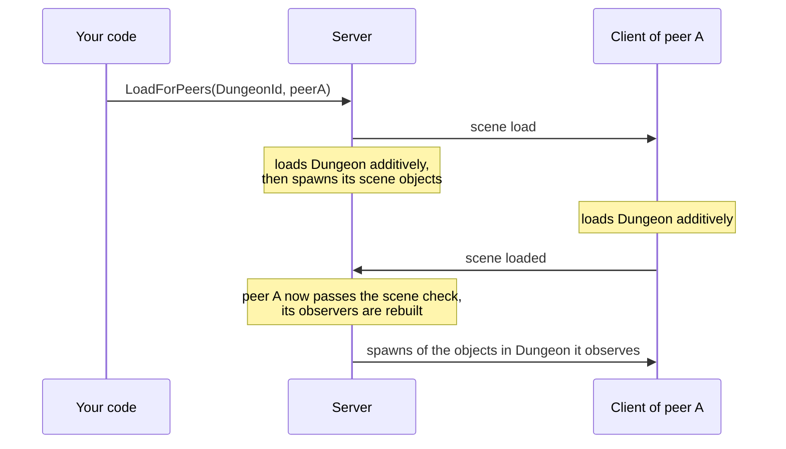

# Network scenes

A network scene is a scene that the server loads additively, both on itself and on selected clients. A scene can be global, meaning it is loaded for every client, or loaded only for chosen peers, such as the players inside one dungeon. Objects in a network scene, including objects spawned into it, only reach peers that have loaded it.

The scene a game starts with is not a network scene. Both sides open it the usual way, and its scene objects are visible to every peer that passes the observer rules.

## Scene ids

The server and the clients identify a network scene by its scene id, a 32-bit hash of the scene asset's GUID. The Editor writes the ids into two files. `FomoxaSceneList.asset` holds the id and path of every scene in the Build Profiles scene list and is refreshed whenever that list or a scene asset changes. `FomoxaScenes.cs` holds a constant `<SceneName>Id` for every scene asset under `Assets`, including scenes outside the build list.

Assign `FomoxaSceneList.asset` to Collected Scenes on the `NetworkManager`. The manager then registers each listed scene with a loader that calls `SceneManager.LoadSceneAsync(path, LoadSceneMode.Additive)` and `UnloadSceneAsync`, and `NetworkManager.Scenes.IdOf("Assets/Scenes/Arena.unity")` returns the id of a listed scene, or 0 for one that is not listed.

## Load a scene for everyone

```csharp
manager.ServerManager.Scenes.LoadGlobal(new[] { FomoxaScenes.ArenaId });
```

The server starts loading the scene and, in the same call, tells every started peer to load it, so the server and the clients load in parallel. A peer that connects later loads every global scene when it starts. `LoadGlobal(sceneIds, replace: true)` unloads the current global scenes before loading the new ones.

`UnloadGlobal(sceneIds)` unloads global scenes and throws for an id that is not a global scene.

## Load a scene for some peers

```csharp
int added = manager.ServerManager.Scenes.LoadForPeers(FomoxaScenes.DungeonId, new[] { peerA, peerB });
```

`LoadForPeers` returns the number of peers it added, skipping peers that are not started or already have the scene. The server loads the scene for itself the first time any peer gets it.

`UnloadForPeers(sceneId, peerIds)` removes the scene from those peers, and once the last peer is removed, the server despawns the scene's objects and unloads it. `Unload(sceneId)` removes a per-peer scene from every peer at once.

A scene is either global or per peer, never both. `LoadForPeers` throws for a global scene, and `LoadGlobal` with a per-peer scene turns it into a global one.

## Objects in network scenes



When the server finishes loading a network scene, it spawns the scene objects in it, and when it unloads the scene, it despawns every object in it.

An object the server spawns into a network scene, by moving it there before `Spawn`, only reaches peers that have loaded the scene, as shown in [spawning](spawning.md#spawning-into-a-network-scene). A peer starts observing such an object only after its client reports that it has finished loading the scene.

## Server events and queries

| Member | Meaning |
|---|---|
| `OnLoaded(uint sceneId)` | The server finished loading a network scene |
| `OnLoadFailed(uint sceneId, Exception exception)` | The server could not load it; the exception is also logged |
| `Global` | The global scene ids |
| `Contains(sceneId)` | The scene is global or loaded for some peer |
| `IsGlobal(sceneId)` | The scene is global |
| `HasLoaded(peerId, sceneId)` | The peer's client reported the scene as loaded |
| `PeersOf(sceneId)` | Peers that have the scene |
| `TryGetScene(sceneId, out Scene scene)` | The Unity `Scene` the server loaded |

All of these members are on `ServerManager.Scenes`.

## On the client

The client loads and unloads scenes one at a time, in the order the server asked for them, and reports each finished load to the server. If a load fails, the client logs the exception and stops with `PrefabMismatch`, raising `OnObjectMismatch` with the kind `UnknownScene`. When the connection stops, the client keeps the scenes it has loaded.

A host's client uses the scenes the server loaded instead of loading them again.

## Custom loaders

A scene that is not in the build list, such as an Addressables scene, needs a loader of your own, registered on the server and on every client:

```csharp
using System;
using Fomoxa.Unity;
using Generated;
using UnityEngine.SceneManagement;

public sealed class ArenaLoader : ISceneLoader
{
    public void Load(Action<Scene> loaded, Action<Exception> failed)
    {
        var operation = SceneManager.LoadSceneAsync("Arena", LoadSceneMode.Additive);
        operation.completed += _ => loaded(SceneManager.GetSceneByName("Arena"));
    }

    public void Unload(Scene scene, Action unloaded)
    {
        SceneManager.UnloadSceneAsync(scene).completed += _ => unloaded();
    }
}
```

```csharp
manager.Scenes.Register(FomoxaScenes.ArenaId, new ArenaLoader());
```

A loader calls `loaded` with the loaded scene or `failed` with an exception, and calls `unloaded` once unloading is done. Register it before the server or the client needs the scene, because `LoadGlobal` and `LoadForPeers` throw `scene 0x... is not in the scene registry` for an unregistered id. Scene id 0 cannot be registered.

## Limitations

Each side loads a given scene asset at most once at a time. All scene loading is additive, and the package neither switches the active scene nor unloads the starting scene.

Network scenes take part in the [observer](observers.md) decision and in [spawning](spawning.md), and the [ServerManager reference](../reference/server-manager.md) lists the scene members.
