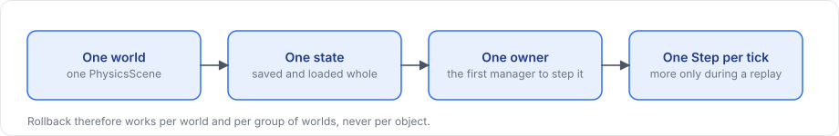

# Physics architecture

This page describes the physics interfaces in layer 1 and the Unity physics component in layer 2. Game code normally only needs [`PhysicsBody`](physics-body.md), so read on if you want to understand how rollback works or to use the interfaces directly.

## Layers

<figure><figcaption>
The physics layers and the assemblies they live in.
</figcaption></figure>

Layer 1 does not reference Unity, so its vectors are `System.Numerics` types, and the Unity worlds map them to Unity's physics.

## The rule of a world

<figure><figcaption>
The rule every physics backend follows.
</figcaption></figure>

A world is one simulation state of the physics engine. With `RigidbodyPhysics` that is one `PhysicsScene` or one `PhysicsScene2D`, shared by every Unity scene that uses it. One `NetworkManager` owns the stepping of a world, and no other manager in the process steps it.

The owner steps the world once per tick. A replay steps it again, but only after loading an earlier state. Rollback therefore works per world and per group of worlds, never per object, as described under [rollback groups](../prediction/rollback.md#rollback-groups).

## IPhysicsSimulation

`IPhysicsSimulation` is the part of a world that the tick loop and rollback need:

| Member | Meaning |
|---|---|
| `Backend` | The `PhysicsBackend` of the world |
| `Step(float seconds)` | Advances the world by one step |
| `CreateSnapshot()` | Creates an empty snapshot object for this backend |
| `Save(PhysicsSnapshot into)` | Writes the current state into a snapshot |
| `Load(PhysicsSnapshot from)` | Restores a saved state |

A snapshot does not know which tick it belongs to; `PhysicsHistory` keeps track of that.

## IPhysicsWorld and IPhysicsWorld2D

Both interfaces extend `IPhysicsSimulation`. They are separate because their states differ: a 3D rotation is a quaternion, while a 2D rotation is an angle.

| Member | 3D | 2D |
|---|---|---|
| Create a body | `CreateBody(in BodyDesc)` | `CreateBody(in BodyDesc2D)` |
| Remove, test | `RemoveBody(BodyHandle)`, `Contains(BodyHandle)` | same |
| Read | `GetBody` returns `BodyState`, `GetKind`, `GetMass` | `GetBody` returns `BodyState2D`, `GetKind`, `GetMass` |
| Write | `SetBody(BodyHandle, in BodyState)` | `SetBody(BodyHandle, in BodyState2D)` |
| Exclude from snapshots | `SetRewindable(BodyHandle, bool)` | same |
| Forces | `AddForce`, `AddImpulse` with `Vector3` | with `Vector2` |
| Queries | `Raycast(origin, direction, maxDistance, out RayHit)`, `Overlap(center, radius, BodyHandle[])` | `Raycast(..., out RayHit2D)`, `Overlap(Vector2, float, BodyHandle[])` |

The interfaces use a small set of data types. `BodyHandle` is an opaque id whose `IsValid` is false for the default value. `BodyKind` is one of `Dynamic`, `Kinematic` and `Static`. The shapes are `BodyShape` (`Box`, `Sphere`, `Capsule`, `ConvexHull`, `TriangleMesh`) and `BodyShape2D` (`Box`, `Circle`, `Capsule`, `ConvexPolygon`, `Polyline`). A `ColliderDesc` or `ColliderDesc2D` places a shape with a `ColliderMaterial`, a layer and a trigger flag, and `BodyDesc` and `BodyDesc2D` describe a new body by kind, colliders, position, rotation, mass and a `BodyMotion` or `BodyMotion2D` (axis locks, gravity, damping). The remaining types are `BodyState` and `BodyState2D`, and `RayHit` and `RayHit2D`. The [physics API reference](../reference/physics.md) lists their members.

`PhysicsBody` and `PhysicsBody2D` wrap a world and a handle, so game code does not have to deal with handles.

## PhysicsHistory

`PhysicsHistory(world, capacity)` keeps snapshots of one world in a ring of `capacity` ticks:

| Member | Meaning |
|---|---|
| `Save(uint tick)` | Saves the world's current state for a tick, reusing the slot's snapshot |
| `Has(uint tick)` | The tick is still in the ring |
| `Load(uint tick)` | Restores the tick; returns false when it is not in the ring |
| `Clear()` | Forgets every tick |
| `Capacity` | The ring size |

The client keeps one history per predicted world, with Prediction History as its capacity.

## NetworkPhysics

`NetworkPhysics` is the abstract component that the Physics field of a `NetworkManager` holds, and `RigidbodyPhysics` is the one the package provides. The manager asks it which worlds to step, which worlds an object belongs to, for the body of a `NetworkObject` and for the history of a world. `WorldsOf(Scene, List<IPhysicsSimulation>)` returns the worlds of a scene, and the `AddStatic` and `AddBody` members described in the [physics overview](overview.md#geometry-and-bodies-added-at-runtime) add geometry and bodies at runtime.

## The Unity worlds

`UnityPhysicsWorld` and `UnityPhysicsWorld2D` implement the interfaces on a Unity physics scene. `RigidbodyPhysics` creates them for the scenes it steps, and you can also construct one yourself from a `Scene` to use the interfaces outside the network loop, for example in tests.

| Behavior | 3D | 2D |
|---|---|---|
| `Step` | `PhysicsScene.Simulate(seconds)` | `PhysicsScene2D.Simulate(seconds)` |
| Snapshot contents | Every dynamic `Rigidbody` that is not excluded: position, rotation, velocity, angular velocity, sleep | Same for `Rigidbody2D` |
| `Register(rigidbody)` | Returns the handle of an existing `Rigidbody` | Same for `Rigidbody2D` |
| `CreateBody` | Creates a GameObject named `FomoxaBody` with its colliders and a `Rigidbody` in the world's first loaded scene, and applies the body's motion settings; `Static` creates a kinematic body | Creates `FomoxaBody2D` with its colliders and a `Rigidbody2D`; `Static` creates a kinematic body |
| Units | Angular velocity in radians per second | Rotation in radians, angular velocity in radians per second |

Contact data is not part of a snapshot, which makes a replay an approximation. Proxies are excluded from snapshots with `SetRewindable(handle, false)`.

For how the package uses these interfaces, see the [physics overview](overview.md). The [physics API reference](../reference/physics.md) lists every member, and [architecture](../concepts/architecture.md) describes the layers as a whole.
