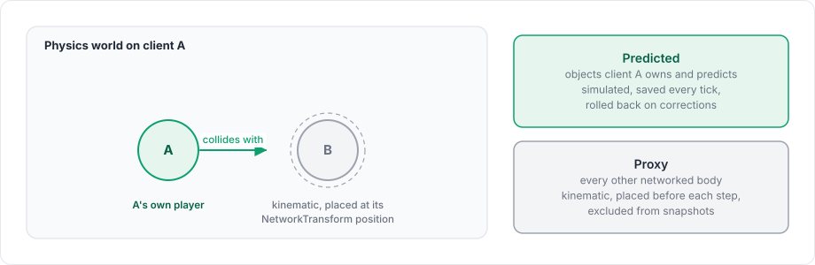

# Physics overview

The package can run Unity's 3D and 2D physics on the network tick. With physics simulation on, the `NetworkManager` steps physics once per tick, a client keeps the bodies it does not predict at their replicated positions, and prediction can roll physics back. Game code reaches a network object's body through the package's own types, `PhysicsBody` and `PhysicsBody2D`.

<figure><figcaption>
How game code reaches Unity physics.
</figcaption></figure>

Code that uses `PhysicsBody` does not depend on Unity's `Rigidbody` API.

## Turning it on

The Physics field of the `NetworkManager` holds the component that runs physics for it, `RigidbodyPhysics`. A manager whose Physics field is empty adds a `RigidbodyPhysics` to its GameObject when it starts, with physics simulation off.

1. Add `RigidbodyPhysics` to the GameObject of the `NetworkManager`.
2. Check its Simulate Physics field.
3. Drag it into the Physics field of the `NetworkManager`.

Do this for the server and for every client. While at least one manager simulates physics, the package sets `Physics.simulationMode` and `Physics2D.simulationMode` to `Script`, so that Unity no longer steps physics after `FixedUpdate`, and it restores the original modes when the last such manager is destroyed.

From then on, the manager does four things each tick:

1. On a remote client, it places the proxies (described below).
2. It applies input.
3. It steps the 3D and 2D physics world of every loaded scene once, by `TimeManager.TickDelta`.
4. It queries contacts for the [contact components](contacts.md).

`FixedUpdate` still runs at Unity's fixed timestep, but physics no longer advances there, so forces and velocity changes that should be networked belong in `apply` or a tick event.

Set the tick rate to the rate your game's physics was tuned for. A project tuned for a 0.02 s fixed timestep, for example, matches 50 ticks per second.

## One world, one owner

A world is one Unity physics scene, either the 3D `PhysicsScene` or the 2D `PhysicsScene2D` of the scenes that use it. Several scenes share one world unless they are loaded with their own local physics.

Each world has one simulation state and is stepped by exactly one `NetworkManager`, exactly once per tick. The first manager that steps a world owns it, and any other manager in the same process leaves it alone, so a server manager and a client manager in one process never step the same physics twice.

## Predicted and interpolated bodies in one world

<figure><figcaption>
Proxies let a predicted body collide with other objects where the client shows them.
</figcaption></figure>

On a remote client, a networked object's body plays one of two roles:

| Role | Objects | What the client does |
|---|---|---|
| Predicted | Objects the client owns and predicts | Simulates the body; rolls it back on corrections |
| Proxy | Every other networked object with a body | Makes the body kinematic and places it at its `NetworkTransform` position before each step |

Proxies let predicted bodies collide with other players' objects at the positions the client shows. When an object stops being a proxy, for example because the client becomes its owner, its original body settings come back. The server and the host simulate every body normally.

## Bodies

`NetworkObject.Body` returns a `PhysicsBody` for the object's `Rigidbody`, and `NetworkObject.Body2D` a `PhysicsBody2D` for its `Rigidbody2D`. The body component must be on the same GameObject as the `NetworkObject`. [PhysicsBody](physics-body.md) describes both types.

## Geometry and bodies added at runtime

A level built at runtime can hand its geometry to the physics component. `NetworkPhysics.AddStatic(Scene, IReadOnlyList<ColliderDesc>)` and `AddStatic2D` add a group of static colliders to a scene, `AddStatic(GameObject)` and `AddStatic2D(GameObject)` add the colliders under a GameObject, and `RemoveStatic` removes a group again. `AddBody` and `AddBody2D` add a body that belongs to no network object, such as a platform that every peer moves the same way from the tick number, and `RemoveBody` and `RemoveBody2D` remove it. `BodyDescriptions.TryDescribe` and `TryDescribe2D` build a `BodyDesc` or `BodyDesc2D` from a GameObject's colliders and `Rigidbody` or `Rigidbody2D`.

With `RigidbodyPhysics`, a static group is a hidden GameObject in the scene with one child per collider. `AddStatic(GameObject)` returns an empty group, because Unity's physics already has the colliders of that GameObject. A dynamic body added with `AddBody` is saved and restored with its world, while a kinematic one is not.

## Physics backend

The server tells each client which physics backend it uses, and a client with a different backend stops with `StopReason.PhysicsBackendMismatch` and does not reconnect. Give the server and the clients the same physics component.

## Without physics simulation

With Simulate Physics off, Unity steps physics on its own fixed timestep, independently of ticks. The server's bodies still move and `NetworkTransform` still replicates them, but a client's copies of dynamic bodies keep simulating on their own between updates. There are no proxies, and prediction cannot roll physics back.

## Limitations

Unity physics is not deterministic across machines, and a saved state does not include contact data, so rollback is approximate, as [rollback with physics](../prediction/rollback.md) explains. Joints, character controllers and wheel colliders are not saved or restored.

Each network object has one body, on the GameObject of its `NetworkObject`. Bodies on children are simulated and saved as part of the world, but they have no `PhysicsBody` and are not proxied.

The [PhysicsBody](physics-body.md) and [contact events](contacts.md) pages cover what game code uses, and [physics architecture](architecture.md) describes the interfaces underneath.
