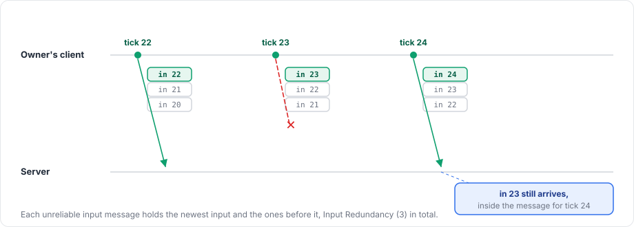

# Input

Input fields carry what the owner's player did in one tick. The package gathers them on the owner's client every tick and sends them to the server tagged with the tick. Your `OnApplyInput` runs with them on the server when that tick comes, and also right away on the owner's client if the client predicts.

## Declaring

```csharp
using Fomoxa.Networking;
using Fomoxa.Unity;
using UnityEngine;

public sealed partial class Walker : NetworkBehaviour
{
    [NetworkInput]
    private float x;

    [NetworkInput]
    private float z;

    protected override void OnGatherInput()
    {
        x = Input.GetAxisRaw("Horizontal");
        z = Input.GetAxisRaw("Vertical");
    }

    protected override void OnApplyInput(InputContext context)
    {
        transform.position += new Vector3(x, 0f, z) * 0.1f;
    }
}
```

An input field is an instance field that is not `readonly`, and it may be private. Its type decides how it travels, as for [state fields](../synchronization/state.md#state-fields), and `[NetworkInput("...")]` gives it a wire type. A behaviour with input fields must override both `OnGatherInput` and `OnApplyInput`, and the class must be `partial`.

The package gathers the input fields of a class, including those of its base classes, into one model, named after the class followed by `Input`, `WalkerInput` here, in the `StateModels` subfolder of the Generated Folder. Give it another name with `[NetworkInputModel("...")]` on the class. As with state, Play mode and builds are blocked while the model is missing or out of date, and adding a field after the last one keeps older builds connected, as [state](../synchronization/state.md#changing-the-fields) explains. When the `NetworkManager` uses the Variable timing mode, the object throws `HandlerRegistrationException` when it spawns.

Without [`[NetworkReconcile]` fields](reconciliation.md) the owner only sends input and does not predict, so the object moves when the server's result arrives, like any other object.

## Gather

`OnGatherInput` runs once per tick on the owner's client, for `TimeManager.PredictionTick`, as long as the client is connected to a remote server and its clock is synchronized. On a host it runs on the server, for the objects the host's client owns. After it returns, the package copies the input fields. A replay writes older inputs into the same fields, so set every input field each time.

Input that happens between ticks, such as a button pressed during one frame, is caught in `Update` and handed over in `OnGatherInput`. The following example adds a `jump` input field to the `PredictedMover` from the [overview](overview.md):

```csharp
[NetworkInput]
private bool jump;

private bool jumpPressed;

private void Update()
{
    if (NetworkObject != null && NetworkObject.IsOwner && Input.GetButtonDown("Jump"))
    {
        jumpPressed = true;
    }
}

protected override void OnGatherInput()
{
    x = Input.GetAxisRaw("Horizontal");
    z = Input.GetAxisRaw("Vertical");
    jump = jumpPressed;
    jumpPressed = false;
}
```

## Apply

Before each call to `OnApplyInput`, the package writes the input for that tick into the input fields. `OnApplyInput` runs in four situations:

| Where | When | `context.Replaying` |
|---|---|---|
| Server | At each tick, for objects with an owner, with the input for that tick | false |
| Owner's client, while predicting | Right after `OnGatherInput` | false |
| Owner's client, during reconciliation | Again for each tick after the corrected one | true |
| Host | At each tick, with the host's freshly gathered input | false |

The server does not call `OnApplyInput` for objects it owns itself, nor before the first input from the owner has arrived.

`InputContext` tells `OnApplyInput` more about the input in the fields:

| Property | Meaning |
|---|---|
| `Tick` | The tick this input is for |
| `Repeated` | The server or the replay had no input for this tick and reuses the last one |
| `RepeatedTicks` | When `Repeated`, how many ticks have passed since the tick of the input being reused |
| `Replaying` | The call is part of a replay on the owner's client |

`Replaying` lets you skip effects that were already shown, such as sounds and particles, and `Repeated` lets you avoid repeating one-shot actions:

```csharp
protected override void OnApplyInput(InputContext context)
{
    Move(x, z, (float)manager.TimeManager.TickDelta);
    if (jump && !context.Repeated)
    {
        Jump(playEffects: !context.Replaying);
    }
}
```

An exception thrown in `OnApplyInput` or `OnGatherInput` is logged and does not disconnect anyone.

## Sending

Each tick the owner's client sends one unreliable input message per behaviour. The message holds the newest input together with the previous ones, Input Redundancy inputs in total (3 by default), so a single lost packet does not lose an input.

<figure><figcaption><p>With the default Input Redundancy of 3, one lost message costs no input.</p></figcaption></figure>

## On the server

The server keeps the inputs it receives per object and behaviour, sorted by tick. It accepts input for ticks from its current tick up to Max Input Lead ticks ahead (30 by default). A message whose newest input is for a tick that has already passed, or lies further ahead, is dropped and counted in `ServerManager.DroppedInputsOf(peerId)`.

At each tick the server applies the input for that tick, and if none arrived in time, it applies the last input again with `Repeated` set. Input from a peer that does not own the object is dropped, and the server logs `Fomoxa dropped input to object <id> from peer <id>, which does not own the object`. When the owner changes or the object despawns, the buffered input is discarded.

The client aims to have each input arrive Input Buffer ticks (2 by default) before the server needs it, as described under [clock synchronization](../concepts/tick.md#clock-synchronization).

## Validating input

The server applies whatever the owner sends, so clamp or reject values in `OnApplyInput`, for example with `Vector3.ClampMagnitude` on a direction, to keep a modified client from moving faster than allowed. Since the same `OnApplyInput` runs on the owner's client, an honest client predicts the clamped result.

Input works together with [reconciliation](reconciliation.md) and the tick clock described in [ticks and timing](../concepts/tick.md). [NetworkBehaviour](../objects/network-behaviour.md) lists the methods a behaviour overrides.
