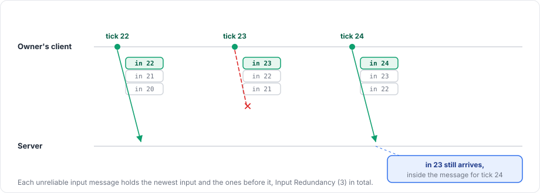

# Input

An input model carries what the owner's player did in one tick. The package gathers it on the owner's client every tick and sends it to the server tagged with the tick. Your `apply` callback runs with it on the server when that tick comes, and also right away on the owner's client if the client predicts.

## Registering

```csharp
protected override void OnRegisterInput(NetworkInput input)
{
    input.Use(MoveInputNetAdapter.Instance, Gather, Apply);
    input.Reconcile(MoveStateNetAdapter.Instance, Capture, Restore, Matches);
}
```

`NetworkInput.Use<T>(codec, gather, apply)` takes two callbacks. `gather(T input)` fills in the input of the current tick, and `apply(T input, InputContext context)` runs the tick with that input.

A behaviour has at most one input model. `Use` throws `HandlerRegistrationException` when it is called twice, or when the `NetworkManager` uses the Variable timing mode.

Without a reconcile model the owner only sends input and does not predict, so the object moves when the server's result arrives, like any other object. [Reconciliation](reconciliation.md) describes the reconcile model.

## Gather

`gather` runs once per tick on the owner's client, for `TimeManager.PredictionTick`, as long as the client is connected to a remote server and its clock is synchronized. On a host it runs on the server, for the objects the host's client owns. The package passes the same instance every tick, so set every field each time.

Input that happens between ticks, such as a button pressed during one frame, is caught in `Update` and handed over in `gather`. The following example adds a `bool` field `Jump` (wire type `bool`) to the `MoveInput` model from the [overview](overview.md):

```csharp
private bool jumpPressed;

private void Update()
{
    if (NetworkObject != null && NetworkObject.IsOwner && Input.GetButtonDown("Jump"))
    {
        jumpPressed = true;
    }
}

private void Gather(MoveInput input)
{
    input.X = Input.GetAxisRaw("Horizontal");
    input.Z = Input.GetAxisRaw("Vertical");
    input.Jump = jumpPressed;
    jumpPressed = false;
}
```

## Apply

`apply` runs in four situations:

| Where | When | `context.Replaying` |
|---|---|---|
| Server | At each tick, for objects with an owner, with the input for that tick | false |
| Owner's client, while predicting | Right after `gather` | false |
| Owner's client, during reconciliation | Again for each tick after the corrected one | true |
| Host | At each tick, with the host's freshly gathered input | false |

The server does not call `apply` for objects it owns itself, nor before the first input from the owner has arrived.

`InputContext` tells `apply` more about the input it receives:

| Property | Meaning |
|---|---|
| `Tick` | The tick this input is for |
| `Repeated` | The server or the replay had no input for this tick and reuses the last one |
| `RepeatedTicks` | When `Repeated`, how many ticks have passed since the tick of the input being reused |
| `Replaying` | The call is part of a replay on the owner's client |

`Replaying` lets you skip effects that were already shown, such as sounds and particles, and `Repeated` lets you avoid repeating one-shot actions:

```csharp
private void Apply(MoveInput input, InputContext context)
{
    Move(input.X, input.Z, (float)manager.TimeManager.TickDelta);
    if (input.Jump && !context.Repeated)
    {
        Jump(playEffects: !context.Replaying);
    }
}
```

An exception thrown in `apply` or `gather` is logged and does not disconnect anyone.

## Sending

Each tick the owner's client sends one unreliable input message per behaviour. The message holds the newest input together with the previous ones, Input Redundancy inputs in total (3 by default), so a single lost packet does not lose an input.

<figure><figcaption><p>With the default Input Redundancy of 3, one lost message costs no input.</p></figcaption></figure>

## On the server

The server keeps the inputs it receives per object and behaviour, sorted by tick. It accepts input for ticks from its current tick up to Max Input Lead ticks ahead (30 by default). A message whose newest input is for a tick that has already passed, or lies further ahead, is dropped and counted in `ServerManager.DroppedInputsOf(peerId)`.

At each tick the server applies the input for that tick, and if none arrived in time, it applies the last input again with `Repeated` set. Input from a peer that does not own the object is dropped, and the server logs `Fomoxa dropped input to object <id> from peer <id>, which does not own the object`. When the owner changes or the object despawns, the buffered input is discarded.

The client aims to have each input arrive Input Buffer ticks (2 by default) before the server needs it, as described under [clock synchronization](../concepts/tick.md#clock-synchronization).

## Validating input

The server applies whatever the owner sends, so clamp or reject values in `apply`, for example with `Vector3.ClampMagnitude` on a direction, to keep a modified client from moving faster than allowed. Since the same `apply` runs on the owner's client, an honest client predicts the clamped result.

Input works together with [reconciliation](reconciliation.md) and the tick clock described in [ticks and timing](../concepts/tick.md). [NetworkBehaviour](../objects/network-behaviour.md) lists the registration hooks.
