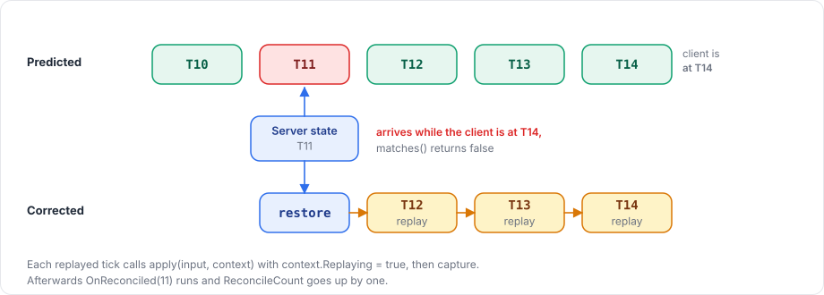

# Reconciliation

Reconciliation is how the owner's client corrects its prediction. After applying an input, the server captures the object's state and sends it to the owner together with the tick. The client compares it with the state it predicted for the same tick, and if the two differ, it restores the server's state and replays its input for every later tick.

## Registering

The reconcile model is registered after the input model:

```csharp
protected override void OnRegisterInput(NetworkInput input)
{
    input.Use(MoveInputNetAdapter.Instance, Gather, Apply);
    input.Reconcile(MoveStateNetAdapter.Instance, Capture, Restore, Matches);
}
```

`NetworkInput.Reconcile<TState>(codec, capture, restore, matches = null)` takes three callbacks:

| Callback | Runs | Does |
|---|---|---|
| `capture(TState state)` | After each applied input on the server; after each predicted or replayed tick on the client | Copies the behaviour's state into the model |
| `restore(TState state)` | On the client, when a correction starts | Copies the server's state back into the behaviour |
| `matches(TState server, TState predicted)` | On the client, for each state that arrives | Returns whether the prediction is close enough |

`Reconcile` throws `HandlerRegistrationException` when it is called before `Use` or called twice.

## What goes in the reconcile model

The reconcile model must hold everything that `apply` reads and changes and that carries over from one tick to the next, such as a position, a velocity, a cooldown timer or a damping velocity. If something is missing, a replay starts from a different value than the server did, and the next comparison fails again.

## Comparing

Without `matches`, the package compares the encoded bytes of the two states, so any difference counts as a mismatch, including floating-point noise in the last bit. For floats, pass a `matches` function with tolerances:

```csharp
private static bool Matches(MoveState server, MoveState predicted) =>
    Vector3.Distance(server.Position, predicted.Position) <= 0.01f;
```

## Correction and replay

<figure><figcaption><p>A correction at tick 11 while the client is already at tick 14.</p></figcaption></figure>

The client keeps the inputs and states of the last Prediction History ticks (64 by default). A replay covers the ticks from the corrected one up to the newest predicted tick, using the inputs the client recorded, and after the correction the package calls `OnReconciled(tick)` on the behaviour and increases its `ReconcileCount`.

When several states arrive between two ticks, the client handles only the newest one. A state for a tick that the client has no prediction for counts as a mismatch.

During a replay, `NetworkBehaviour.IsReplaying` and `ClientManager.IsReplaying` are true, and so is `InputContext.Replaying` in `apply`.

## Starting and stopping prediction

The owner's client starts predicting when the first reconcile state arrives from the server, and until then it only sends input.

When the object loses its owner or changes owner, the previous owner stops predicting it, clears its history and goes back to following `NetworkTransform`. The new owner starts predicting once the server has sent it a state.

## How often the server sends

The server sends the state every Reconcile Interval ticks (1 by default), for ticks in which it applied an input. A higher interval saves bandwidth, and corrections become less frequent but larger.

## Showing corrections smoothly

A correction moves the object at once. To hide that, assign a child holding the visible parts to the Visual field of the object's `NetworkTransform`. The package then keeps that child where it was on screen and blends it back over Smoothing Time, as described in [NetworkTransform](../synchronization/transform.md#prediction).

## Diagnosing frequent corrections

`ReconcileCount` should stay low as long as nothing unexpected happens. When it keeps growing, the usual causes are:

- `apply` uses `Time.deltaTime` instead of `TimeManager.TickDelta`.
- `apply` reads data that differs between server and client, such as other objects or unseeded random numbers.
- The reconcile model misses state that carries over between ticks.
- `matches` is missing or too strict.
- Input arrives late at the server and is repeated, which `ServerManager.DroppedInputsOf` shows.

[Deterministic simulation](../concepts/deterministic-simulation.md) explains why each of these makes the two sides differ.

## With physics

When the object moves with a `Rigidbody` or `Rigidbody2D` and physics simulation is on, a correction also rolls the physics worlds back, as described in [rollback with physics](rollback.md).

Reconciliation builds on [input](input.md), and the [prediction overview](overview.md) shows both in a complete character. [NetworkBehaviour](../objects/network-behaviour.md) lists `OnReconciled` and the other callbacks.
