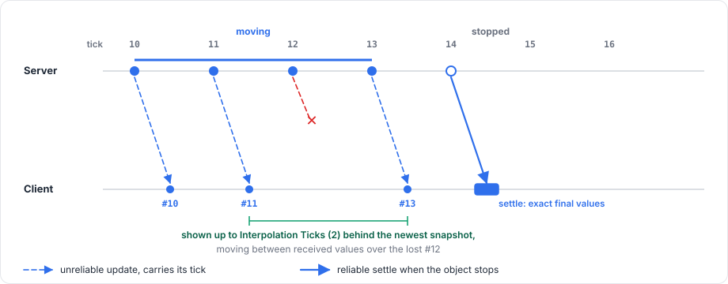
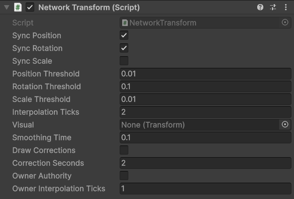

# NetworkTransform

`NetworkTransform` sends the server's transform of a GameObject to every observer and moves the client's copy smoothly between the received values. It is a `NetworkBehaviour`, so it sits on a `NetworkObject` or on one of its children.

## When to use it

Add it to objects that the server moves, such as other players' characters, projectiles and moving platforms. An object that its owner predicts needs one too, so that the other clients see it move, although the owner itself ignores it while predicting.

## Basic usage

1. Add `NetworkTransform` to the prefab, on the GameObject whose transform should be replicated.
2. Choose which parts to sync. Position and rotation are on by default, scale is off.
3. Move the object on the server.

No code is needed beyond moving the object.

## How it works

The server samples the local position, rotation and scale after every tick.

<figure><figcaption><p>Updates while the object moves, one settle when it stops, and the client following a little behind.</p></figcaption></figure>

While the object moves, the server sends an update for each tick in which a synced part has moved more than its threshold away from the value it last sent. These updates are unreliable and carry the tick. When the object stops, the server sends one settle message on the reliable channel with the exact final values, so a lost update can never leave an object resting in the wrong place. A client also gets a settle with the current values when the object spawns and whenever it starts observing the object.

An update contains only the parts that changed, and the client never applies a part it has not received yet.

## Server behavior

The server only reads the transform, so you can move it any way you like, whether from code, from physics or from an animation.

How often it reads depends on the physics backend. With [Rapier](../rapier/overview.md), a `NetworkTransform` on the GameObject of the `NetworkObject` is read only when something changed it: Rapier reports the object's body moving, its parent moved or changed, the z of a 2D object changed, or `Teleport()` was called. Once nothing changes any more, the server keeps reading it after every tick until it has sent the settle, then stops reading it. Every other `NetworkTransform` is read after every tick: with `RigidbodyPhysics`, on a child GameObject, on an object without a body, and on any object with Sync Scale on, because the body does not decide the scale.

When Rapier simulates an object, move it through its [NetworkBody](../physics/physics-body.md). Rapier writes the body's pose to the `Transform` after every step, so a position set on the `Transform` alone is overwritten.

## Client behavior

Clients keep a short list of received snapshots and show the object up to Interpolation Ticks (2 by default) behind the newest one, interpolating position and scale linearly and rotation spherically. A settle replaces the list and puts the object at its values at once.

The client applies the values to the local position, rotation and scale, so the object must have the same parent on the server and on the clients for the values to mean the same thing.

## Interpolation

Interpolation shows remote objects slightly in the past, so that there is always a next snapshot to move towards. More Interpolation Ticks give smoother movement on a lossy network at the cost of more delay, while fewer give less delay but more visible stutter when updates are lost.

Unlike [prediction](../concepts/prediction.md), interpolation does not use input and makes no guess about where the object will be.

## Prediction

While the owner's client predicts an object, it ignores that object's transform updates and lets its own simulation move it. Other clients interpolate the object as usual.

A correction can make the predicted object jump. To hide the jump, put the object's visible parts on a child GameObject and assign that child to the Visual field. After each correction the package keeps the child where it was on screen and moves it back to its resting place over Smoothing Time seconds (0.1 by default), or snaps it there at once if Smoothing Time is 0.

## Teleporting

Call `Teleport()` on the server after moving the object to its new place:

```csharp
transform.position = respawnPoint;
GetComponent<NetworkTransform>().Teleport();
```

Clients then jump to the new values instead of interpolating across the distance, and ignore updates from before the teleport that arrive late. `Teleport()` does nothing on a client or before the object has spawned.

For an object with a physics body, set the body's position as well, as described in [NetworkBody](../physics/physics-body.md#teleporting).

## Letting the owner decide

Some objects should move on the owner's screen the moment the player presses a key, without the input and replay of [prediction](../concepts/prediction.md). Turn on Owner Authority on their `NetworkTransform`. The owner's client then reads its own transform after every tick and sends it to the server with the same thresholds, updates and settle that the server uses. The server shows the owner's movement up to Owner Interpolation Ticks (1 by default) behind the owner's newest sample, writes it into the object and forwards it to every other observer. With 0 the server applies each sample on the tick it arrives, which adds no delay but passes the owner's jitter on to everyone else.

Owner Authority is only the starting value. The server reads it when the object spawns, and only the server can change `OwnerAuthority` later, for example to take a character back during a cutscene. Setting it on a client after spawn throws `InvalidOperationException`, and the flag in a client build has no effect. An object without an owner stays with the server.

The owner's client knows it may move the object while `IsOwnerSending` is true. Move the transform only then, because anything you set while the server decides is overwritten:

```csharp
using Fomoxa.Unity;
using UnityEngine;

public sealed class OwnerWalker : NetworkBehaviour
{
    [SerializeField] private float speed = 4f;

    private void Update()
    {
        if (!GetComponent<NetworkTransform>().IsOwnerSending)
        {
            return;
        }

        var direction = new Vector3(Input.GetAxisRaw("Horizontal"), 0f, Input.GetAxisRaw("Vertical"));
        transform.position += direction * (speed * Time.deltaTime);
    }
}
```

On the server, a `Rigidbody`, `Rigidbody2D` or Rapier body on the same GameObject becomes kinematic while the owner decides, and the server moves it to each pose it applies. The body gets its old kind back when the owner stops deciding or the object despawns. The owner's client keeps the body as you set it up. If that client also predicts physics, the object stays a kinematic proxy there like any other object it does not predict, so move it through its transform.

### Checking the owner's samples

The server can still refuse a sample. Set `OwnerSampleFilter` on the server to look at each sample before it is applied. It receives the last sample the server accepted, the incoming one with every synced part filled in, and the number of the owner's ticks between them. Return `false` to drop the incoming sample:

```csharp
using Fomoxa.Unity;
using UnityEngine;

public sealed class SpeedLimit : NetworkBehaviour
{
    [SerializeField] private float maxSpeed = 6f;

    public override void OnStartServer()
    {
        float tickSeconds = (float)NetworkManager.TimeManager.TickDelta;
        GetComponent<NetworkTransform>().OwnerSampleFilter = (in NetworkTransformSample accepted, in NetworkTransformSample incoming, uint ticks) =>
            ticks == 0 || Vector3.Distance(accepted.LocalPosition, incoming.LocalPosition) <= maxSpeed * ticks * tickSeconds;
    }
}
```

`ticks` is 0 for the first sample after the owner starts deciding and for a teleport by the owner. In both cases `accepted` holds the pose the server has at that moment. A dropped sample is not applied or forwarded, and the owner is not told. To put the owner back where the server wants it, set the transform on the server and call `Teleport()`. The owner jumps there and goes on sending from the new place, and the server ignores whatever the owner sent before it got the correction. The filter runs while the server delivers the owner's message, so an exception thrown by it is a [handler exception](../concepts/error-handling.md#exceptions-in-server-handlers): the server raises `OnHandlerException` and closes the owner's connection unless a subscriber clears `Disconnect`.

The owner can call `Teleport()` too, after moving its own object somewhere new. The server then applies that sample at once instead of interpolating to it, and makes the other clients jump.

### Not with prediction

An object cannot be both predicted and decided by its owner, because both would write the owner's pose. A player build fails when a prefab or a scene object has a `NetworkTransform` with Owner Authority on and any of its behaviours declares a `[NetworkInput]` or `[NetworkReconcile]` field. At run time, spawning such an object with Owner Authority on, or turning it on later, throws `InvalidOperationException` on the server.

## Configuration

<figure><figcaption><p>A NetworkTransform with its default values.</p></figcaption></figure>

| Field | Default | Meaning |
|---|---|---|
| Sync Position | on | Replicate the local position |
| Sync Rotation | on | Replicate the local rotation |
| Sync Scale | off | Replicate the local scale |
| Position Threshold | 0.01 | Distance a position must move before an update includes it |
| Rotation Threshold | 0.1 | Angle in degrees a rotation must turn before an update includes it |
| Scale Threshold | 0.01 | Change a scale must make before an update includes it |
| Interpolation Ticks | 2 | At most how many ticks behind the newest snapshot clients show the object |
| Visual | none | A child transform that is smoothed after prediction corrections |
| Smoothing Time | 0.1 | Seconds over which the Visual returns to its rest position |
| Owner Authority | off | Let the owner's client decide the transform, starting at spawn |
| Owner Interpolation Ticks | 1 | How many of the owner's ticks behind its newest sample the server applies the owner's movement |

`Visual` and `SmoothingTime` can also be set from code, and `OwnerAuthority` can be set on the server, while the sync flags, `InterpolationTicks` and `OwnerInterpolationTicks` are read-only there.

## Limitations

Unless Owner Authority is on, transforms flow from the server to clients only, and a client can move a networked object for others only through RPCs or input. Values are replicated in local space, and re-parenting a replicated object at run time is not replicated. Movement that stays within a threshold of the last sent value is only sent once the object stops. On a host, the server's transform is shown as it is, without interpolation for the host's own view.

[Replication](../concepts/replication.md) explains how transform messages fit with the other messages, the [prediction overview](../prediction/overview.md) shows `NetworkTransform` on a predicted character, and the [components reference](../reference/components.md#networktransform) lists its members.
