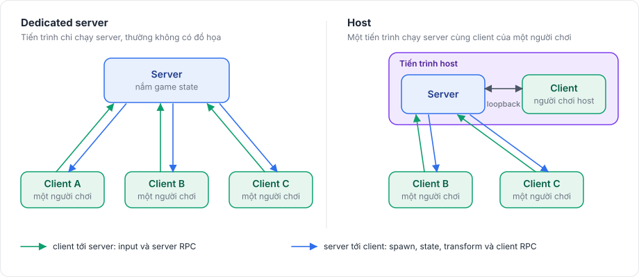

# Fomoxa for Unity

Fomoxa for Unity (`com.fomoxa.networking`) là package networking theo mô hình server-authoritative cho game Unity. Package được xây trên giao thức Fomoxa và runtime C# của giao thức là Fomoxa.Net. Game khai báo dữ liệu cần gửi bằng các class C# thông thường, package sinh codec cho chúng, còn các component như `NetworkManager`, `NetworkObject` và `NetworkBehaviour` lo phần kết nối, spawn, RPC, state, transform và client-side prediction.

<figure><figcaption>
Game chạy một dedicated server hoặc một host. Client gửi input và yêu cầu; server gửi lại những gì đã xảy ra.
</figcaption></figure>

| | |
|---|---|
| Package | `com.fomoxa.networking` 0.1.0 |
| Unity | 6000.5 trở lên |
| Giấy phép | Apache-2.0 |
| Trình sinh code đi kèm | `fomoxac` v0.2.2, Windows x64 và Linux x64 |

## Bắt đầu từ đâu 

| Nếu bạn muốn | Hãy đọc |
|---|---|
| Biết package làm được gì và không làm gì | [Giới thiệu](getting-started/introduction.md) |
| Thêm package vào project | [Cài đặt](getting-started/installation.md) |
| Làm một game nhiều người chơi nhỏ theo từng bước | [Tutorial](getting-started/tutorial/README.md) |
| Hiểu package hoạt động bên dưới ra sao | [Kiến thức nền](concepts/architecture.md) |
| Thêm một tính năng, có code chạy được | Các hướng dẫn trong Kết nối, Network object, Messaging, Đồng bộ, Prediction và Physics |
| Đưa một game có sẵn lên online | [Ví dụ Red Runner](examples/redrunner/README.md), chuyển một game platformer một người chơi lên online qua chín bước |
| Tra một type hoặc một member | [Tham chiếu](reference/api.md) |
| Sửa một chỗ không chạy | [Xử lý sự cố](getting-started/troubleshooting.md) |

## Package làm được gì 

Package kết nối các peer qua UDP, TCP hoặc WebSocket, và một server có thể lắng nghe trên nhiều transport cùng lúc. Host mode nối client của người chơi host vào server qua một kết nối trong cùng tiến trình thay vì qua socket.

Network object được spawn từ prefab hoặc đặt sẵn trong scene. Mỗi object có thể có một owner, và mức hiển thị khác nhau với từng peer. Client gọi server và server gọi client qua RPC khai báo bằng attribute. Mỗi behaviour có thể giữ một state được gửi bằng delta encoding, `NetworkTransform` gửi transform có interpolation và teleport, còn `NetworkAnimator` gửi các parameter của Animator. Network scene có thể được load cho mọi người hoặc chỉ cho một số peer.

Package còn có client-side prediction với input, reconciliation và replay, kể cả rollback physics 3D và 2D của Unity. Client WebGL kết nối qua WebSocket của trình duyệt.

[Giới thiệu](getting-started/introduction.md#what-is-not-included) liệt kê những gì package không làm.

## Ngoài physics của Unity và server Unity 

Có hai phần tùy chọn xây trên package, dùng khi game đã chạy được trong Unity. [Rapier physics](rapier/overview.md) là một package riêng thay physics của Unity bằng Rapier, để rollback phát lại physics của server một cách chính xác. [Server console](console-server/overview.md) chạy server của game như một chương trình .NET, không cần Unity. Phần còn lại của tài liệu không phụ thuộc vào hai phần này, và phần thứ hai của [ví dụ Red Runner](examples/redrunner/rapier-and-console/README.md) dùng cả hai.
