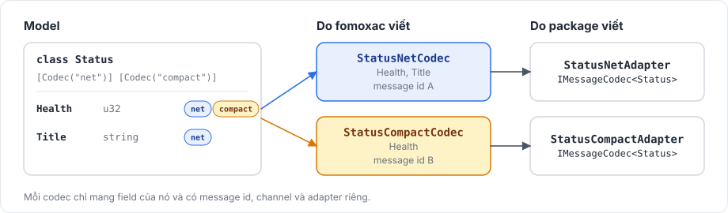

# Codec tùy chỉnh và type của Unity

## Nhiều codec cho một model <a href="#several-codecs-for-one-model" id="several-codecs-for-one-model"></a>

Một model có thể khai báo nhiều codec, mỗi codec mang một tập con các property của nó. Vì mỗi codec có message id và adapter riêng, cùng một class có thể được gửi ở dạng đầy đủ và ở dạng rút gọn:

```csharp
[Network]
[Codec("net")]
[Codec("compact")]
public class Status
{
    [Network("u32")]
    [Codec("net")]
    [Codec("compact")]
    public uint Health { get; set; }

    [Network("string")]
    [Codec("net")]
    public string Title { get; set; }
}
```

<figure><figcaption><p>Hai codec của Status và adapter của chúng.</p></figcaption></figure>

`StatusCompactAdapter` chỉ encode `Health`, và decode bằng nó sẽ giữ nguyên `Title`. Mỗi codec cũng có thể có channel riêng, khai báo bằng `[NetworkChannel("compact", Channel.ReliableOrdered)]`. [Model và codec](../messaging/models.md) mô tả các attribute.

## Type của Unity <a href="#unity-types" id="unity-types"></a>

Property của model có thể dùng trực tiếp `Vector2`, `Vector3`, `Vector4`, `Vector2Int`, `Vector3Int`, `Quaternion`, `Color`, `Color32` và `Rect`. Với mỗi type trong số này mà một model dùng, package ghi một codec nhỏ tên `<Type><Codec>Codec` vào `<Generated Folder>/UnityCodecs/`, codec này ghi lần lượt các field của type:

| Type | Field |
|---|---|
| `Vector2` | `x`, `y` dạng `f32` |
| `Vector3` | `x`, `y`, `z` dạng `f32` |
| `Vector4`, `Quaternion` | `x`, `y`, `z`, `w` dạng `f32` |
| `Vector2Int` | `x`, `y` dạng `i32` |
| `Vector3Int` | `x`, `y`, `z` dạng `i32` |
| `Color` | `r`, `g`, `b`, `a` dạng `f32` |
| `Color32` | `r`, `g`, `b`, `a` dạng `u8` |
| `Rect` | `x`, `y`, `width`, `height` dạng `f32` |

Mảng của các type này, như `Array<Vector3>`, không biên dịch được. Hãy dùng các property riêng, hoặc bọc type làm property của một model rồi gửi `Array<Model>`.

## Thêm value type của riêng bạn <a href="#adding-your-own-value-types" id="adding-your-own-value-types"></a>

Một struct có các field hoặc property gán được thuộc type vô hướng cũng dùng được theo cách đó, sau khi được đăng ký bằng `FomoxaUnityTypes.Register` trong Editor. Hãy đăng ký nó từ một script Editor chạy khi Editor load, để việc đăng ký diễn ra trước khi sinh code:

```csharp
using Fomoxa.Unity.Editor;
using UnityEditor;

[InitializeOnLoad]
internal static class GameWireTypes
{
    static GameWireTypes()
    {
        FomoxaUnityTypes.Register(
            "GridCell",
            "MyGame.GridCell",
            new FomoxaUnityField("X", "i16"),
            new FomoxaUnityField("Y", "i16"));
    }
}
```

```csharp
namespace MyGame
{
    public struct GridCell
    {
        public short X;
        public short Y;
    }
}
```

Sau đó một model có thể khai báo `[Network("GridCell")]` trên một property kiểu `GridCell`. Tham số đầu của `Register` là tên dùng trong `[Network("...")]`, tham số thứ hai là tên type C# đầy đủ, và mỗi field ghép một tên member với một wire type trong số `bool`, `i8` tới `u64`, `f32` và `f64`. Đăng ký lại một tên sẽ thay layout trước đó của nó, và điều này áp dụng cả với các type có sẵn.

Đặt script trong một thư mục `Editor`, và giữ type trong một assembly mà code sinh ra có thể tham chiếu.

## Codec viết tay <a href="#hand-written-codecs" id="hand-written-codecs"></a>

`IMessageCodec<T>` là interface public, nhưng mọi message id phải thuộc schema đã sinh, vì dispatcher từ chối handler cho id nằm ngoài schema và handshake so sánh schema. Thay vào đó, hãy viết model và để package sinh adapter cho chúng.

[Model và codec](../messaging/models.md) nói chung về model, và [tích hợp Editor](editor-integration.md) mô tả bước sinh code ghi ra các codec này.
