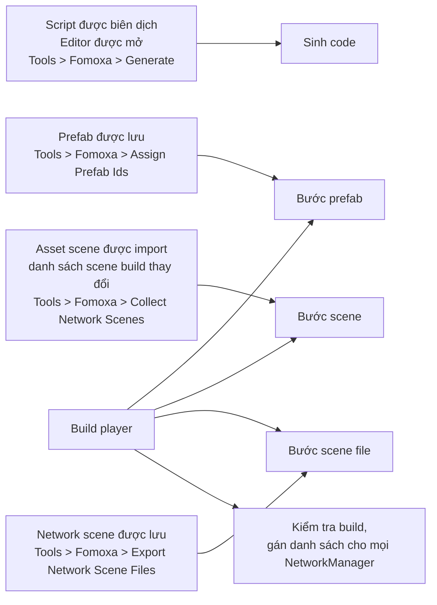

# Tích hợp Editor

Assembly Editor của package sinh code, gán prefab id, scene id và scene object id, ghi một scene file cho mỗi network scene, và kiểm tra project trước khi build. Trang này liệt kê cái gì chạy khi nào và mỗi bước ghi những file nào.

## Settings 

Mỗi project có một asset `FomoxaSettings`, tạo bằng Assets > Create > Fomoxa > Settings:

| Field | Mặc định | Ý nghĩa |
|---|---|---|
| Models Folder | `Assets/Models` | Nơi chứa các class model của bạn |
| Generated Folder | `Assets/Generated` | Nơi ghi code và asset được sinh |

Namespace được sinh mang tên thư mục cuối của Generated Folder.

## Menu 

| Mục menu | Chạy |
|---|---|
| Tools > Fomoxa > Generate | Sinh code |
| Tools > Fomoxa > Assign Prefab Ids | Bước prefab |
| Tools > Fomoxa > Collect Network Scenes | Bước scene |
| Tools > Fomoxa > Export Network Scene Files | Bước scene file cho mọi network scene |
| Assets > Create > Fomoxa > Settings | Tạo settings asset |
| Assets > Create > Fomoxa > Distance Rule | Tạo asset [`DistanceRule`](../objects/observers.md#distancerule) |

## Sinh code 

Việc sinh code chạy sau mỗi lần biên dịch script, khi Editor load, và từ menu, nhưng không bao giờ chạy khi Play Mode đang khởi động hoặc đang chạy. Nó đi qua các bước sau:

1. Copy các system model của package vào `FomoxaSystemModels/` ở gốc project.
2. Ghi một model rỗng cho mỗi RPC không tham số vào `<Generated Folder>/RpcModels/`.
3. Ghi `fomoxa.toml` từ settings.
4. Chạy `fomoxac generate` đi kèm ở gốc project. Nó đọc Models Folder, `FomoxaSystemModels` và `RpcModels`, rồi ghi các codec, `NetSchema.cs`, `Handshake.cs` và `Runtime.cs` vào Generated Folder, và các file schema vào `.fomoxa/`.
5. Ghi codec cho các type Unity mà model dùng vào `<Generated Folder>/UnityCodecs/`, và `.fomoxa/schema.inspect.json`, một bản copy của schema có mô tả các type đó cho công cụ inspect.
6. Ghi một adapter cho mỗi codec, `<Model><Codec>Adapter.cs`.
7. Ghi `FomoxaAdapters.cs`, file đăng ký schema, mọi system adapter, mọi channel đã khai báo và mọi RPC id, và `FomoxaUnityRegistration.cs`, file gọi nó khi player khởi động.
8. Chạy bước prefab và bước scene nếu output của chúng chưa tồn tại.

Mọi file package ghi đều bắt đầu bằng một comment đánh dấu. Package từ chối ghi đè file không có dấu này, và xóa các file có dấu mà không còn cần.

Lỗi và cảnh báo xuất hiện trong Console với tiền tố `[Fomoxa]`, và [xử lý sự cố](../getting-started/troubleshooting.md#code-generation-fails) giải thích từng thông báo.

## Source generator cho RPC 

`Runtime/Core/Generators/Fomoxa.Networking.Generators.dll` là một Roslyn source generator mà Unity chạy cho mọi assembly tham chiếu `Fomoxa.Networking`. Nó viết phần đăng ký các method `[ServerRpc]` và `[ClientRpc]` vào mỗi behaviour `partial` và báo các lỗi `FOMOXA001` tới `FOMOXA010`, liệt kê trong [RPC](../messaging/rpc.md#compile-errors).

## Bước prefab 

Bước prefab chạy khi một prefab được import hoặc lưu trong Editor, từ menu, và trước mỗi lần build player, nhưng không chạy khi import ở batch mode.

Với mọi prefab dưới `Assets` có `NetworkObject`, bước này gán prefab id từ asset GUID trừ khi Explicit Prefab Id đang bật, và xóa scene object id trên asset prefab nếu có. Nó kiểm tra `NetworkObject` nằm ở gốc, không có `NetworkObject` lồng nhau, có tối đa 256 component `NetworkBehaviour`, và id khác 0 và không bị prefab khác dùng.

Bước này ghi `<Generated Folder>/FomoxaPrefabList.asset` và `<Generated Folder>/FomoxaPrefabs.cs`. Lỗi của nó được log, và trong lúc build thì làm build thất bại.

## Bước scene 

Bước scene chạy khi một scene asset được import, khi Scene List của Build Profiles thay đổi, từ menu, và trước mỗi lần build player.

Nó tính scene id của mọi scene dưới `Assets` từ GUID và kiểm tra không id nào bằng 0 hay bị trùng. Sau đó nó ghi `<Generated Folder>/FomoxaSceneList.asset` với các scene trong danh sách build và scene file của chúng, và `<Generated Folder>/FomoxaScenes.cs` với một hằng số cho mỗi scene.

Để sửa scene id bằng 0 hoặc bị trùng, hãy tạo lại một trong các scene asset, việc này cho nó một GUID mới.

## Scene file 

Một scene file, `<Generated Folder>/<scene id>.fomoxascene`, mô tả một network scene ở dạng không cần Unity: các scene object với tư thế, behaviour và body của chúng, các collider tĩnh của scene, và ma trận va chạm layer 3D và 2D. File được mã hóa bằng codec của system model `SceneFile` của package, nên chỉ đọc được cùng với schema đã sinh ra nó.

Bước scene file ghi file của một network scene khi bạn lưu scene đó, và ghi cho mọi network scene khi chạy từ menu. Trước khi build player, nó ghi các file còn thiếu, cũ hơn scene của chúng hoặc không còn đọc được, và xóa file của những scene không còn là network scene. Unity import mỗi file thành một `TextAsset`, và danh sách scene tham chiếu tới nó, nên bản build có kèm file. `RigidbodyPhysics` không đọc scene file.

Scene có object hoặc collider không mô tả được, ví dụ vì một scene object chưa có scene object id, sẽ log lỗi và giữ file cũ.

## Scene object id 

Khi một scene được lưu, mỗi `NetworkObject` trong đó chưa có scene object id duy nhất sẽ được gán một id, tạo từ scene id kết hợp với một id cục bộ trong scene.

Trong Play Mode, scene object không có id hợp lệ sẽ nhận id tạm, và package cảnh báo `scene objects without a unique scene object id got one for this Play Mode session only; save the scene so every build uses the same ids`. Khi build, id bị thiếu hoặc trùng sẽ làm build thất bại.

## Kiểm tra khi build 

Trước khi build player, package chạy bước prefab, bước scene và bước scene file, và làm build thất bại nếu chúng có lỗi. Nó kiểm tra model sinh ra của mọi RPC không tham số có mặt và đúng phiên bản và được `FomoxaAdapters.cs` đăng ký, nếu không thì thất bại với `run Tools > Fomoxa > Generate and commit the generated files`.

Sau đó nó gán danh sách prefab và danh sách scene đã sinh cho mọi `NetworkManager` trong các scene được build, danh sách prefab chỉ ở những manager bật Collect Prefabs, và kiểm tra scene object id của mọi scene được build. Việc gán này cũng chạy cho mỗi scene khi bạn vào Play Mode, nhưng sau `Awake` của các manager, nên nó không có tác dụng trong phiên đó; [NetworkManager](../connections/network-manager.md#prefab-and-scene-lists) giải thích vì sao danh sách cũng cần được gán trong scene.

## File cần commit 

| Đường dẫn | Commit |
|---|---|
| Asset `FomoxaSettings` | Có |
| `fomoxa.toml` | Có |
| `FomoxaSystemModels/` | Có |
| `.fomoxa/` | Có |
| Generated Folder, kèm `RpcModels/`, `UnityCodecs/` và các scene file | Có |

Commit các file này giúp một bản clone mới hoặc máy build biên dịch được mà không cần chạy bộ sinh code trước.

## Nền tảng 

Binary `fomoxac` đi kèm cho Editor Windows x64 và Linux x64. Trên Editor của nền tảng khác, việc sinh code thất bại, nhưng project đã commit các file sinh ra vẫn biên dịch và build được.

[Cài đặt](../getting-started/installation.md) hướng dẫn lần sinh code đầu tiên, [model và codec](../messaging/models.md) mô tả những gì được sinh từ model của bạn, và [spawn](../objects/spawning.md) cùng [network scene](../objects/scenes.md) giải thích các id được dùng lúc chạy ra sao.
