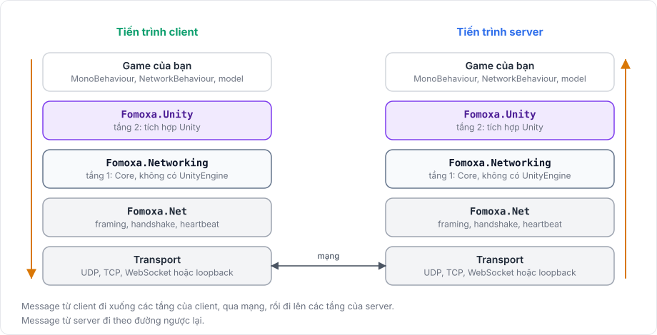
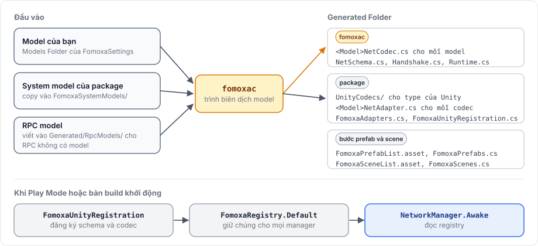

# Package được xây dựng thế nào

Package được xây theo từng tầng, và mỗi tầng chỉ dùng các tầng bên dưới nó. Tầng 1, gọi là Core, không biết gì về Unity. Tầng 2 nối Core với GameObject, scene, player loop và physics của Unity. Biết tầng nào làm việc gì giúp bạn tìm đúng type, và giải thích vì sao phần lớn quy tắc networking chạy giống nhau dù Unity, một bài test hay một server console điều khiển chúng.

<figure><figcaption>
Hai đầu của một kết nối có cùng các tầng. Một host có cả hai chồng trong một tiến trình.
</figcaption></figure>

## Assembly 

| Assembly | Thư mục | Tham chiếu UnityEngine | Nội dung |
|---|---|---|---|
| `Fomoxa.Net` | `Runtime/Plugins/Fomoxa.Net.dll` | Không | Runtime của giao thức Fomoxa: frame, handshake, heartbeat, `Schema`, transport TCP và UDP |
| `Fomoxa.Attributes` | `Runtime/Plugins/Fomoxa.Attributes.dll` | Không | `[Network]` và `[Codec]`, trong namespace `Fomoxa` |
| `Fomoxa.Networking` | `Runtime/Core` | Không | Tầng 1, cùng source generator cho RPC trong `Runtime/Core/Generators` |
| `Fomoxa.Unity` | `Runtime/Unity` | Có | Tầng 2 |
| `Fomoxa.Unity.Editor` | `Editor` | Có, chỉ trong Editor | Sinh code, bước gán prefab id và scene id, scene file, kiểm tra khi build |

Code game của bạn tham chiếu `Fomoxa.Unity` để dùng các component, và `Fomoxa.Networking` cho các type như `NetworkState`, `ConnectionState` và các attribute RPC.

## Tầng 1: Fomoxa.Networking 

Tầng 1 chứa mọi thứ chạy được mà không cần Unity. Assembly definition của nó đặt `noEngineReferences`, nên compiler từ chối mọi chỗ dùng `UnityEngine` bên trong, và vector, quaternion trong API của nó là type `System.Numerics`.

| Mảng | Namespace | Làm gì |
|---|---|---|
| Manager | `Fomoxa.Networking` | `ServerManager`, `ClientManager` và `TimeManager`, thứ tự công việc trong một tick, `FomoxaRegistry`, các attribute RPC và channel, và các type đăng ký `NetworkRpcs`, `NetworkState`, `NetworkInput` |
| Messaging | `Fomoxa.Networking.Messaging` | Message id, `IMessageCodec<T>`, message bundle, channel reliable-ordered, dispatcher chuyển một message id tới handler, delta encoding, các system model của package |
| Session | `Fomoxa.Networking.Sessions` | Session phía client và server: trạng thái kết nối, hàng đợi gửi và giới hạn của chúng, flush, kết nối lại, event kết nối |
| Object | `Fomoxa.Networking.Objects` | Bảng object, message spawn, despawn và đổi owner, tập observer, network scene theo từng peer |
| Timing | `Fomoxa.Networking.Timing` | Ước lượng của client về tick của server và về prediction tick, ping và pong |
| Prediction | `Fomoxa.Networking.Prediction` | Bộ đệm input của server theo object và peer, cùng prediction, reconciliation và replay của client |
| Simulation | `Fomoxa.Networking.Simulation` | Các interface physics `IPhysicsSimulation`, `IPhysicsWorld` và `IPhysicsWorld2D`, `PhysicsBody`, `PhysicsHistory` và theo dõi contact |
| Transport | `Fomoxa.Networking.Transports` | `ITransportFactory`, connector không chặn, giao thức WebSocket, loopback, listener gộp |

Các quyết định networking được đưa ra ở tầng 1: spawn, ownership, định tuyến RPC và state, quyết định ai observe gì, và quyết định khi nào gửi transform. Một `NetworkBehaviour` chuyển callback và đăng ký của nó xuống một behaviour ở tầng 1, nên quy tắc là như nhau bất kể thứ gì điều khiển nó.

Tầng 1 ghi cảnh báo và lỗi qua một `NetworkLog` do tầng 2 cung cấp, và tầng 2 đưa chúng ra Console của Unity.

## Tầng 2: Fomoxa.Unity 

Tầng 2 nối tầng 1 với Unity. `NetworkManager` đọc các field trong Inspector, dựng tầng 1 từ đó và chạy nó trong player loop của Unity. `TransportManager`, `NetworkObject` và `NetworkBehaviour` thuộc tầng này, các component `NetworkTransform` và `NetworkAnimator` cũng vậy.

Registry của prefab và scene, việc load scene và các asset observer rule cũng nằm ở tầng 2. Tầng này còn chứa component `RigidbodyPhysics` cùng các world `Rigidbody` và `Rigidbody2D`, các component contact event, và các component transport, kể cả WebSocket trên trình duyệt cho WebGL.

## Code sinh ra 

Code của bạn chạy cùng với code mà package sinh ra trong project. Các message của chính package, như message spawn và transform, cũng là model: package copy chúng vào thư mục `FomoxaSystemModels` của project và sinh code cho chúng cùng lúc với model của bạn. Vì vậy mọi message game gửi đi đều thuộc một schema chung, và client với server so sánh schema đó trong lúc handshake.

<figure><figcaption>
Model trở thành codec và đến được NetworkManager như thế nào.
</figcaption></figure>

[Cài đặt](../getting-started/installation.md#how-code-generation-works) đi qua một lần sinh code, và [tích hợp Editor](../advanced/editor-integration.md) liệt kê mọi file sinh ra.

## Vì sao tách tầng 

Tầng 1 không phụ thuộc Unity, nên có thể biên dịch và kiểm thử bên ngoài Unity, và [server console](../console-server/overview.md) chạy nó mà không cần Unity. Physics cũng tách theo cách đó: code game dùng các interface và `PhysicsBody` của tầng 1, còn các world của Unity hiện thực chúng ở tầng 2, như [kiến trúc physics](../physics/architecture.md) giải thích.

Các trang tiếp theo xây trên trang này. [Server, client và message](networking-model.md) mô tả những gì đi qua các tầng, còn [tick và thời gian](tick.md) mô tả khi nào.
